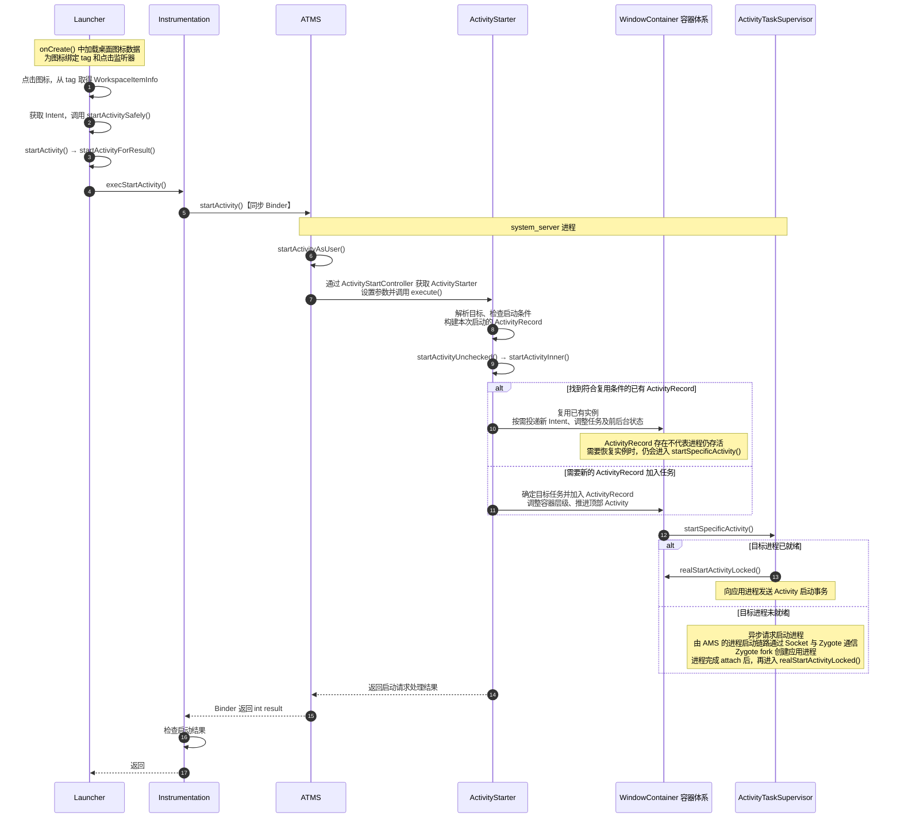
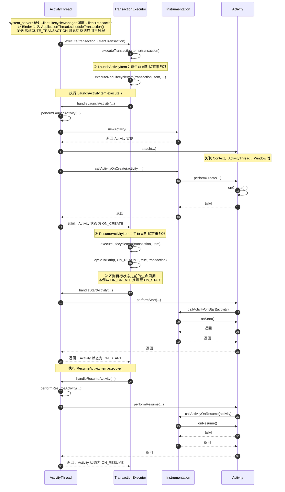

# Android APP 启动流程

前面了解apk安装后会通知launcher app显示图标，那么我们用户启动app的行为就是点击app的图标。


## 1. Launcher 发起启动请求

[博客园Launcher源码解读](https://www.cnblogs.com/anywherego/p/18225051)


### 点击事件触发

**入口：`BubbleTextView`（图标 View）被点击**

每个桌面/应用抽屉里的图标都是一个 `BubbleTextView`，它绑定了统一的 `OnClickListener`：

```java
// ItemClickHandler.java
public static final OnClickListener INSTANCE = ItemClickHandler::onClick;
```

### 分发点击

**`ItemClickHandler.onClick()`**（`ItemClickHandler.java:93`）

```java
private static void onClick(View v) {
    Object tag = v.getTag();  // 关键！从 View 的 tag 中取出数据对象
    if (tag instanceof WorkspaceItemInfo) {
        onClickAppShortcut(v, (WorkspaceItemInfo) tag, launcher);  // 桌面快捷方式
    } else if (tag instanceof AppInfo) {
        startAppShortcutOrInfoActivity(v, (AppInfo) tag, launcher);  // 应用抽屉里的App
    } else if (tag instanceof FolderInfo) {
        onClickFolderIcon(v);  // 文件夹
    }
    ...
}
```

**核心机制：View 的 `tag` 就是关键！** 每个图标 View 在创建时就被 `setTag()` 绑定了一个数据对象，里面包含了 **Intent** 和 **ComponentName**。

### 启动页面

**`ItemClickHandler.startAppShortcutOrInfoActivity()`**（`ItemClickHandler.java`）：

```java
private static void startAppShortcutOrInfoActivity(View v, ItemInfo item, Launcher launcher) {
    Intent intent = item.getIntent();  // 取出之前构造好的 Intent
    ...
    launcher.startActivitySafely(v, intent, item);  // 发起启动
}
```

**`Launcher.startActivitySafely()`**→ 调用父类 **`ActivityContext.startActivitySafely()`**：

```java
default RunnableList startActivitySafely(View v, Intent intent, ItemInfo item) {
    intent.addFlags(Intent.FLAG_ACTIVITY_NEW_TASK);
    
    if (isShortcut && intent.getPackage() != null) {
        // Deep Shortcut：通过 LauncherApps 服务启动
        launcherApps.startShortcut(packageName, id, sourceBounds, optsBundle, user);
    } else if (user == null || user.equals(Process.myUserHandle())) {
        // 当前用户：直接 startActivity ← 最常见的路径
        context.startActivity(intent, optsBundle);
    } else {
        // 跨用户：通过 LauncherApps 服务
        launcherApps.startMainActivity(component, user, sourceBounds, optsBundle);
    }
}
```

### 进入 AMS

```java
//contextImpl.java
public void startActivity(Intent intent, Bundle options) {
    
    // ...
    // 注意这里的Instrumentation，他会经常出现，先不介绍
    // 注意这里的mMainThread 其实就是ActivityThread，那么getApplicationThread()
    // 拿到的其实就是ApplicationThread，它又继承extends IApplicationThread.Stub
    // 那么其实他就是一个IBinder对象 
    mMainThread.getInstrumentation().execStartActivity(
            getOuterContext(), mMainThread.getApplicationThread(), null,
            (Activity) null, intent, -1, applyLaunchDisplayIfNeeded(options));
}


// Instrumentation.java
public ActivityResult execStartActivity(
        Context who, IBinder contextThread, IBinder token, Activity target,
        Intent intent, int requestCode, Bundle options) {
    IApplicationThread whoThread = (IApplicationThread) contextThread;
    // ...
    int result = ActivityManager.getService()
        .startActivity(whoThread, who.getBasePackageName(), intent,
                intent.resolveTypeIfNeeded(who.getContentResolver()),
                token, target != null ? target.mEmbeddedID : null,
                requestCode, 0, null, options);  // ← 通过 Binder 调用 AMS
    // ...
}

```

## 2. AMS 接收 startActivity 请求


从源码 `ActivityManagerService.java` 可以看到：

```java
// ActivityManagerService.java
// AMS 内部的核心管理模块
ActivityTaskManagerService mActivityTaskManager;         // Activity 管理
ActiveServices mServices;                                // Service 管理
BroadcastController mBroadcastController;                // BroadcastReceiver 管理
ContentProviderHelper mCpHelper;                         // ContentProvider 管理

@Deprecated
@Override
public int startActivity(IApplicationThread caller, String callingPackage,
        Intent intent, String resolvedType, IBinder resultTo, String resultWho, int requestCode,
        int startFlags, ProfilerInfo profilerInfo, Bundle bOptions) {
    return mActivityTaskManager.startActivity(caller, callingPackage, null, intent,
            resolvedType, resultTo, resultWho, requestCode, startFlags, profilerInfo, bOptions);
}
```

AMS 将请求委托给 **ActivityTaskManager (ATM)** 处理，ATM 负责 Activity 的调度和管理。

### 2.1 获取 ActivityStarter

```java
// ActivityTaskManagerService.java
public final int startActivity(IApplicationThread caller, String callingPackage,
            String callingFeatureId, Intent intent, String resolvedType, IBinder resultTo,
            String resultWho, int requestCode, int startFlags, ProfilerInfo profilerInfo,
            Bundle bOptions) {
        return startActivityAsUser(caller, callingPackage, callingFeatureId, intent, resolvedType,
                resultTo, resultWho, requestCode, startFlags, profilerInfo, bOptions,
                UserHandle.getCallingUserId());
    }

private int startActivityAsUser(IApplicationThread caller, String callingPackage,
            @Nullable String callingFeatureId, Intent intent, String resolvedType,
            IBinder resultTo, String resultWho, int requestCode, int startFlags,
            ProfilerInfo profilerInfo, Bundle bOptions, int userId, boolean validateIncomingUser) {
        mAmInternal.addCreatorToken(intent, callingPackage);
        final int callingPid = Binder.getCallingPid();
        final int callingUid = Binder.getCallingUid();
        //基本的用户校验
        // ......

        // TODO: Switch to user app stacks here.
        return getActivityStartController().obtainStarter(intent, "startActivityAsUser")
                .setCaller(caller)
                .setCallingPackage(callingPackage)
                .setCallingFeatureId(callingFeatureId)
                .setResolvedType(resolvedType)
                .setResultTo(resultTo)
                .setResultWho(resultWho)
                .setRequestCode(requestCode)
                .setStartFlags(startFlags)
                .setProfilerInfo(profilerInfo)
                .setActivityOptions(opts)
                .setUserId(userId)
                .execute();
    }
```

`ActivityStartController` 接收请求后，并非直接执行，而是从工厂对象池中取出一个可复用的 `ActivityStarter` 来处理具体的启动逻辑。

```java
// ActivityStartController.java
ActivityStarter obtainStarter(Intent intent, String reason) {
    // 对象池复用，减少内存抖动
    return mFactory.obtain().setIntent(intent).setReason(reason);
}
```

**知识点延伸：**

- **对象池机制**：执行完成后 `onExecutionComplete` 会回收 starter 并保留 `mLastStarter` 快照用于后续处理。
- **统一收口**：Home 桌面的启动 (`startHomeActivity`) 以及批量启动 (`startActivities`) 最终都殊途同归，依赖此处的 `obtainStarter(...).execute()`。

### 2.2 ActivityStarter 执行请求

```
ActivityStarter.execute()
  └→ executeRequest(Request)
       ├─ 1. 权限校验（caller 合法性、BAL 后台启动检查等）
       ├─ 2. 创建 ActivityRecord（目标 Activity 在服务端的描述对象）
       ├─ 3. 创建 Transition（收集窗口变化，用于动画）
       └→ 4. startActivityUnchecked(...)
       		  └→ startActivityInner(r, sourceRecord, ...)
              ├─ 1. 确定 Task 归属（复用已有 Task 或创建新 Task）
              ├─ 2. 将 ActivityRecord 加入 Task（addChild）
              ├─ 3. 创建 Starting Window（启动白屏）
              └→ 4. mRootWindowContainer.resumeFocusedTasksTopActivities()
```

#### 2.2.1 权限校验

`executeRequest()` 依次执行以下校验，任一失败都会终止启动：

```java
// ActivityStarter.java
// ① caller 校验：通过 IApplicationThread（Binder 代理）获取调用方进程控制器
WindowProcessController callerApp = mService.getProcessController(caller);

// ② Intent 解析校验
if (intent.getComponent() == null) err = START_INTENT_NOT_RESOLVED;
if (aInfo == null) err = START_CLASS_NOT_FOUND;

// ③ 三重权限检查
abort = !mSupervisor.checkStartAnyActivityPermission(...);  // 权限检查
abort |= !mService.mIntentFirewall.checkStartActivity(...);  // IntentFirewall
abort |= !mService.getPermissionPolicyInternal().checkStartActivity(...);  // PermissionPolicy

// ④ 后台启动检查 BAL（Android 10+）
BalVerdict balVerdict = balController.checkBackgroundActivityStart(
        callingUid, callingPid, callingPackage, ...);
```

#### 2.2.2 创建 ActivityRecord

通过所有校验后，使用 **Builder 模式** 创建 `ActivityRecord`——这是目标 Activity 在服务端（system_server）的描述对象，贯穿整个启动流程：

```java
// ActivityStarter.java
final ActivityRecord r = new ActivityRecord.Builder(mService)
        .setCaller(callerApp)                    // 调用方进程控制器
        .setLaunchedFromPid(callingPid)          // 调用方 PID
        .setLaunchedFromUid(callingUid)          // 调用方 UID
        .setIntent(intent)                       // 启动 Intent
        .setActivityInfo(aInfo)                  // ActivityInfo（从 PKMS 获取的组件元信息）
        .setResultTo(resultRecord)               // 接收结果的 Activity
        .setActivityOptions(checkedOptions)      // ActivityOptions（动画、启动参数等）
        .setSourceRecord(sourceRecord)           // 发起启动的源 Activity
        .build();
```

> **ActivityRecord** 是 WMS 侧对一个 Activity 实例的完整描述，包含 Intent、ActivityInfo、Task 归属、窗口状态、生命周期状态等。可以理解为"Activity 在服务端的身份证"，它存在于 system_server 进程中，而非 APP 进程。

#### 2.2.3 创建 Transition

Android 12+ 引入了 Shell Transition 机制，在 `startActivityInner` 之前先创建 Transition 收集窗口变化：

```java
// ActivityStarter.java:1602
chain.attachTransition(r.mTransitionController.createAndStartCollecting(TRANSIT_OPEN));
```

#### 2.2.4 startActivityInner —— 确定 Task 归属 & 加入 Task

`startActivityUnchecked` 封装了窗口布局的 defer/continue，内部调用核心方法 `startActivityInner`：

```java
// ActivityStarter.java:1793
mService.deferWindowLayout();        // 暂停窗口布局，批量操作
result = startActivityInner(r, sourceRecord, ...);  // ← 核心方法
mService.continueWindowLayout();     // 恢复窗口布局，一次性应用所有变化
```

`startActivityInner` 根据启动模式（Standard/SingleTop/singleTask/singleInstance）和 Intent Flags 决定 Task 归属：

```java
// ActivityStarter.java:2015
int startActivityInner(final ActivityRecord r, ActivityRecord sourceRecord, ...) {
    setInitialState(r, options, ...);
    computeLaunchingTaskFlags();

    // 尝试复用已有 Task
    final Task reusedTask = resolveReusableTask(...);
    final Task targetTask = reusedTask != null ? reusedTask : computeTargetTask();
    final boolean newTask = targetTask == null;  // null 说明需要创建新 Task

    if (newTask) {
        setNewTask(taskToAffiliate);  // 创建新 Task
    } else if (mAddingToTask) {
        addOrReparentStartingActivity(targetTask, "adding to task");  // 加入已有 Task
    }
}
```

两种路径最终都走到 `addOrReparentStartingActivity`，**这是 ActivityRecord 真正加入 Task 的地方**：

```java
// ActivityStarter.java:3362
private void addOrReparentStartingActivity(@NonNull Task task, String reason) {
    TaskFragment newParent = task;
    // ... 处理 TaskFragment 嵌入的情况 ...

    if (mStartActivity.getTaskFragment() == null
            || mStartActivity.getTaskFragment() == newParent) {
        // ★ 将 ActivityRecord 作为子节点加入 Task 的顶部
        newParent.addChild(mStartActivity, POSITION_TOP);
    } else {
        mStartActivity.reparent(newParent, newParent.getChildCount(), reason);
    }
}
```

> `Task` 继承自 `WindowContainer`，`addChild(mStartActivity, POSITION_TOP)` 将 ActivityRecord 放到 Task 栈顶。

#### 2.2.5 创建 Starting Window & 触发 Resume

ActivityRecord 加入 Task 后，`startActivityInner` 调用 `Task.startActivityLocked()` 触发 **Starting Window**（启动白屏）的创建：

```java
// Task.java
} else if (SHOW_APP_STARTING_PREVIEW && doShow) {
    mWmService.mStartingSurfaceController.showStartingWindow(r, prev, newTask,
            isTaskSwitch, sourceRecord);
}
```

> **注意**：Starting Window 是在**服务端（system_server 进程）** 创建的，此时目标 APP 的进程可能还没有被 fork 出来。它是一个临时的占位窗口，等 APP 真正渲染出内容后就会被移除。

最后通知 `RootWindowContainer` 开始 resume 流程，触发 `Task.resumeTopActivityUncheckedLocked()` → `startSpecificActivity()`，进入 2.3 节：

```java
// ActivityStarter.java:2247
mRootWindowContainer.resumeFocusedTasksTopActivities(
        mTargetRootTask, mStartActivity, mOptions, mTransientLaunch);
```

### 2.3 Activity 调度与进程准备

```
RootWindowContainer.resumeFocusedTasksTopActivities()
  └→ Task.resumeTopActivityUncheckedLocked()
       └→ Task.resumeTopActivityInnerLocked()
            └→ TaskFragment.resumeTopActivity()
```

`RootWindowContainer` 从栈顶向下找到需要 resume 的 Activity，发现目标 Activity 的**进程尚未启动**（或进程已存在但 Activity 实例未创建），于是调用 `ActivityTaskSupervisor.startSpecificActivity()`。

```java
// TaskFragment.java:1552
if (next.attachedToProcess()) {
    // ═══ [快路径] Activity 已绑定到进程 ═══
    // 直接走 resume 生命周期：
    //   1. 设置 visibility
    //   2. setState(RESUMED)
    //   3. 投递 ActivityResultItem / NewIntentItem
    //   4. 下发 ResumeActivityItem → 应用进程执行 onResume
} else {
    // ═══ [慢路径] Activity 未绑定进程 ═══
    // TaskFragment.java:1680
    mTaskSupervisor.startSpecificActivity(next, true, true);
}
```

### 2.4 ActivityTaskSupervisor

```java
// ActivityTaskSupervisor.java:1171
void startSpecificActivity(ActivityRecord r, boolean andResume, boolean checkConfig) {
    // 1. 查找目标进程是否已存在
    final WindowProcessController wpc =
            mService.getProcessController(r.processName, r.getUid());

    // 2. 进程已存在且有线程 → 直接在已有进程中启动
    if (wpc != null && wpc.hasThread()) {
        realStartActivityLocked(r, wpc, andResume, checkConfig);
        return;
    }

    // 3. 进程不存在 → 异步创建新进程（AMS通过Socket通知Zygote进程 fork Zygote）
    mService.startProcessAsync(r, knownToBeDead, isTop,
            isTop ? HostingRecord.HOSTING_TYPE_TOP_ACTIVITY
                  : HostingRecord.HOSTING_TYPE_ACTIVITY);
}

```

### 2.5 Socket通信

```java
// ActivityTaskManagerService.java:5885
void startProcessAsync(ActivityRecord activity, boolean knownToBeDead, boolean isTop,
        String hostingType) {
    // 记住这里，不然后续app启动后怎么打开这个页面
    if (!mStartingProcessActivities.contains(activity)) {
        mStartingProcessActivities.add(activity);           // 加入等待队列
        // 按 z-order 排序，高优先级的 Activity 先启动
        if (mStartingProcessActivities.size() > 1) {
            mStartingProcessActivities.sort(null);          // 排序
        }
    } else if (mProcessNames.get(activity.processName, activity.getUid()) != null) {
        // 已经在列表里且进程正在启动中，直接等 attach 即可
        return;
    }

    // 通过异步消息通知 AMS 去 fork 进程（避免持锁调用 AMS 导致死锁）
    final Message m = PooledLambda.obtainMessage(
            ActivityManagerInternal::startProcess,
            mAmInternal, activity.processName, activity.info.applicationInfo,
            knownToBeDead, ...);
    mH.sendMessage(m);
}

```

消息被 Handler 消费后，调用 `ActivityManagerInternal.startProcess()`，这是 AMS 暴露给 ATMS 的内部接口，最终走到：

```java
// ActivityManagerService.java:3496
final ProcessRecord startProcessLocked(String processName,
        ApplicationInfo info, boolean knownToBeDead, int intentFlags,
        HostingRecord hostingRecord, ...) {
    return mProcessList.startProcessLocked(processName, info, knownToBeDead,
            intentFlags, hostingRecord, ...);
}
```

`mProcessList.startProcessLocked()` 是真正 fork 进程的地方，这里太多了就不分析了：

```java
// ProcessList.java
ProcessRecord startProcessLocked(...) {
    // 1. 创建 ProcessRecord
    // 2. 放入 mPendingStarts 等待 attach
    // 3. 调用 ZygoteProcess.start()
    //    → 通过 Socket 连接 Zygote
    //    → Zygote fork() 出新进程
    //    → 新进程执行 ActivityThread.main()
}
ActivityManagerService (各种触发点)
  → ProcessList.startProcessLocked()    // 准备参数
    → ProcessList.startProcess()        // 构建完整 fork 参数
      → Process.start()                 // 通过 socket 发送请求给 Zygote
```

## 3. Zygote Fork 新进程

我们分析过开机启动流程，里面有提到Zygote里面有个SystemServer不是一直循环等待吗？

```java
public static void main(String[] argv) {
    // ... 预加载类和资源
    preload(bootTimingsTraceLog);
    
    // 创建 ZygoteServer 并进入循环等待
    zygoteServer = new ZygoteServer(isPrimaryZygote);
    
    // fork SystemServer
    if (startSystemServer) {
        Runnable r = forkSystemServer(abiList, zygoteSocketName, zygoteServer);
        // ...
    }
    
    // 进入 select 循环，等待 AMS 的 fork 请求
    caller = zygoteServer.runSelectLoop(abiList);
    
    // 子进程执行
    if (caller != null) {
        caller.run();
    }
}
```

### 3.1 `ZygoteServer` 构造

```java
ZygoteServer(boolean isPrimaryZygote) {
    mUsapPoolEventFD = Zygote.getUsapPoolEventFD();
    if (isPrimaryZygote) {
        mZygoteSocket = Zygote.createManagedSocketFromInitSocket(Zygote.PRIMARY_SOCKET_NAME);
        mUsapPoolSocket = Zygote.createManagedSocketFromInitSocket(Zygote.USAP_POOL_PRIMARY_SOCKET_NAME);
    } else {
        mZygoteSocket = Zygote.createManagedSocketFromInitSocket(Zygote.SECONDARY_SOCKET_NAME);
        mUsapPoolSocket = Zygote.createManagedSocketFromInitSocket(Zygote.USAP_POOL_SECONDARY_SOCKET_NAME);
    }
    mUsapPoolSupported = true;
    fetchUsapPoolPolicyProps();
}
```

关键点：

- Socket 是由 **init 进程**预先创建的（通过 [`init.rc`](init.rc)），Zygote 只是接管已有的 fd
- Primary Zygote（64位）和 Secondary Zygote（32位）各有独立的 socket
- 同时还有 **USAP Pool**（Unspecialized App Process Pool）的 socket，用于预创建进程池

### 3.2  `runSelectLoop()`

```java
Runnable runSelectLoop(String abiList) {
    ArrayList<FileDescriptor> socketFDs = new ArrayList<>();
    ArrayList<ZygoteConnection> peers = new ArrayList<>();

    socketFDs.add(mZygoteSocket.getFileDescriptor());  // index 0: server socket
    peers.add(null);

    while (true) {
        // 1. 构建 poll 数组
        //    [0] = server socket (监听新连接)
        //    [1..N] = session sockets (已建立的连接)
        //    [N+1] = USAP pool event FD
        //    [N+2..M] = USAP pipe FDs

        // 2. Os.poll(pollFDs, pollTimeoutMs)
        //    阻塞等待任意 fd 可读

        // 3. 处理 poll 结果（从后往前遍历）
        while (--pollIndex >= 0) {
            if (pollIndex == 0) {
                // 新连接到来 → acceptCommandPeer()
                ZygoteConnection newPeer = acceptCommandPeer(abiList);
                peers.add(newPeer);
                socketFDs.add(newPeer.getFileDescriptor());

            } else if (pollIndex < usapPoolEventFDIndex) {
                // 已有连接发来命令 → processCommand()
                ZygoteConnection connection = peers.get(pollIndex);
                Runnable command = connection.processCommand(this, multipleForksOK);

                if (mIsForkChild) {
                    // 我们在子进程中 → 返回 Runnable 给上层执行
                    return command;
                }
                // 否则在父进程（Zygote）中继续循环

            } else {
                // USAP pool 管理消息
            }
        }
    }
}

```

### 3.3 处理 fork 命令 

位于 `ZygoteConnection.java:`，这是 Zygote 处理创建进程请求的核心：

```java
Runnable processCommand(ZygoteServer zygoteServer, boolean multipleOK) {
    // 1. 从 socket 读取并解析参数
    parsedArgs = ZygoteArguments.getInstance(argBuffer);

    // 2. 处理特殊命令（非 fork）
    if (parsedArgs.mBootCompleted) { handleBootCompleted(); return null; }
    if (parsedArgs.mAbiListQuery) { handleAbiListQuery(); return null; }
    if (parsedArgs.mPidQuery) { handlePidQuery(); return null; }

    // 3. 安全策略校验
    Zygote.applyUidSecurityPolicy(parsedArgs, peer);
    Zygote.applyInvokeWithSecurityPolicy(parsedArgs, peer);

    // 4. 准备需要关闭的 fd 列表（防止泄漏到子进程）
    int[] fdsToClose = { mSocket.fd, zygoteServer.getZygoteSocketFileDescriptor() };

    // 5. 执行 fork（两条路径）
```

**Fork 的两条路径**是理解 Zygote 的关键：

#### 路径 A：传统 `Zygote.forkAndSpecialize()`（复杂场景）

当满足以下任一条件时走此路径：

- `invokeWith != null`（wrapper 脚本）
- `mStartChildZygote`（创建子 Zygote）
- `!multipleOK`（不允许批量 fork）
- `peer.getUid() != SYSTEM_UID`

```java
pid = Zygote.forkAndSpecialize(parsedArgs.mUid, parsedArgs.mGid,
        parsedArgs.mGids, parsedArgs.mRuntimeFlags, rlimits,
        parsedArgs.mMountExternal, parsedArgs.mSeInfo, parsedArgs.mNiceName,
        fdsToClose, fdsToIgnore, ...);

if (pid == 0) {
    // ===== 子进程 =====
    zygoteServer.setForkChild();
    zygoteServer.closeServerSocket();  // 关闭 server socket
    return handleChildProc(parsedArgs, childPipeFd, ...);
} else {
    // ===== 父进程（Zygote）=====
    handleParentProc(pid, serverPipeFd);  // 将 pid 写回 socket 给 AMS
    return null;
}
```

#### 路径 B：优化路径 `Zygote.forkSimpleApps()`（简单场景，USAP 未启用时）

```java
ZygoteHooks.preFork();
Runnable result = Zygote.forkSimpleApps(argBuffer,
        zygoteServer.getZygoteSocketFileDescriptor(),
        peer.getUid(), Zygote.minChildUid(peer),
        parsedArgs.mNiceName, parsedArgs.mIsTopApp);

if (result == null) {
    // 父进程：已完成若干次 fork，继续循环
    ZygoteHooks.postForkCommon();
    continue;
} else {
    // 子进程：返回 Runnable
    zygoteServer.setForkChild();
    return result;
}
```

`forkSimpleApps` 是 Native 层实现的优化路径，可以在一次调用中**批量处理多个 fork 请求**，减少 Java 层开销。

### 3.4 子进程后续 — `handleChildProc()`

位于 `ZygoteConnection.java:507`：

```java
private Runnable handleChildProc(ZygoteArguments parsedArgs,
        FileDescriptor pipeFd, boolean isZygote) {
    closeSocket();  // 关闭客户端 socket
    Zygote.setAppProcessName(parsedArgs, TAG);

    if (parsedArgs.mInvokeWith != null) {
        // wrapper 模式
        WrapperInit.execApplication(...);
    } else {
        if (!isZygote) {
            // 普通 app 进程 → 最终会执行 ActivityThread.main()
            return ZygoteInit.zygoteInit(parsedArgs.mTargetSdkVersion,
                    parsedArgs.mDisabledCompatChanges,
                    parsedArgs.mEnabledCompatChanges,
                    parsedArgs.mRemainingArgs, null);
        } else {
            // 子 Zygote
            return ZygoteInit.childZygoteInit(parsedArgs.mRemainingArgs);
        }
    }
}
```

### 3.5 父进程回写 — `handleParentProc()`

位于 `ZygoteConnection.java:549`：

```java
private void handleParentProc(int pid, FileDescriptor pipeFd) {
    if (pid > 0) {
        setChildPgid(pid);  // 将子进程加入 peer 的进程组
    }
    // 如果使用 wrapper，通过 pipe 读取真实 pid
    // ...
    // 将新进程 pid 写回 socket 给 AMS
    mSocketOutStream.writeInt(pid);
    mSocketOutStream.writeBoolean(usingWrapper);
}
```

### 3.6 执行APP程序入口

当 AMS 发送 fork 请求时，Zygote 通过 `runSelectLoop` 接收请求并 fork 出新的 APP 进程。子进程 fork 后，会调用 `zygoteInit` 方法：

```java
public static Runnable zygoteInit(int targetSdkVersion, long[] disabledCompatChanges,
        long[] enabledCompatChanges, String[] argv, ClassLoader classLoader) {
    RuntimeInit.redirectLogStreams();
    RuntimeInit.commonInit();
    ZygoteInit.nativeZygoteInit();  // 初始化 Native 层，启动 Binder 线程池
    return RuntimeInit.applicationInit(targetSdkVersion, disabledCompatChanges,
            enabledCompatChanges, argv, classLoader);  // 最终调用 ActivityThread.main()
}
```

## 4.ActivityThread

`ActivityThread.java` 是 Android Framework 中最核心、最基础的类之一。它本质上代表了 Android 应用程序的**主线程（UI 线程）**。虽然它的名字里带有 "Thread"，但**它本身并不是一个线程（不继承自 `Thread` 类）**，而是一个运行在应用主线程中的普通 Java 类。

Android 应用程序真正的 `main()` 方法。当 Zygote 进程 fork 出一个新的应用进程后，就会调用 `ActivityThread` 的 `main()` 方法来启动应用。

```java
// 核心成员
Instrumentation mInstrumentation;           // 组件生命周期调度器
Application mInitialApplication;            // Application 实例
final ArrayMap<IBinder, ActivityClientRecord> mActivities;  // Activity 缓存
final ArrayMap<IBinder, Service> mServices; // Service 缓存
final ResourcesManager mResourcesManager;   // 资源管理器
ConfigurationController mConfigurationController;  // 配置控制器

public static void main(String[] args) {
    // ........
    
    // 1. 初始化主线程的 Looper 和 MessageQueue
    Looper.prepareMainLooper();
    
    // 2. 创建 ActivityThread 实例，并向 AMS 报告应用已启动
    ActivityThread thread = new ActivityThread();
    thread.attach(false, startSeq);
    
    // 3. 开启主线程的消息循环，死循环不断处理消息
    Looper.loop();
    
    // 正常情况下，代码永远不会执行到这里，除非主线程崩溃或退出
    throw new RuntimeException("Main thread loop unexpectedly exited");
}
```

`ActivityThread` 负责管理应用程序进程的执行，主要承担以下四大职责：

1. **应用进程的入口：** 包含 Android 应用程序真正的 `main()` 方法。当 Zygote 进程 fork 出一个新的应用进程后，就会调用 `ActivityThread` 的 `main()` 方法来启动应用。
2. **组件生命周期管理：** 负责实例化并在主线程中执行 Android 四大组件（Activity、Service、BroadcastReceiver、ContentProvider）的生命周期方法（如 `onCreate`、`onResume` 等）。
3. **与系统服务通信（IPC）：** 作为应用进程与系统服务端（主要是 `ActivityManagerService`，简称 **AMS**）进行跨进程通信的桥梁。
4. **管理主线程消息循环：** 初始化并管理主线程的 `Looper` 和 `MessageQueue`，确保 UI 线程能够持续不断地处理事件和刷新视图。

在 Android Framework 中，如果说 `ActivityThread` 是整个应用进程的“大管家”，那么 **`Instrumentation`**、**`ApplicationThread`** 和 **`H` 类** 就是大管家手下最核心的三员大将。它们分工明确，共同构成了 Android 组件生命周期调度的核心链路。

下面为您详细梳理这三个类的角色定位与核心职责：

### 4.1 Instrumentation

`Instrumentation` 是 Android 系统中一个非常特殊且关键的类，它在应用进程启动的最早期就会被实例化（比 Application 还要早）。

- **核心角色：** 它是系统与组件之间的“隔离层”**和**“监控者”。所有的四大组件（如 Activity、Application）的创建以及生命周期方法的调用，最终都不是由 `ActivityThread` 直接执行的，而是委托给 `Instrumentation` 来完成。
- **主要职责：**
  1. **反射创建实例：** 当系统需要启动一个 Activity 时，`Instrumentation` 的 `newActivity()` 方法会被调用，它负责通过反射真正地实例化这个 Activity 对象。
  2. **触发生命周期：** 它包装了所有组件的生命周期方法。例如，调用 Activity 的 `onCreate` 时，实际上是执行了 `Instrumentation.callActivityOnCreate()`，在这个方法内部再去调用 `Activity.onCreate()`。
- **为什么需要它？** 它的初衷是为了**测试和监控**（这也是它名字的由来，“仪器/仪表盘”）。在自动化测试（如 Espresso、Robotium）或者插件化框架中，开发者可以通过 Hook（劫持）甚至替换系统的 `Instrumentation` 实例，来拦截、监听或修改组件的创建和生命周期走向，而不必去修改底层极度复杂的 `ActivityThread`。

### 4.2 ApplicationThread

`ApplicationThread` 是 `ActivityThread` 的一个私有内部类。它继承自 `IApplicationThread.Stub`，这意味着它是一个 **Binder 的服务端实现**。

- **核心角色：** 它是应用进程专门用来**接收系统服务（如 AMS / ATMS）远程跨进程调用的“接收器”**（我们要记住只要AMS去控制本质都是拿到这个bpbinder对象去操控）。
- **主要职责：**
  1. **倾听系统指令：** 系统需要控制应用时（例如：启动 Activity、绑定 Service、发送内存不足警告），都会通过 Binder 代理直接调用 `ApplicationThread` 中对应的方法（如 `scheduleTransaction`、`scheduleBindService` 等）。
  2. **打包任务：** 由于它是 Binder 的服务端，**它的所有方法都是运行在应用进程的 Binder 线程池中的**。Android 规定只能在主线程更新 UI 并执行生命周期，因此 `ApplicationThread` 绝对不能直接执行业务逻辑，它的唯一任务就是把系统传来的指令打包，交给 `H` 类。（重点交给H类也就是交给了handler，再通过handleMessage就可以获取）

### 4.3 Handler

`H` 是 `ActivityThread` 内部自定义的一个类，它直接继承自系统的 `Handler`。在 `ActivityThread` 初始化时，它绑定了主线程的 `Looper`。

- **核心角色：** 它是**线程切换的桥梁**，负责将底层传递过来的指令准确地分发到主线程中执行。（要记住只要我们的应用进程收到AMS指令都是交给handler处理的）
- **主要职责：**
  1. **线程切换：** 接收 `ApplicationThread`（在 Binder 线程）发来的消息，将其放入主线程的消息队列（MessageQueue）中。
  2. **分发执行：** 当主线程的 `Looper` 轮询到这些消息时，会交给 `H` 类的 `handleMessage()` 方法处理。`H` 内部会根据消息的类型（`msg.what`，如 `BIND_APPLICATION`, `RECEIVER` 等），调用 `ActivityThread` 中具体的 `handleXXX()` 方法来执行真正的逻辑。

## 5. attach() 方法

这里ActivityThread需要告诉AMS自己实例化好了，因为ActivityThread自己本身只是做一些所有APP启动的都必须要的基础设施，ActivityThread并不知道自己要干什么，它是一张白纸。它怎么知道自己是要启动 QQ、微信还是一个后台 Service？

- **配置信息在 AMS 手里**：应用要加载哪个 APK、包名是什么、进程名是什么、里面有哪些 ContentProvider、该启动哪个 Application，这些统统掌握在系统服务（AMS / PKMS）手中。
- **必须先报到，才能领任务**：应用必须先调用 `attachApplication` 传过去一个通行证，AMS 收到后，才会通过反向的 Binder 调用（`bindApplication`）告诉它：“*你是com.example.app，现在开始初始化你的 Application，加载你的 Provider 吧！*”  

```java
private void attach(boolean system, long startSeq) {
    
    //.......
    
    if (!system) {
        //........
        // 关键：通过 `mgr.attachApplication()` 回调 AMS，告诉 AMS "新进程已启动"
        final IActivityManager mgr = ActivityManager.getService();
        try {
            mgr.attachApplication(mAppThread, startSeq);  // ← Binder IPC 调用 AMS
        } catch (RemoteException ex) {
            throw ex.rethrowFromSystemServer();
        }
        // .........
       
    } else {
        // system_server 进程
        android.ddm.DdmHandleAppName.setAppName("system_process", UserHandle.myUserId());
        initializeSystemThread(this);
    }
    // ........
    
}
```

## 6. handleBindApplication() 

AMS 收到 `attachApplication()` 后，会调用 `ActivityThread.bindApplication()`，ActivityThread 收到消息后执行sendMessage发送BIND_APPLICATION的指令，然后我们的HandleMessage收到消息根据指令判断执行了 `handleBindApplication()`。

<!-- TODO: 将图片上传到图床或加入仓库后恢复引用。
原始图片路径：C:\Users\11196760\AppData\Roaming\Typora\typora-user-images\image-20260827110425642.png
-->

```java
private void handleBindApplication(AppBindData data) {
    // 1. 注册 UI 线程为敏感线程
    VMRuntime.registerSensitiveThread();
    
    // 2. 设置进程启动时间
    Process.setStartTimes(SystemClock.elapsedRealtime(), SystemClock.uptimeMillis(),
            data.startRequestedElapsedTime, data.startRequestedUptime);
    
    // 3. 安装兼容性回调
    AppCompatCallbacks.install(data.disabledCompatChanges, data.enabledCompatChanges,
            data.mLoggableCompatChanges, data.mLogChangeChecksToStatsD,
            data.appInfo.targetSdkVersion);
    
    // 4. 设置配置信息
    mBoundApplication = data;
    mConfigurationController.setConfiguration(data.config);
    mConfigurationController.setCompatConfiguration(data.config);
    mConfiguration = mConfigurationController.getConfiguration();
    mCompatibilityInfo = data.compatInfo;
    
    // 5. 设置 Profiler
    mProfiler = new Profiler();
    if (data.initProfilerInfo != null) {
        mProfiler.profileFile = data.initProfilerInfo.profileFile;
        mProfiler.profileFd = data.initProfilerInfo.profileFd;
        mProfiler.samplingInterval = data.initProfilerInfo.samplingInterval;
        mProfiler.autoStopProfiler = data.initProfilerInfo.autoStopProfiler;
    }
    
    // 6. 设置进程名称和包名
    Process.setArgV0(data.processName);
    android.ddm.DdmHandleAppName.setAppName(data.processName, data.appInfo.packageName,
            UserHandle.myUserId());
    VMRuntime.setProcessPackageName(data.appInfo.packageName);
    
    // 7. 设置数据目录
    VMRuntime.setProcessDataDirectory(data.appInfo.dataDir);
    
    // 8. 处理 AsyncTask 兼容性
    if (data.appInfo.targetSdkVersion <= android.os.Build.VERSION_CODES.HONEYCOMB_MR1) {
        AsyncTask.setDefaultExecutor(AsyncTask.THREAD_POOL_EXECUTOR);
    }
    
    // 9. 设置时区和 Locale
    TimeZone.setDefault(null);
    LocaleList.setDefault(data.config.getLocales());
  	// 10. 设置字体
    if (Typeface.ENABLE_LAZY_TYPEFACE_INITIALIZATION) {
        try {
            Typeface.setSystemFontMap(data.mSerializedSystemFontMap);
        } catch (IOException | ErrnoException e) {
            Slog.e(TAG, "Failed to parse serialized system font map");
            Typeface.loadPreinstalledSystemFontMap();
        }
    }
    
    // 11. 应用配置到资源
    synchronized (mResourcesManager) {
        mResourcesManager.applyConfigurationToResources(data.config, data.compatInfo);
        mCurDefaultDisplayDpi = data.config.densityDpi;
        mConfigurationController.applyCompatConfiguration();
    }
    
    // 12. 获取 PackageInfo
    data.info = getPackageInfo(data.appInfo, mCompatibilityInfo, null, false, true, false, isSdkSandbox);
    
    // 13. 设置密度兼容模式
    if ((data.appInfo.flags & ApplicationInfo.FLAG_SUPPORTS_SCREEN_DENSITIES) == 0) {
        mDensityCompatMode = true;
        Bitmap.setDefaultDensity(DisplayMetrics.DENSITY_DEFAULT);
    }
    
    // 14. 设置时间格式（12/24小时）
    final String use24HourSetting = getCoreSettingsForDefaultDeviceLocked().getString(
            Settings.System.TIME_12_24);
    Boolean is24Hr = "24".equals(use24HourSetting) ? Boolean.TRUE : Boolean.FALSE;
    DateFormat.set24HourTimePref(is24Hr);
    
    // 15. 初始化 StrictMode
    StrictMode.initThreadDefaults(data.appInfo);
    StrictMode.initVmDefaults(data.appInfo);
    
    // 16. 设置 Binder 跟踪
    boolean isAppDebuggable = (data.appInfo.flags & ApplicationInfo.FLAG_DEBUGGABLE) != 0;
    boolean isAppProfileable = isAppDebuggable || data.appInfo.isProfileable();
    Trace.setAppTracingAllowed(isAppProfileable);
    if ((isAppProfileable || Build.IS_DEBUGGABLE) && data.enableBinderTracking) {
        Binder.enableStackTracking();
    }
    
    // 17. 初始化堆分析
    if (isAppProfileable || Build.IS_DEBUGGABLE) {
        nInitZygoteChildHeapProfiling();
    }
    
    // 18. 设置硬件渲染器
    HardwareRenderer.setDebuggingEnabled(isAppDebuggable || Build.IS_DEBUGGABLE);
    HardwareRenderer.setPackageName(data.appInfo.packageName);
    HardwareRenderer.setContextForInit(getSystemContext());
    
    // 19. 准备 Instrumentation
    final InstrumentationInfo ii;
    if (data.instrumentationName != null) {
        ii = prepareInstrumentation(data);
    } else {
        ii = null;
    }
  	// 20. 创建应用上下文
    final ContextImpl appContext = ContextImpl.createAppContext(this, data.info);
    mConfigurationController.updateLocaleListFromAppContext(appContext);
    
    // 21. 设置 HTTP 代理
    final IBinder b = ServiceManager.getService(Context.CONNECTIVITY_SERVICE);
    if (b != null) {
        final ConnectivityManager cm = appContext.getSystemService(ConnectivityManager.class);
        Proxy.setHttpProxyConfiguration(cm.getDefaultProxy());
    }
    
    // 22. 设置图形支持
    if (!Process.isIsolated()) {
        setupGraphicsSupport(appContext);
    }
    
    // 23. 安装网络安全配置
    NetworkSecurityConfigProvider.install(appContext);
    
    // 24. 初始化 TrafficStats
    if (!Process.isIsolated()) {
        TrafficStats.init(appContext);
    }
    
    // 25. 初始化 Instrumentation
    if (ii != null) {
        initInstrumentation(ii, data, appContext);
    } else {
        mInstrumentation = new Instrumentation();
        mInstrumentation.basicInit(this);
    }
    
    // 26. 设置堆大小限制
    if ((data.appInfo.flags & ApplicationInfo.FLAG_LARGE_HEAP) != 0) {
        dalvik.system.VMRuntime.getRuntime().clearGrowthLimit();
    } else {
        dalvik.system.VMRuntime.getRuntime().clampGrowthLimit();
    }
    
    // 27. 创建 Application 实例（关键！）
    Application app;
    try {
        app = data.info.makeApplicationInner(data.restrictedBackupMode, null);
        
        // 28. 设置 Autofill 选项
        app.setAutofillOptions(data.autofillOptions);
        
        // 29. 设置 ContentCapture 选项
        app.setContentCaptureOptions(data.contentCaptureOptions);
        
        mInitialApplication = app;
        
        // 30. 安装 ContentProvider（关键！）
        if (!data.restrictedBackupMode) {
            if (!ArrayUtils.isEmpty(data.providers)) {
                installContentProviders(app, data.providers);
            }
        }
      // 31. 调用 Instrumentation.onCreate()
        try {
            mInstrumentation.onCreate(data.instrumentationArgs);
        } catch (Exception e) {
            throw new RuntimeException("Exception thrown in onCreate() of " + data.instrumentationName, e);
        }
        
        // 32. 调用 Application.onCreate()（关键！）
        try {
            timestampApplicationOnCreateNs = SystemClock.uptimeNanos();
            mInstrumentation.callApplicationOnCreate(app);
        } catch (Exception e) {
            timestampApplicationOnCreateNs = 0;
            if (!mInstrumentation.onException(app, e)) {
                throw new RuntimeException("Unable to create application " + app.getClass().getName(), e);
            }
        }
    } finally {
        // 恢复 StrictMode 策略
    }
    
    // 33. 预加载字体
    FontsContract.setApplicationContextForResources(appContext);
    if (!Process.isIsolated()) {
        final ApplicationInfo info = getPackageManager().getApplicationInfo(
                data.appInfo.packageName, PackageManager.GET_META_DATA, UserHandle.myUserId());
        if (info != null && info.metaData != null) {
            final int preloadedFontsResource = info.metaData.getInt(
                    ApplicationInfo.METADATA_PRELOADED_FONTS, 0);
            if (preloadedFontsResource != 0) {
                data.info.getResources().preloadFonts(preloadedFontsResource);
            }
        }
    }
    
    // 34. 回调 AMS，告诉它"Application 初始化完成"（关键！）
    try {
        mgr.finishAttachApplication(mStartSeq, timestampApplicationOnCreateNs);
    } catch (RemoteException ex) {
        throw ex.rethrowFromSystemServer();
    }
    
    // 35. 设置 Binder 事务回调
    Binder.setTransactionCallback(new IBinderCallback() {
        @Override
        public void onTransactionError(int pid, int code, int flags, int err) {
            // 处理 Binder 事务错误
        }
    });
    
    // 36. 注册 GC 后内存指标回调
    if (!Process.isIsolated() && ii == null && Flags.reportPostgcMemoryMetrics()) {
        VMRuntime.addPostCleanupCallback(new Runnable() {
            @Override public void run() {
                MetricsLoggerWrapper.logPostGcMemorySnapshot();
            }
        });
    }
    
    // 37. 初始化窗口嵌入
    if (Flags.virtualGamepadOverride() && CompatChanges.isChangeEnabled(OVERRIDE_ENABLE_VIRTUAL_GAMEPAD)
            && isVirtualGamepadOverrideAllowed(app) && !Process.isIsolated()) {
        WindowExtensionsHelper.initEmbedding(app);
    }
}
```

> **关键细节：** 这就是为什么 `ContentProvider.onCreate()` 的执行时机**早于** `Application.onCreate()`。如果你在 Provider 的 `onCreate` 里访问某些依赖 Application 初始化才生成的单例，就会报 NPE。

**核心工作**：

1. **创建 Application 实例**：`app = data.info.makeApplicationInner()`
2. **安装 ContentProvider**：`installContentProviders(app, data.providers)`
3. **调用 Application.onCreate()**：`mInstrumentation.callApplicationOnCreate(app)`
4. **回调 AMS**：`mgr.finishAttachApplication()`，告诉 AMS "Application 初始化完成，可以启动 Activity 了"

## 7.服务端准备工作

Application 初始化完成后，AMS 通过 `finishAttachApplicationInner`继续启动 Activity：

```java
//AMS
private void finishAttachApplicationInner(long startSeq, int uid, int pid) {
    // 1. 获取新创建的进程记录 (ProcessRecord)
    final ProcessRecord app;
    synchronized (mPidsSelfLocked) {
        app = mPidsSelfLocked.get(pid);
    }

    synchronized (mGlobalLock) {
        final String processName = app.processName;

        // 2. [核心] 调度启动属于该进程的 Activity
        mAtmInternal.attachApplication(app.getWindowProcessController());

        // 3. 调度启动属于该进程的 Service
        mServices.attachApplicationLocked(app, processName);

        // 4. 调度发送属于该进程的 Broadcast (广播)
        mBroadcastQueue.onApplicationAttachedLocked(app);
        
        // (注：后续还有 BackupAgent 备份代理的启动逻辑，此处省略)
    }
}
// ATMS
@Override
public boolean attachApplication(WindowProcessController wpc) throws RemoteException {
    synchronized (mGlobalLockWithoutBoost) {
        // 直接委托给 RootWindowContainer 处理该进程的 Activity 挂载
        return mRootWindowContainer.attachApplication(wpc);
    }
}
// RootWindowContainer
boolean attachApplication(WindowProcessController app) throws RemoteException {
    app.mHasEverAttached = true;
    
    // 获取当前系统中所有因为“进程未启动”而处于等待状态的 Activity 列表
    final ArrayList<ActivityRecord> activities = mService.mStartingProcessActivities;
    boolean hasActivityStarted = false;

    // 倒序遍历等待列表
    for (int i = activities.size() - 1; i >= 0; i--) {
        final ActivityRecord r = activities.get(i);
        
        // 1. 匹配 UID 和 进程名。如果这个等待的 Activity 不是当前这个新进程的，跳过。
        if (app.mUid != r.getUid() || !app.mName.equals(r.processName)) {
            continue;
        }

        // 2. 从等待列表中移除该 Activity
        activities.remove(i);

        // 3. 检查 Activity 是否可见、是否完成等状态（省略部分检查）
        final TaskFragment tf = r.getTaskFragment();
        if (tf == null || r.finishing || r.app != null) {
            continue;
        }

        // 4. [核心] 真正启动该 Activity
        final boolean canResume = r.isFocusable() && r == tf.topRunningActivity();
        if (mTaskSupervisor.realStartActivityLocked(r, app, canResume, true)) {
            hasActivityStarted = true;
        }
    }
    return hasActivityStarted;
}

```

> 从 Android 9.0 (Pie) 开始，以及 Android 10 引入 `ActivityTaskManagerService` (ATMS) 之后，**AMS/ATMS 控制 Activity 生命周期的核心机制发生了重大重构，引入了 `ClientTransaction` (客户端事务) 机制。**
>
> 系统服务端 (SystemServer 进程中的 AMS/ATMS) 不再直接跨进程调用具体的 `scheduleLaunchActivity` 或`scheduleResumeActivity`，而是将多个生命周期指令组合成一个**事务 (Transaction)** 发送给客户端 (App 进程)。

### 7.1 构建事物项

```
ClientTransactionItem (抽象基类 — 所有事务项的父类)
├── isActivityLifecycleItem() → 默认返回 false
└── ActivityTransactionItem (抽象)
    └── ActivityLifecycleItem (抽象) ->重写了isActivityLifecycleItem()返回true，因此他的实现类都是返回true
        ├── ResumeActivityItem
        ├── PauseActivityItem
        ├── StopActivityItem
        └── DestroyActivityItem

LaunchActivityItem 直接继承 ClientTransactionItem (不是 ActivityLifecycleItem)
→ 所以 LaunchActivityItem 调用isActivityLifecycleItem()默认是false
```

ATM 最终调用 `realStartActivityLocked` 启动目标 Activity，执行：

1. **查找待启动的 Activity**： ATMS 会遍历当前处于前台的 Activity 栈，找到属于刚刚启动的这个进程的、正在等待启动的 `ActivityRecord`（目标 Activity 的记录对象）。

2. **核心方法：`realStartActivityLocked`**： 找到后， 内部又会调用`tryRealStartActivityInner`在这个方法内部，ATMS 会构建一个跨进程的事务对象 `ClientTransaction`：

```JAVA
// 1. 创建 LaunchActivityItem：告诉客户端，你要 Launch (实例化并启动) 这个 Activity
final LaunchActivityItem launchActivityItem = new LaunchActivityItem(
    r.token, r.intent, System.identityHashCode(r), r.info,
    procConfig, overrideConfig, deviceId,
    r.getFilteredReferrer(r.launchedFromPackage), task.voiceInteractor,
    proc.getReportedProcState(), r.getSavedState(), persistentState,
    results, newIntents, r.takeSceneTransitionInfo(), isTransitionForward,
    proc.createProfilerInfoIfNeeded(), r.assistToken, activityClientController,
    r.shareableActivityToken, r.getLaunchedFromBubble(), fragmentToken,
    r.initialCallerInfoAccessToken, activityWindowInfo, r.getDisplayId());
// 2. 创建 LifecycleItem：告诉客户端，Launch 完之后，最终要走到 Resume 状态
final ActivityLifecycleItem lifecycleItem;
if (andResume) {
    lifecycleItem = new ResumeActivityItem(r.token, isTransitionForward,
            r.shouldSendCompatFakeFocus());
} else if (r.isVisibleRequested()) {
    lifecycleItem = new PauseActivityItem(r.token);
} else {
    lifecycleItem = new StopActivityItem(r.token);
}
// ③ 将两个 item 一起发送
final boolean isSuccessful = mService.getLifecycleManager().scheduleTransactionItems(
        proc.getThread(),
        true /* shouldDispatchImmediately */,  // 立即发送
        launchActivityItem, lifecycleItem);     // 两个item
```

**AMS 是如何控制生命周期的？** AMS/ATMS 通过内部的状态机判断 Activity 应该处于什么状态，然后将目标状态（如 `ResumeActivityItem`，如果是后台启动可能是 `StopActivityItem`）封装进 Transaction。App 进程收到后，必须一步步执行回调，直到达到 AMS 要求的这个最终状态。

### 7.2 封装事物项

`ClientLifecycleManager.java` 中的 `scheduleTransactionItems`：

```java
boolean scheduleTransactionItems(IApplicationThread client,
        boolean shouldDispatchImmediately, ClientTransactionItem... items) {
    // 获取或创建该进程的 pending transaction
    final ClientTransaction clientTransaction = getOrCreatePendingTransaction(client);
    for (int i = 0; i < size; i++) {
        clientTransaction.addTransactionItem(items[i]);  // 逐个添加 item
    }
    return onClientTransactionItemScheduled(clientTransaction, shouldDispatchImmediately);
}
```

因为 `shouldDispatchImmediately = true`（冷启动场景），会立即调用 `scheduleTransaction()`：

```java
boolean scheduleTransaction(ClientTransaction transaction) {
    final RemoteException e = transaction.schedule();  // 关键！
    ...
}
```

### 7.3 Binder通信

`ClientTransaction.java` 的 `schedule()` 方法：

```java
public RemoteException schedule() {
    try {
        mClient.scheduleTransaction(this);  // ← Binder IPC 调用！
        return null;
    } catch (RemoteException e) {
        return e;
    }
}
```

**`mClient` 就是 `IApplicationThread`**，它是 App 进程中 `ActivityThread.ApplicationThread` 的 Binder 代理对象。这一行调用会通过 Binder 驱动跨进程到达 App 进程。

## 8. App 进程接收事务

之前说过AMS会使用ActivityThread.ApplicationThread 进行binder通信，然后将事件类别和信息通过sendmessage发送到消息队列，主线程的 Handler 收到消息后，会把事务交给 **`TransactionExecutor`** 来执行。 `TransactionExecutor.execute()` 会处理刚才 ATMS 发来的事务。

```java
public void execute(ClientTransaction transaction) {
    executeTransactionItems(transaction);
    mPendingActions.clear();
}
```

### 8.1 遍历所有 item 

```java
public void executeTransactionItems(ClientTransaction transaction) {
    final List<ClientTransactionItem> items = transaction.getTransactionItems();
    final int size = items.size();
    for (int i = 0; i < size; i++) {
        final ClientTransactionItem item = items.get(i);
        //8.1 开篇解释过这个方法
        if (item.isActivityLifecycleItem()) {
            // 生命周期项
            executeLifecycleItem(transaction, (ActivityLifecycleItem) item);
        } else {
            // 非生命周期项
            executeNonLifecycleItem(transaction, item,
                    shouldExcludeLastLifecycleState(items, i));
        }
    }
}
```

对于我们的启动场景，`mTransactionItems` 中有两个 item：

1. `LaunchActivityItem` → `isActivityLifecycleItem() = false` → 走 `executeNonLifecycleItem`
2. `ResumeActivityItem` → `isActivityLifecycleItem() = true` → 走 `executeLifecycleItem`

### 8.2 非生命周期项

```java
private void executeNonLifecycleItem(ClientTransaction transaction,
        ClientTransactionItem item, boolean shouldExcludeLastLifecycleState) {
    final IBinder token = item.getActivityToken();
    ActivityClientRecord r = mTransactionHandler.getActivityClient(token);

    // 1. 如果事物项要求执行前达到某个状态，先 cycle 到那个状态
    final int postExecutionState = item.getPostExecutionState();
    if (item.shouldHaveDefinedPreExecutionState()) {
        final int closestPreExecutionState = mHelper.getClosestPreExecutionState(r,
                postExecutionState);
        if (closestPreExecutionState != UNDEFINED) {
            cycleToPath(r, closestPreExecutionState, transaction);
        }
    }

    // 2. 执行 execute()
    item.execute(mTransactionHandler, mPendingActions);

    // 3. 执行 postExecute()
    item.postExecute(mTransactionHandler, mPendingActions);

    // 4. 如果要求执行后达到某个状态，cycle 到那个状态
    if (postExecutionState != UNDEFINED && r != null) {
        cycleToPath(r, postExecutionState, shouldExcludeLastLifecycleState, transaction);
    }
}
```

**对于 `LaunchActivityItem`，关键点在于**：

- `LaunchActivityItem` 没有覆写 `getPostExecutionState()`，所以返回默认值 `UNDEFINED`（`ClientTransactionItem.java:47-49`）
- 因此步骤1和4都跳过，**直接执行步骤2**

`LaunchActivityItem.execute()`（`LaunchActivityItem.java`）：

```java
public void execute(ClientTransactionHandler client, PendingTransactionActions pendingActions) {
    Trace.traceBegin(TRACE_TAG_ACTIVITY_MANAGER, "activityStart");
    final ActivityClientRecord r = new ActivityClientRecord(mActivityToken, mIntent, ...);
    client.handleLaunchActivity(r, pendingActions, mDeviceId, null);  // → ActivityThread
    Trace.traceEnd(TRACE_TAG_ACTIVITY_MANAGER);
}
```

这会调用到 `ActivityThread.handleLaunchActivity()`（`ActivityThread.java），其中核心是：

```java
public Activity handleLaunchActivity(ActivityClientRecord r, ...) {
    WindowManagerGlobal.initialize();
    final Activity a = performLaunchActivity(r, customIntent);  // 核心！
    ...
}
```

执行 `LaunchActivityItem.execute()` 时，会调用到 `ActivityThread.handleLaunchActivity()`，进而调用 **`performLaunchActivity()`**。这是 Activity 诞生的核心方法：

- **创建 Context**：`createBaseContextForActivity()` 为 Activity 创建上下文。

- **反射创建 Activity**：`mInstrumentation.newActivity()` 通过类加载器 (ClassLoader) 反射实例化你写的 Activity 对象。

- **创建 Window**：调用 `activity.attach()`。这里会创建属于该 Activity 的 `PhoneWindow`，并将其与 `WindowManager` 绑定。

- **生命周期 `onCreate()`**：

  ```java
  mInstrumentation.callActivityOnCreate(activity, r.state);
  ```

  最终回调到我们代码中的 **`Activity.onCreate()`**。此时 Activity 完成了视图层级树 (DecorView) 的创建（如果你在 onCreate 中调用了 setContentView）。

### 8.3 生命周期项

因为前面我们知道放入了2个item，继续处理第二个 item `ResumeActivityItem`：

```java
private void executeLifecycleItem(ClientTransaction transaction,
        ActivityLifecycleItem lifecycleItem) {
    final IBinder token = lifecycleItem.getActivityToken();
    final ActivityClientRecord r = mTransactionHandler.getActivityClient(token);

    // 1. 先 cycle 到目标状态的前一个状态（excludeLastState = true）
    
    cycleToPath(r, lifecycleItem.getTargetState(), true, transaction);

    // 2. 执行最终的生命周期转换
    lifecycleItem.execute(mTransactionHandler, mPendingActions);
    lifecycleItem.postExecute(mTransactionHandler, mPendingActions);
}
```

**`cycleToPath`** 是关键！`ResumeActivityItem.getTargetState()` 返回 `ON_RESUME`。当前 Activity 状态是 `ON_CREATE`（刚才 `performLaunchActivity` 设置的）。所以 `cycleToPath` 计算出的路径是：`ON_CREATE → ON_START`（排除最后一个状态 ON_RESUME，因为要单独执行）。

> 至于为什么要排除最后一个状态，因为 `cycleToPath` 是一个通用的状态推进器，它只知道"从状态 A 走到状态 B"，不知道每个具体 `LifecycleItem` 携带的特定参数。

`cycleToPath` → `performLifecycleSequence()`（`TransactionExecutor.java`）：

```java
private void performLifecycleSequence(ActivityClientRecord r, IntArray path, ...) {
    for (int i = 0; i < path.size(); i++) {
        switch (path.get(i)) {
            case ON_START:
                mTransactionHandler.handleStartActivity(r, mPendingActions, null);
                break;
            // ... 其他状态
        }
    }
}
```

`handleStartActivity()`（`ActivityThread.java`）中：

```java
public void handleStartActivity(ActivityClientRecord r, ...) {
    activity.performStart("handleStartActivity");  // → Activity.onStart()
    r.setState(ON_START);
    // 恢复实例状态、调用 onPostCreate 等
}
```

然后回到 `executeLifecycleItem` 的步骤2，执行 `ResumeActivityItem.execute()`，最终调用到 `handleResumeActivity()`（`ActivityThread.java`）：

```java
public void handleResumeActivity(ActivityClientRecord r, ...) {
    if (!performResumeActivity(r, finalStateRequest, reason)) {  // → Activity.onResume()
        return;
    }
    // 关键：将 DecorView 添加到 WindowManager
    if (r.window == null && !a.mFinished && willBeVisible) {
        r.window = r.activity.getWindow();
        View decor = r.window.getDecorView();
        ViewManager wm = a.getWindowManager();
        wm.addView(decor, l);  // 触发 ViewRootImpl 创建，开始 measure/layout/draw
    }
}
```

这会调用到 `ActivityThread.handleResumeActivity()`，进而调用 **`performResumeActivity()`**：

- **生命周期 `onResume()`**：

  ```
  r.activity.performResume(r.startsNotResumed, reason);
  ```

  这里回调到 **`Activity.onResume()`**。此时 Activity 处于前台。

- **将 DecorView 添加到 WindowManager (关键)**： 在 `onResume()` 执行完毕后，`handleResumeActivity` 中会执行一个极其关键的动作：

  ```java
  // 这里跟踪代码最总会发现还是通过binder通信调用了vms的显示
  wm.addView(decor, l);
  ```

  **注意：** 虽然在 `onStart` 时说是“可见”，但实际上真正的 UI 渲染和绘制（View 的三大流程）是在 `onResume` 执行之后，`WindowManager.addView` 被调用时才真正发起的。在首帧绘制完成前，屏幕上可能仍然是之前窗口的内容（或 StartingWindow/Splash Screen）。

## 9. 时序图

### 9.1 Launcher 到系统端启动调度



### 9.2 应用进程生命周期回调




## 10. 补充知识

上面用了system server、systemservice、systemservicemanager servicemanager现在能区分都是干什么的吗？再回顾下

- **`system_server`**：Android的核心进程，由Zygote孵化。它是所有Java层系统服务（如AMS、WMS、PMS）运行的物理载体和宿主进程。
- **`SystemService`**：所有被`SystemServiceManager`管理的服务的抽象基类。它定义了生命周期回调（如`onStart()`、`onBootPhase()`）。
- **`SystemServiceManager`**：存在于`system_server`进程内部的Java类，是系统服务生命周期的管理者。它负责按特定顺序实例化服务、触发`onStart()`，并向服务广播系统的启动阶段（如`PHASE_BOOT_COMPLETED`）。
- **`ServiceManager`**：Binder通信机制的“大管家”。它本身是一个C/C++层的守护进程（Java层有代理类），维护着一张“名称 -> Binder句柄”的映射表。App通过它（比如传入"activity"）来获取AMS的Binder代理对象，从而发起跨进程调用。

也就是说我们的AMS、ATMS、WMS这些都是SystemService的子类。那么我们这些服务又是binder的子类。可是Java中类是单继承的，因此我们会看到这些服务内部有一个Lifecycle静态内部类继承了SystemService ，Lifecycle又持有了服务的对象因此可以调用服务从而达到了SystemServiceManager控制Lifecycle进一步控制服务

## 11. APP启动流程优化

了解了APP的启动流程那么我们可以怎么优化这个启动流程呢？首先明确APP的启动我们作为用户肯定是点击图标到第一个Activity显示我们认为启动成功。

- framework工程师：优化zygote的fork过程，system_server的binder通信机制，里面的一些初始化操作
- APP应用开发：优化contenprivoder的的初始化，application的初始化，前面分析了页面的渲染是resume（）执行之后oncreate，onstart,onresume都是优化的地方
