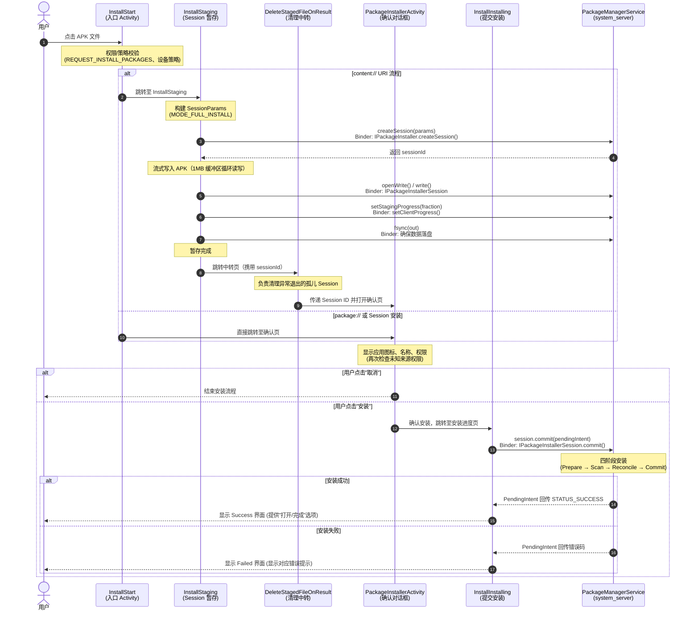

# Android apk 安装流程

Package Manager Service（PMS）是 Android 系统中负责应用生命周期管理的核心服务，统一调度 APK（Android Package）从解析校验、目录创建、DEX 编译优化到通知 Launcher 的全过程。

```
1. 拷贝 APK → 2. 资源加载 → 3. 解析 Manifest → 4. dexopt 执行 → 5. 四大组件注册 → 6. 安装完成广播
```

整个安装流程涉及 **四个层次** 的协同工作：

| 层次       | 组件                         | 职责                                                         |
| ---------- | ---------------------------- | ------------------------------------------------------------ |
| **应用层** | PackageInstaller（系统 App） | 提供安装 UI 界面，创建安装 Session，将 APK 写入 Session      |
| **服务层** | PackageManagerService（PMS） | 接收 Session 提交，解析 APK，校验签名，注册包信息            |
| **桌面层** | Launcher3                    | 监听安装事件、显示 Promise 图标、更新进度、替换真实图标、更新应用抽屉 |



## 常见的 APP 安装方式

Android 系统中引发应用安装的具体途径主要分为以下四类：

| **安装类型**       | **常见场景**                                | **核心机制与路径**                                           |
| ------------------ | ------------------------------------------- | ------------------------------------------------------------ |
| **系统预装安装**   | 开机首次启动、系统升级或恢复出厂设置        | PMS 启动时逐个扫描 `/system/app`、`/system/priv-app`、`/vendor/app` 等目录并自动完成解析安装。 |
| **界面安装**       | 通过浏览器下载 APK 打开，或通过应用商店安装 | 调起系统应用 `PackageInstaller` 的 UI 界面，用户确认后通过 `PackageInstaller.Session` 进行安装。 |
| **ADB 命令行安装** | 开发者调试执行 `adb install app.apk`        | 客户端通过 ADB Daemon 调用 Shell 层的 `cmd package install`，绕过 UI 确认界面直接向 PMS 发起 Session 提交。 |
| **应用商店安装**   | 第三方 App 检查更新或系统应用后台安装       | 普通应用调用 `Intent.ACTION_VIEW` 触发系统安装器；具备系统权限（`INSTALL_PACKAGES`）的应用可直接通过 API 静默写入。 |

## 应用安装涉及到的目录

- **/system/app/**：存放系统基础的预装应用（如 HTML 查看器、系统屏保等），位于只读分区，需 Root 权限才能修改。
- **/system/priv-app/**：存放拥有系统最高特权（Privileged）的核心应用（如系统 UI、设置、电话呼叫服务等），可获取普通应用无法申请的 `signatureOrSystem` 权限。
- **/vendor/app/**：存放手机厂商或芯片厂商（如高通、联发科）定制的硬件绑定应用及驱动组件（如特定 NFC 服务、指纹算法等）。
- **/data/app/**：存放用户主动安装及下载的第三方应用。Android 8.0 以前直接放置 `.apk` 文件；Android 8.0 及以后会为每个 App 生成带随机 Hash 的独立文件夹（如 `/data/app/~~Hash==/com.xxx-Hash/`），内部包含 `base.apk` 及按 CPU 架构提取的 `.so` 原生库。
- **/data/data/**（或多用户架构下的 **/data/user/0/**）：存放应用的运行私有数据，仅本应用及 Root 用户有权访问，随 App 卸载自动删除。内部包含 `files/`（常规私有文件）、`cache/`（临时缓存）、`shared_prefs/`（XML 配置文件）、`databases/`（SQLite 数据库）及 `lib/`（指向 `.so` 库的软链接）。
- **/sdcard/Android/data/<package_name>/**：存放在外部 SD 卡或大容量存储上的 App 私有数据（如大图缓存、下载资源），无需申请读写权限，同样随 App 卸载自动清除。
- **/data/dalvik-cache/**：存放优化后的可执行文件。Dalvik 时代用于存放解压出的 `.dex` 优化文件（ODEX）；ART 时代（Android 7.0+）采用 AOT+JIT 混合编译，部分 `.oat`、`.vdex` 及 `.art` 也会直接保存在 `/data/app/<pkg>/oat/<arch>/` 目录下。
- **/data/system/**：Android 系统框架（PMS/AMS）的核心全局配置目录，相当于系统的“注册表”。关键文件包含记录已安装 APK 路径、权限、签名和 UID 的 `packages.xml`，以及记录应用包名、UID 和默认存储路径的 `packages.list`。
- **/data/local/tmp/**：执行 `adb install` 或 PackageInstaller 解析 APK 时的临时中转目录，系统在此完成校验后再将其移入 `/data/app/` 正式安装。

## PackageInstaller 安装

PackageInstaller 本身就是一个 **系统级别的 App**，包名为 `com.android.packageinstaller`，源码：[frameworks/base/packages/](https://cs.android.com/android/platform/superproject/+/android-latest-release:frameworks/base/packages/)

在设备上可以确认其存在：

```bash
adb shell "ls /system/priv-app/ | grep Package"
# 输出: PackageInstaller
```

### 源码目录结构

```
frameworks/base/packages/PackageInstaller/
├── Android.bp                          # Soong 构建文件
├── AndroidManifest.xml                 # 应用清单
├── res/                                # 布局、字符串、图标等资源
├── src/com/android/packageinstaller/
│   ├── common/                         # 公共组件
│   │   ├── EventResultPersister.java   # 安装结果持久化
│   │   ├── InstallEventReceiver.java   # 安装事件广播接收器
│   │   ├── TemporaryFileManager.java   # 临时文件管理
│   │   └── UninstallEventReceiver.java
│   ├── handheld/                       # 手持设备 UI 片段
│   ├── television/                     # TV 设备 UI 片段
│   ├── v2/                             # V2 新版架构（Kotlin + MVVM）
│   │   ├── model/                      # Repository + Stage 状态机
│   │   ├── ui/                         # FragmentActivity + Fragment
│   │   └── viewmodel/                  # ViewModel 层
│   ├── InstallStart.java               # 安装入口 Activity（exported）
│   ├── InstallStaging.java             # APK 文件暂存到 Session
│   ├── DeleteStagedFileOnResult.java   # 暂存文件中转
│   ├── PackageInstallerActivity.java   # 用户确认对话框
│   ├── InstallInstalling.java          # Session 提交（调用 commit）
│   ├── InstallSuccess.java             # 安装成功界面
│   ├── InstallFailed.java              # 安装失败界面
│   ├── UninstallerActivity.java        # 卸载入口
│   ├── PackageUtil.java                # 工具类（V1/V2 切换判断）
│   └── ...
└── tests/                              # 测试代码
```

### AndroidManifest.xml 关键声明

**权限声明（核心）：**

```xml
<uses-permission android:name="android.permission.INSTALL_PACKAGES" />
<uses-permission android:name="android.permission.DELETE_PACKAGES" />
<uses-permission android:name="android.permission.READ_INSTALL_SESSIONS" />
<uses-permission android:name="android.permission.QUERY_ALL_PACKAGES" />
```

**Activity 与 Intent Filter：**

| Activity                   | Exported | Intent Filter                                                |
| -------------------------- | -------- | ------------------------------------------------------------ |
| `InstallStart`             | ✅ true   | `ACTION_VIEW` + `application/vnd.android.package-archive`；`ACTION_INSTALL_PACKAGE`；`ACTION_CONFIRM_INSTALL` |
| `InstallStaging`           | ❌ false  | 无（内部跳转）                                               |
| `PackageInstallerActivity` | ❌ false  | 无（内部跳转）                                               |
| `InstallInstalling`        | ❌ false  | 无（内部跳转）                                               |
| `InstallSuccess`           | ❌ false  | 无                                                           |
| `InstallFailed`            | ❌ false  | 无                                                           |
| `UninstallerActivity`      | ✅ true   | `ACTION_DELETE` + `package://`；`ACTION_UNINSTALL_PACKAGE`   |

此处可以看到，仅有 `InstallStart` 和 `UninstallerActivity` 声明了 `exported="true"`，这意味着它们可以被外部应用通过 Intent 直接发起调用。

### V1 与 V2 双路径架构

PackageInstaller 存在 **两套并行代码路径**，由 `PackageUtil.isVersionTwoEnabled()` 决定：

```java
// PackageUtil.java
public static boolean isVersionTwoEnabled(@NonNull Context context) {
    if (isAuto(context) || isTV(context) || isWatch(context)) {
        Log.d(LOG_TAG, "The device doesn't support PIA version 2");
        return false;
    }
    // Only enable PIA V2 on the version that is newer than BAKLAVA
    if (Build.VERSION.SDK_INT_FULL <= Build.VERSION_CODES_FULL.BAKLAVA) {
        Log.d(LOG_TAG, "The OS version doesn't support PIA version 2");
        return false;
    }
    Log.d(LOG_TAG, "Use PIA V2");
    return true;
}
```

- **V1（Legacy）**：传统 Activity 链式跳转（`InstallStart → InstallStaging → PackageInstallerActivity → InstallInstalling`）
- **V2（Modern）**：Kotlin + MVVM 架构（`InstallLaunch → InstallRepository → InstallViewModel → InstallationFragment`）

V2 仅在非 Auto/TV/Watch 且 post-Baklava（andorid 17以后） 版本启用。下面以 V1 流程为主线讲解。

### 安装流详解（V1）

#### InstallStart — 安装入口

**源码路径：** `src/com/android/packageinstaller/InstallStart.java`

当用户点击一个 APK 文件时，系统发出 `ACTION_VIEW` Intent，`InstallStart` 作为 exported Activity 被调起。

**核心逻辑：**

```java
// InstallStart.java
@Override
protected void onCreate(@Nullable Bundle savedInstanceState) {
    super.onCreate(savedInstanceState);

    // 1. V2 架构检查：post-Baklava 设备走 InstallLaunch（V2 入口）
    if (PackageUtil.isVersionTwoEnabled(this)) {
        // 转发到 InstallLaunch，结束
        return;
    }

    // 2. 获取调用者身份
    int callingUid = getLaunchedFromUid();
    int originatingUid = callingUid;  // 默认 originatingUid = callingUid

    // 3. 判断是否为 Session 安装
    final boolean isSessionInstall =
            PackageInstaller.ACTION_CONFIRM_PRE_APPROVAL.equals(intentAction)
            || PackageInstaller.ACTION_CONFIRM_INSTALL.equals(intentAction);

    // 4. 判断来源是否可信
    //    - 有 INSTALL_PACKAGES 权限 + 非 Intent 方式 → 可信
    //    - 特权应用 + EXTRA_NOT_UNKNOWN_SOURCE → 可信
    //    - DocumentsManager / DownloadsProvider 特殊处理：
    //      它们只是中转站，真正来源在 Intent.EXTRA_ORIGINATING_UID
    //    - targetSdk >= O 的普通应用 → 需要 REQUEST_INSTALL_PACKAGES 权限
    // 5. Session Owner 校验
    if (sessionId != -1 && !isCallerSessionOwner(callingUid, sessionId)) {
        mAbortInstall = true;
    }

    // 6. 设备策略检查
    checkDevicePolicyRestrictions(isTrustedSource);
    //    可信来源只检查 DISALLOW_INSTALL_APPS
    //    不可信来源额外检查 DISALLOW_INSTALL_UNKNOWN_SOURCES

    // 7. 路由到下一个 Activity
    if (isSessionInstall) {
        // Session 安装 → PackageInstallerActivity
        nextActivity.setClass(this, PackageInstallerActivity.class);
    } else {
        Uri packageUri = intent.getData();

        if (packageUri != null
                && packageUri.getScheme().equals(ContentResolver.SCHEME_CONTENT)
                && (originatingUid == Process.INVALID_UID
                || canPackageQuery(originatingUid, packageUri))) {
            // [IMPORTANT] This path is deprecated, but should still work.
            // content:// URI → InstallStaging（先暂存 APK 到 Session）
            // 注意：还需要 canPackageQuery() 校验 originatingUid 能否访问该 URI
            nextActivity.setClass(this, InstallStaging.class);
        } else if (packageUri != null
                && PackageInstallerActivity.SCHEME_PACKAGE.equals(packageUri.getScheme())) {
            // package:// URI → PackageInstallerActivity
            nextActivity.setClass(this, PackageInstallerActivity.class);
        } else {
            // 其他 scheme → 安装失败（INSTALL_FAILED_INVALID_URI）
            nextActivity = null;
        }
    }
    //....
    startActivity(nextActivity);
}
```

**关键 Extras 传递给下游 Activity：**

- `EXTRA_CALLING_PACKAGE` — 调用者包名
- `EXTRA_ORIGINAL_SOURCE_INFO` — 调用者 ApplicationInfo
- `EXTRA_ORIGINATING_UID_FROM_SESSION_INFO` — 来源 UID
- `EXTRA_IS_TRUSTED_SOURCE` — 是否可信来源

#### InstallStaging — APK 流式写入 Session

**为什么需要暂存（Staging）？** 当 APK 以 `content://` URI 提供时（微信/QQ/浏览器下载的 APK 都是这种），文件归属于第三方 Provider 应用。在系统校验签名和实际安装之间有时间差，Provider 可能随时修改或删除文件。写入 Session 后，APK 数据由系统管理（存储在 `/data/app/vmdl*.tmp/` 临时目录），确保安装过程中文件不被篡改。

**为什么源码标注 deprecated？** `InstallStart.java` 中 content:// 路径的注释写着 `[IMPORTANT] This path is deprecated, but should still work`。这是因为 Google 从 Android 10 开始推行 Session-based Install API，应用商店应该直接使用 `PackageInstaller.Session` 创建 Session、写入 APK、调用 `commit()`，不需要经过 InstallStaging 这个中转。但 `content://` 安装是用户从文件管理器点击 APK 的主要路径，仍然需要保留兼容。

##### 创建 Session

```java
// InstallStaging.java line 115
@Override
protected void onResume() {
    if (mStagingTask == null) {
        // 1. 打开 content:// URI 对应的文件描述符
        final Uri packageUri = getIntent().getData();
        final AssetFileDescriptor afd = openAssetFileDescriptor(packageUri);

        // 2. 构建 SessionParams
        PackageInstaller.SessionParams params = createSessionParams(
                mInstaller, getIntent(), pfd, packageUri.toString());

        // 3. 创建 Session
        //    这一步通过 Binder 调用到 PMS 的 PackageInstallerService.createSession()
        //    PMS 创建 Session 后会触发 notifySessionCreated()
        //    binder回调 Launcher3 的 InstallSessionTracker的onCreated()
        
        mStagedSessionId = mInstaller.createSession(params);

        // 4. 启动异步暂存任务
        mStagingTask = new StagingAsyncTask();
        mStagingTask.execute();
    }
}
```

**注意**：

- `createSessionParams()` 只设置了 `appPackageName`、`installLocation`、`size`，**没有调用 `setAppIcon()` 或 `setAppLabel()`**。这意味着 `onCreated` 时 SessionInfo 中的 `appIcon` 和 `appLabel` 可能为 null。
- `createSession()` 的返回值就是 PMS 内部给这个 Session 分配的序号。PackageInstaller 拿到这个 int 后，后续所有操作都用它来引用这个 Session：

##### 流式写入 APK

```java
// InstallStaging.java line 282
private final class StagingAsyncTask extends AsyncTask<Void, Integer, SessionInfo> {

    @Override
    protected void onPreExecute() {
        // 设置进度条（如果文件大小已知）
        final long sizeBytes = getContentSizeBytes();
        if (sizeBytes > 0 && mDialog != null) {
            mProgressBar = mDialog.requireViewById(R.id.progress_indeterminate);
            mProgressBar.setProgress(0);
            mProgressBar.setMax(100);
            mProgressBar.setIndeterminate(false);
        }
    }

    @Override
    protected SessionInfo doInBackground(Void... params) {
        Uri packageUri = getIntent().getData();
        try (Session session = mInstaller.openSession(mStagedSessionId);
             InputStream in = getContentResolver().openInputStream(packageUri)) {

            session.setStagingProgress(0);

            long sizeBytes = getContentSizeBytes();
            long totalRead = 0;

            // 打开 Session 的输出流
            try (OutputStream out = session.openWrite("PackageInstaller", 0, sizeBytes)) {
                byte[] buffer = new byte[1024 * 1024];  // 1MB 缓冲区
                while (true) {
                    int numRead = in.read(buffer);
                    if (numRead == -1) {
                        session.fsync(out);  // 确保数据落盘
                        break;
                    }
                    if (isCancelled()) break;

                    out.write(buffer, 0, numRead);

                    if (sizeBytes > 0) {
                        totalRead += numRead;
                        float fraction = ((float) totalRead / (float) sizeBytes);
                        // 更新暂存进度
                        //    通过 Binder 调用到 PMS 的 PackageInstallerSession.setClientProgress()
                        //    → computeProgressLocked() → mCallback.onSessionProgressChanged()
                        //    → Launcher3 的 InstallSessionTracker.onProgressChanged()
                        session.setStagingProgress(fraction);
                        publishProgress((int) (fraction * 100.0));
                    }
                }
            }
            return mInstaller.getSessionInfo(mStagedSessionId);
        } catch (IOException | SecurityException | IllegalStateException
                 | IllegalArgumentException e) {
            return null;
        }
    }

    @Override
    protected void onProgressUpdate(Integer... progress) {
        // 更新本地 UI 进度条
        if (mProgressBar != null && progress != null && progress.length > 0) {
            mProgressBar.setProgress(progress[0], true);
        }
    }
}
```

##### 暂存完成，跳转下一步

```java
// InstallStaging.java line 361
@Override
protected void onPostExecute(SessionInfo sessionInfo) {
    // 校验 Session 状态
    if (sessionInfo == null || !sessionInfo.isActive()
            || sessionInfo.getResolvedBaseApkPath() == null) {
        cleanupStagingSession();
        showError();
        return;
    }

    // 构建跳转 Intent
    Intent installIntent = new Intent(getIntent());
    installIntent.setClass(InstallStaging.this, DeleteStagedFileOnResult.class);

    // 把 file:// URI 指向 Session 中暂存的 APK 文件
    installIntent.setData(Uri.fromFile(new File(sessionInfo.getResolvedBaseApkPath())));
    installIntent.putExtra(EXTRA_STAGED_SESSION_ID, mStagedSessionId);
    installIntent.addFlags(Intent.FLAG_ACTIVITY_NO_ANIMATION);

    startActivity(installIntent);
    InstallStaging.this.finish();
}
```

#### PackageInstallerActivity — 用户确认

到这一步之前首先经过一个中转`DeleteStagedFileOnResult.java`，这是一个简单的中转 Activity：

- 通过 `startActivityForResult()` 启动 `PackageInstallerActivity`
- 在 `onDestroy()` 中，如果 Activity 正在 finish，则放弃暂存的 Session（作为孤儿 Session 的安全网）

然后通过PackageInstallerActivity.java，向用户展示安装确认对话框，显示应用图标、名称、权限列表等信息。

**核心流程：**

```
onCreate()
├── 读取 callingPackage、sourceInfo、originatingUid
├── 确定 packageSource（从 Session 或 URI）
├── processAppSnippet() → 解析 APK 获取 AppSnippet（图标 + 名称）
│   ├── processPackageUri()    — 处理 package:// 和 file:// URI
│   └── processSessionInfo()   — 处理 Session 安装
│
onResume()
├── bindUi() → 构建 AlertDialog（安装/取消按钮）
├── checkIfAllowedAndInitiateInstall()
│   ├── 可信来源或允许未知来源 → initiateInstall()
│   └── 否则 → handleUnknownSources()
│       ├── 检查 AppOps REQUEST_INSTALL_PACKAGES
│       ├── 被阻止 → 显示 ExternalSourcesBlockedDialog（跳转设置）
│       └── 允许 → initiateInstall()
│
用户点击"安装"
└── startInstall()
    └── 启动 InstallInstalling，传递：
        ├── EXTRA_STAGED_SESSION_ID
        ├── PackageUtil.INTENT_ATTR_APPLICATION_INFO
        ├── EXTRA_APP_SNIPPET
        └── 各种 originating/referrer URI
```

**关键行为：** 在 `finish()` 中，对于 Session 安装，调用 `mInstaller.setPermissionsResult(mSessionId, true/false)` 来授权或拒绝安装。

#### InstallInstalling— 提交安装

这是整个 UI 安装流程中最关键的一步——真正调用 `session.commit()` 将安装请求发送给 PMS。

**核心逻辑：**

```java
// onCreate()
// 1. 注册安装事件观察者
InstallEventReceiver.addObserver(this, installId, this::launchFinishBasedOnResult);

// 2. 获取之前暂存的 Session ID
mSessionId = getIntent().getIntExtra(EXTRA_STAGED_SESSION_ID, -1);

// onResume() → InstallingAsyncTask
// doInBackground:
PackageInstaller.Session session = getPackageManager()
    .getPackageInstaller().openSession(mSessionId);

// onPostExecute:
// 1. 创建 PendingIntent 用于接收安装结果广播
Intent broadcastIntent = new Intent(BROADCAST_ACTION);
broadcastIntent.putExtra(EventResultPersister.EXTRA_ID, mInstallId);
PendingIntent pendingIntent = PendingIntent.getBroadcast(
    context, mInstallId, broadcastIntent, PendingIntent.FLAG_UPDATE_CURRENT);

// 2. 提交 Session → 触发 PMS 安装流程
session.commit(pendingIntent.getIntentSender());
```

**结果处理：**

```java
private void launchFinishBasedOnResult(int statusCode, int legacyStatus,
        String statusMessage, int serviceId, Intent intent) {
    if (statusCode == PackageInstaller.STATUS_SUCCESS) {
        // 安装成功 → 跳转到 InstallSuccess
        startActivity(new Intent(this, InstallSuccess.class)...);
    } else {
        // 安装失败 → 跳转到 InstallFailed
        startActivity(new Intent(this, InstallFailed.class)...);
    }
}
```

- **InstallSuccess**：显示成功对话框，提供"打开"和"完成"按钮
- **InstallFailed**：根据错误码（`STATUS_FAILURE_BLOCKED`、`STATUS_FAILURE_CONFLICT`、`STATUS_FAILURE_INCOMPATIBLE` 等）显示对应的错误信息

## PMS安装流程

```
PackageInstaller.Session.commit(IntentSender)               ← PackageInstaller App 进程
    │
    │ Binder IPC
    ▼
━━━ system_server 进程 ━━━━━━━━━━━━━━━━━━━━━━━━━━━━━━━━━━━━━━━━━━━━━━━

PackageInstallerSession.commit(statusReceiver, forTransfer)  Binder Stub
    ├─ markAsSealed()              ← 标记会话为"密封"状态，禁止再写入
    └─ dispatchSessionSealed()     ← 发送 MSG_ON_SESSION_SEALED
          │
          ▼ Handler 消息
    handleSessionSealed()                                   
        ├─ mCallback.onSessionSealedBlocking()   ← 持久化密封状态
        └─ dispatchStreamValidateAndCommit()     ← 发送 MSG_STREAM_VALIDATE_AND_COMMIT
              │
              ▼ Handler 消息
        handleStreamValidateAndCommit()                     
            ├─ streamValidateAndCommit()  ← 对每个子 Session 和自身做流校验
            └─ 全部通过 → 发送 MSG_INSTALL
                  │
                  ▼ Handler 消息
            handleInstall()                                 
                ├─ sendPendingUserActionIntentIfNeeded()  ← 检查是否需要用户确认
                ├─ prepareInheritedFiles()                ← 准备继承的文件
                ├─ parseApk()                             ← 解析 APK
                └─ resumeVerify()                         
                      │
                      ▼
                verify()                                   
                    └─ runExtractNativeLibraries()         ← 提取 .so 原生库
                          │
                          ▼ IO 线程回调
                    handleOnNativeLibsExtracted()          
                        └─ verifyNonStaged()               
                              ├─ markStageDirInUseLocked()
                              └─ SessionVerifier.verify()  ← 委托给 SessionVerifier
                                    │
                                    ▼ 验证完成回调
                              onVerificationComplete()     
                                  ├─ (staged 会话 → StagingManager.commitSession, 返回)
                                  └─ (非 staged) → install() 最后会调用dispatchSessionFinished进行通知
                                        │
                                        ▼
                                  installNonStaged()       
                                      └─ InstallingSession.installStage()
                                            │
                                            ▼
                                  InstallPackageHelper.installPackagesTraced()  ← 四阶段入口
```

`mSession` 是 `IPackageInstallerSession` 的 Binder 代理（Stub.Proxy），调用 `commit()` 会通过 Binder 驱动跨进程调用到 `system_server` 进程中的 `PackageInstallerSession`（Binder Stub 实现）。

### 四阶段安装流程

PMS 的安装流程被明确划分为 **四个阶段**，入口方法为 `InstallPackageHelper.installPackagesTraced()`：

```java
/**
 * Installs one or more packages atomically. This operation is broken up into four phases:
 * <ul>
 *     <li><b>Prepare</b>
 *         <br/>Analyzes any current install state, parses the package and does initial
 *         validation on it.</li>
 *     <li><b>Scan</b>
 *         <br/>Interrogates the parsed packages given the context collected in prepare.</li>
 *     <li><b>Reconcile</b>
 *         <br/>Validates scanned packages in the context of each other and the current system
 *         state to ensure that the install will be successful.</li>
 *     <li><b>Commit</b>
 *         <br/>Commits all scanned packages and updates system state. This is the only place
 *         that system state may be modified in the install flow and all predictable errors
 *         must be determined before this phase.</li>
 * </ul>
 */
void installPackagesTraced(List<InstallRequest> requests, MoveInfo moveInfo) {
    boolean pendingForDexopt = false; // 标记是否等待 dexopt 异步回调
   
    try {

        // 1. 准备安装（解析 APK）& 扫描（收集签名、分配 appId 等）
        if (prepareInstallPackages(requests)
                && scanInstallPackages(requests, createdAppId, versionInfos)) {

            // 2. 对账：合并多包信息、检查版本冲突
            List<ReconciledPackage> reconciledPackages =
                    reconcileInstallPackages(requests, versionInfos);
            if (reconciledPackages == null) {
                return;
            }

            // 3. 重命名并更新路径（必须在 dexopt 之前，art 会把路径编码进 odex/vdex）
            if (renameAndUpdatePaths(requests)) {
                pendingForDexopt = true; // 标记：收尾工作交给 dexopt 完成后的回调

                // 4. 执行 dexopt（编译优化），完成后回调 doPostDexopt 做收尾
                final Runnable actionsAfterDexopt = () ->
                        doPostDexopt(reconciledPackages, requests,
                                createdAppId, moveInfo, acquireTime);
                prepPerformDexoptIfNeeded(reconciledPackages, actionsAfterDexopt);
            }
        }
    } finally {
        if (!pendingForDexopt) {
            // 未走 dexopt 路径（失败或无需优化），在此同步完成收尾
            completeInstallProcess(requests, createdAppId, success);
            Trace.traceEnd(TRACE_TAG_PACKAGE_MANAGER);
            doPostInstall(requests, moveInfo);                     // 回调安装结果
            releaseWakeLock(acquireTime, requests.size());         // 释放唤醒锁
        }
        // pendingForDexopt=true 时，以上收尾由 actionsAfterDexopt 回调处理
    }
}

```

#### Phase 1: Prepare（准备阶段）

**调用**：`prepareInstallPackages()` → `preparePackage()`

| 步骤            | 做了什么                                       | 源码关键调用                                                 |
| --------------- | ---------------------------------------------- | ------------------------------------------------------------ |
| 解析 APK        | 提取包名、版本号、四大组件、权限声明、签名信息 | `PackageParser2.parsePackage()`                              |
| Target SDK 检查 | 拒绝 targetSdk 过低的应用                      | `parsedPackage.getTargetSdkVersion() < MIN_INSTALLABLE_TARGET_SDK` |
| 测试包检查      | `FLAG_TEST_ONLY` 需要 `INSTALL_ALLOW_TEST`     | `parsedPackage.isTestOnly()`                                 |
| 签名验证        | 校验 APK 签名完整性                            | `ParsingPackageUtils.getSigningDetails()`                    |
| 已有包检查      | 判断是覆盖安装还是全新安装，验证签名兼容性     | 查询 `mPm.mSettings`                                         |

#### Phase 2: Scan（扫描阶段）

**调用**：`scanInstallPackages()` → `scanPackageTraced()`（line 1354）

基于 Prepare 的结果做深入检查：

- 验证权限声明合法性
- 检查共享库依赖
- 确定 ABI 兼容性
- 收集系统级约束信息

#### Phase 3: Reconcile（协调阶段）

**调用**：`reconcileInstallPackages()` → `ReconcilePackageUtils.reconcilePackages()`（line 1436）

在多个包之间和系统状态之间交叉验证：

- 确保包之间没有冲突
- 验证与当前系统状态一致
- **所有可预见的错误必须在此阶段之前被发现**（Commit 阶段不允许报错）

#### Phase 4: Commit（提交阶段）

这是**唯一可以修改系统状态**的阶段。与前三阶段不同，**Commit 阶段分两步执行**：

```
Phase 4 步骤 A：renameAndUpdatePaths()          // 同步，文件从临时目录移到正式目录
                    ↓
Phase 4 步骤 B：prepPerformDexoptIfNeeded()      // 异步执行 dex2oat
                    ↓ CompletableFuture 回调
                doPostDexopt()                
                    → commitPackagesLocked()      // 包注册 + 四大组件注册
                    → executePostCommitStepsLIF() // 后续清理
```

##### **步骤 A：文件移动（APK 归档到正式目录）**

```java
// renameAndUpdatePaths()
private boolean renameAndUpdatePaths(List<InstallRequest> requests) {
    try (PackageManagerTracedLock installLock = mPm.mInstallLock.acquireLock()) {
        for (InstallRequest request : requests) {
            // 从临时位置移动到 /data/app/~~Hash==/com.xxx-Hash/
            doRenameLI(request, parsedPackage);

            // 更新路径信息
            PackageSetting ps = request.getScannedPackageSetting();
            ps.setPath(new File(parsedPackage.getPath()));
            ps.setLegacyNativeLibraryPath(parsedPackage.getNativeLibraryRootDir());
        }
        return true;
    }
}
```

##### **步骤 B：DEX 优化（dex2oat）**

要理解 Android 应用的执行与优化过程，首先需要了解其运行环境 —— **ART（Android Runtime）虚拟机**。ART 作为 Android 系统的核心托管运行时，摒弃了早期 Dalvik 纯靠实时解释执行的低效模式；而实现这一性能飞跃的关键，正是 ART 内部集成的核心编译工具机制 —— **DEX 优化（dex2oat）**。

基于 AOT + JIT + Profile 的混合编译策略，将 `.dex` 字节码文件异步转换为针对当前硬件优化的 `.vdex`、`.odex/.oat` 和 `.art` 文件。

```java
// prepPerformDexoptIfNeeded()
private void prepPerformDexoptIfNeeded(...) {
    List<CompletableFuture<Void>> futures = new ArrayList<>();
    for (ReconciledPackage reconciledPkg : reconciledPackages) {
        // **准备应用数据目录
        mAppDataHelper.prepareAppDataPostCommitLIF(ps, 0, newUsers);

        // ***异步执行 dex2oat
        CompletableFuture<Void> future =
                mPm.getDexOptHelper().performDexoptIfNeededAsync(request);
        futures.add(future);
    }
    // 等待所有 dexopt 完成
    CompletableFuture.allOf(futures.toArray(new CompletableFuture[0]))
            .thenRun(() -> mPm.mHandler.post(actionsAfterDexopt));
}
```

**installd 负责需要 root 权限的文件操作**：

| 操作              | 调用路径                                     | 为什么需要 installd                                          |
| ----------------- | -------------------------------------------- | ------------------------------------------------------------ |
| 创建 app 数据目录 | `Installer.createAppData()` → installd       | 需要以 app 的 uid/gid 创建 `/data/data/com.xxx/` 和 `/data/user/0/com.xxx/` |
| 设置 SELinux 标签 | installd 内部 `selinux_android_setfilecon()` | 需要 root 权限设置安全上下文                                 |
| CE/DE 存储分离    | installd 创建 `ce/` 和 `de/` 子目录          | Credential Encrypted 目录在用户解锁前不可访问                |

**dex2oat 编译则不经过 installd**，而是通过 ART Service（`com.android.art` APEX 模块）完成。旧版本中 installd 同时负责文件操作和 dexopt，新版本将 dexopt 拆到独立的 ART Service 中，使其可通过 APEX 独立更新。##### **步骤 C：包注册**

本步骤正式将准备好的应用数据**写入系统的内存注册表与持久化配置文件（`packages.xml`）**。一旦此函数执行完毕，应用在 Android 系统层面即宣告“安装成功/已注册”。

```java
// commitPackagesLocked()
private void commitPackagesLocked(List<ReconciledPackage> reconciledPackages, int[] allUsers) {
    for (ReconciledPackage reconciledPkg : reconciledPackages) {
        if (installRequest.isInstallReplace()) {
            // 覆盖安装：清理旧包
            AndroidPackage oldPackage = mPm.mPackages.get(packageName);
        }

        // 提交扫描结果到系统注册表
        AndroidPackage pkg = commitReconciledScanResultLocked(reconciledPkg, allUsers);
        updateSettingsLI(pkg, allUsers, installRequest);

        // 更新 PackageSetting
        PackageSetting ps = mPm.mSettings.getPackageLPr(packageName);
        ps.setUpdateAvailable(false);
    }
    // 使缓存失效
    PackageManagerService.invalidateGetPackagesForUidCache(...);
}
```

**四大组件注册**在 `commitReconciledScanResultLocked()` 中调用 `ComponentResolver.addAllComponents()`：

```java
// InstallPackageHelper.java
mPm.mComponentResolver.addAllComponents(pkg, chatty, ...);
```

```java
// ComponentResolver.java
public void addAllComponents(AndroidPackage pkg, ...) {
    synchronized (mLock) {
        addActivitiesLocked(computer, pkg, newIntents, chatty);   // Activity
        addReceiversLocked(computer, pkg, chatty);                // BroadcastReceiver
        addProvidersLocked(computer, pkg, chatty);                // ContentProvider
        addServicesLocked(computer, pkg, chatty);                 // Service
    }
}
// Activity
for (int i = 0; i < activitiesSize; i++) {
    ParsedActivity a = pkg.getActivities().get(i);
    mActivities.addActivity(computer, a, "activity", newIntents);
}

// BroadcastReceiver
for (int i = 0; i < receiversSize; i++) {
    ParsedActivity a = pkg.getReceivers().get(i);
    mReceivers.addActivity(computer, a, "receiver", null);
}

// ContentProvider
for (int i = 0; i < providersSize; i++) {
    ParsedProvider p = pkg.getProviders().get(i);
    mProviders.addProvider(computer, p);
}

// Service
for (int i = 0; i < servicesSize; i++) {
    ParsedService s = pkg.getServices().get(i);
    mServices.addService(computer, s);
}

```

`mActivities`、`mReceivers`、`mProviders`、`mServices` 都是 `ComponentResolver` 内部的注册表，以 `ComponentName` 为 key 存储。注册完成后，系统就能通过 `startActivity()`、`startService()`、`bindService()`、`sendBroadcast()`、`resolveContentProvider()` 等方式找到这个应用的组件了。

` packages.xml`  写入的都是：包名、路径、UID、版本号、签名、安装来源、时间戳、标志位等**包级别元数据**。

```xml
<package
    name="com.example.app"
    codePath="/data/app/~~Hash==/com.example.app-Hash"
    nativeLibraryPath="/data/app/.../lib"
    primaryCpuAbi="arm64-v8a"
    publicFlags="..."
    privateFlags="..."
    ft="..."                          <!-- 文件修改时间 -->
    ut="..."                          <!-- 最后更新时间 -->
    version="100"                     <!-- versionCode -->
    targetSdkVersion="34"
    userId="10123"                    <!-- UID -->
    installer="com.android.vending"   <!-- 安装来源 -->
    ...>
    <sigs ...>                        <!-- 签名 -->
    <proper-signing-keyset .../>
</package>

```

**四大组件信息从哪来？** 系统重启时，PMS 会重新扫描 `/data/app/` 下所有已安装 APK 的目录，调用 `PackageParser2.parsePackage()` 重新解析每个 APK 的 `AndroidManifest.xml`，从中提取出 Activity、Service、Receiver、Provider，再注册到 `ComponentResolver`。

> [!NOTE]
>
> **为什么不在 packages.xm里存组件信息？** 因为组件信息完全可以从 APK 文件中解析出来，没必要冗余存储。`packages.xml` 只存那些**无法从 APK 中获取**的信息：UID、安装时间、签名验证结果、权限授予状态、安装来源等。

### 通知与广播

#### Session 级通知

这条路径的职责是**通知 Session 的发起者和监听者**，做三件事：

```java
// PackageInstallerSession.java line 6263
private void dispatchSessionFinished(int returnCode, String msg, Bundle extras) {
    // 1: 回传结果给 PackageInstaller（或应用商店）
    //    通过 session.commit() 时传入的 PendingIntent 回传
    //    → PackageInstaller 的 InstallEventReceiver 收到
    //    → launchFinishBasedOnResult() → InstallSuccess / InstallFailed
    sendUpdateToRemoteStatusReceiver(returnCode, msg, extras, ...);

    // 2: 新安装成功时，发送 ACTION_SESSION_COMMITTED 给默认 Launcher
    //    → Launcher3 的 SessionCommitReceiver 收到
    if (success && isNewInstall && mPm.mInstallerService.okToSendBroadcasts()) {
        mPm.sendSessionCommitBroadcast(...);
    }

    // 3: 通知 SessionCallback 监听者
    //    → Launcher3 的 InstallSessionTracker.onFinished()
    mCallback.onSessionFinished(this, success);
}
```

`sendUpdateToRemoteStatusReceiver()`不直接发送，而是通过 Handler 异步发送 `MSG_ON_PACKAGE_INSTALLED`：

```java
// PackageInstallerSession.java
private void sendUpdateToRemoteStatusReceiver(int returnCode, String msg, Bundle extras, ...) {
    final IntentSender statusReceiver = ...;  // 就是 session.commit() 时传入的 PendingIntent
    final SomeArgs args = SomeArgs.obtain();
    args.arg1 = getPackageName();
    args.arg4 = statusReceiver;
    args.argi1 = returnCode;
    mHandler.obtainMessage(MSG_ON_PACKAGE_INSTALLED, args).sendToTarget();
}
```

Handler 收到 `MSG_ON_PACKAGE_INSTALLED` 后调用 `sendOnPackageInstalled()`，把结果填入 Intent 并通过 `statusReceiver.sendIntent()` 发回 PackageInstaller：

```java
// PackageInstallerSession.java 
private static void sendOnPackageInstalled(Context context, IntentSender target,
        int sessionId, ..., int returnCode, ..., Bundle extras) {
    final Intent fillIn = new Intent();
    fillIn.putExtra(PackageInstaller.EXTRA_PACKAGE_NAME, basePackageName);
    fillIn.putExtra(PackageInstaller.EXTRA_SESSION_ID, sessionId);
    fillIn.putExtra(PackageInstaller.EXTRA_STATUS, ...);  // STATUS_SUCCESS 或错误码
    // ...
    target.sendIntent(context, 0, fillIn, ...);
    //  ↑ 这个 target 就是 PackageInstaller 在 session.commit() 时传入的 PendingIntent
    //    → PackageInstaller 的 InstallEventReceiver 收到 → launchFinishBasedOnResult()
    //    → STATUS_SUCCESS → InstallSuccess，否则 → InstallFailed
}
```


#### 发送系统广播

这条路径的职责是**通知全系统有新包安装/更新了**，所有感兴趣的 App 都能收到：

```java
// InstallPackageHelper.java
void handlePackagePostInstall(InstallRequest request, boolean launchedForRestore) {
    final boolean succeeded = request.getReturnCode() == INSTALL_SUCCEEDED;
    if (succeeded) {
        // 发送安装广播（ACTION_PACKAGE_ADDED / ACTION_PACKAGE_REPLACED）
        mBroadcastHelper.sendPostInstallBroadcasts(mPm::snapshotComputer, request, packageName,
                mPm.mRequiredPermissionControllerPackage, mPm.mRequiredVerifierPackages,
                mPm.mRequiredInstallerPackage, mPm, launchedForRestore, killApp, update, archived);

        // 通知 PackageObserver
        if (request.isAllNewUsers() && !update) {
            mPm.notifyPackageAdded(packageName, request.getAppId());
        } else {
            mPm.notifyPackageChanged(packageName, request.getAppId());
        }
    }
}
```

`BroadcastHelper.sendPostInstallBroadcasts()`发送的广播非常细致，针对不同接收方分别发送：

```java
// BroadcastHelper.java line 567
void sendPostInstallBroadcasts(...) {
    // 新安装 → ACTION_PACKAGE_ADDED
    sendPackageBroadcastAndNotify(ACTION_PACKAGE_ADDED, ...);   // 给所有运行中的 App
    sendPackageBroadcastAndNotify(ACTION_PACKAGE_ADDED, ..., installerPackageName, ...);
    sendPackageBroadcastAndNotify(ACTION_PACKAGE_ADDED, ..., requiredPermissionControllerPackage, ...);
    sendPackageBroadcastAndNotify(ACTION_PACKAGE_ADDED, ..., requiredInstallerPackage, ...);

    // 更新安装 → 额外发送 ACTION_PACKAGE_REPLACED
    if (isUpdate) {
        sendPackageBroadcastAndNotify(ACTION_PACKAGE_REPLACED, ...);
        sendPackageBroadcastAndNotify(ACTION_MY_PACKAGE_REPLACED, ..., packageName, ...);
    }
}
```

Launcher3 通过 `LauncherApps.Callback.onPackageAdded()` 收到 `ACTION_PACKAGE_ADDED` 广播，这是桌面更新图标的主要触发点

## Launcher3显示图标

Launcher3 不参与安装过程本身，它只是**监听安装事件并响应**。整个 Launcher3 的响应链路可以清晰划分为 **三大核心子系统**：

**文件**：`model/ModelInitializer.kt`

```kotlin
fun initialize(model: LauncherModel) {
    val modelCallbacks = model.newModelCallbacks()
    val launcherApps = context.getSystemService(LauncherApps::class.java)!!

    // 1: 注册 LauncherApps.Callback → 监听应用包增删改
    launcherApps.registerCallback(modelCallbacks, MODEL_EXECUTOR.handler)

    // 2: 注册 InstallSessionTracker → 监听安装会话生命周期
    lifeCycle.addCloseable(installSessionHelper.registerInstallTracker(modelCallbacks))
}
```

**核心路由器 `ModelLauncherCallbacks`**（`model/ModelLauncherCallbacks.kt`）同时实现两个接口，把所有事件转换为 `ModelUpdateTask`：

```kotlin
class ModelLauncherCallbacks(private var taskExecutor: Consumer<ModelUpdateTask>) :
    LauncherApps.Callback(), InstallSessionTracker.Callback {

    // ---- LauncherApps.Callback 侧（来自系统广播） ----
    override fun onPackageAdded(packageName: String, user: UserHandle) {
        taskExecutor.accept(PackageUpdatedTask(OP_ADD, user, packageName))
    }
    override fun onPackageChanged(packageName: String, user: UserHandle) {
        taskExecutor.accept(PackageUpdatedTask(OP_UPDATE, user, packageName))
    }
    override fun onPackageRemoved(packageName: String, user: UserHandle) {
        taskExecutor.accept(PackageTaskFactory.appsRemoved(user, setOf(packageName)))
    }

    // ---- InstallSessionTracker.Callback 侧（来自 Session 回调） ----
    override fun onPackageStateChanged(installInfo: PackageInstallInfo) {
        taskExecutor.accept(PackageInstallStateChangedTask(installInfo))
    }
    override fun onUpdateSessionDisplay(key: PackageUserKey, info: SessionInfo) {
        taskExecutor.accept { controller, _, _ ->
            controller.iconCache.updateSessionCache(key, info)
        }
        taskExecutor.accept(CacheDataUpdatedTask(OP_SESSION_UPDATE, key.mUser, hashSetOf(key.mPackageName)))
    }
    override fun onSessionFailure(packageName: String, user: UserHandle) {
        taskExecutor.accept(SessionFailureTask(packageName, user))
    }
    override fun onInstallSessionCreated(sessionInfo: PackageInstallInfo) {
        // 空实现 — Session 创建本身不触发 Task
    }
}
```

###  Promise Icon 机制

**解决的问题**：从用户点击安装到安装完成的数秒内，桌面上需要有即时的视觉反馈。SessionCallback贯穿整个安装过程，负责实时反馈（Promise 图标 + 进度条）

**监听者**：`InstallSessionTracker`（`pm/InstallSessionTracker.java`）
直接继承 `PackageInstaller.SessionCallback`，通过 `InstallSessionHelper.registerInstallTracker()` 注册。

```java
// packages/apps/Launcher3/src/com/android/launcher3/install/InstallSessionTracker.java
public class InstallSessionTracker {
    
    private final PackageInstaller.SessionCallback mSessionCallback = new PackageInstaller.SessionCallback() {
        @Override
        public void onCreated(int sessionId) {
            SessionInfo sessionInfo = mInstaller.getSessionInfo(sessionId);
            if (sessionInfo != null) {
                // 关键步骤：在桌面生成 Promise Icon（灰色占位图标 + 进度条）
                mCallback.onSessionCreated(sessionInfo);
            }
        }

        @Override
        public void onProgressChanged(int sessionId, float progress) {
            // 实时更新安装进度条
            mCallback.onSessionUpdate(mInstaller.getSessionInfo(sessionId));
        }

        @Override
        public void onFinished(int sessionId, boolean success) {
            // 安装会话结束（成功或失败）
            mCallback.onSessionFinished(sessionId, success);
        }
    };
}
```

 Promise Icon 的状态流转与 UI 表现

- **`onCreated` 触发**：Launcher3 读取 `SessionInfo`，获取包名、应用名称和提取出的应用图标（若有），在桌面上创建一个特殊的 `WorkspaceItemInfo`（标记为 `PromiseAppInfo`）。此时图标呈现**半透明/灰色占位状**，并带有动态圆环或横向进度条。
- **`onProgressChanged` 触发**：根据 PMS 传递上来的 `progress`（0.0 ~ 1.0），动态刷新图标 View 的绘制层，呈现下载/解压进度。
- **`onFinished` 触发**：
  - **若 `success == true`**：移除 Promise 状态，将占位图标转换为标准的、可交互的真实 App 图标。
  - **若 `success == false`**：直接从桌面上移除该占位图标，并视情况弹出安装失败提示。

### AllApps 链路

当 PMS 完成底层的 `handlePackagePostInstall` 并广播 `Intent.ACTION_PACKAGE_ADDED` 时，Launcher3 的数据模型开始更新应用抽屉。ACTION_PACKAGE_ADDED广播， 只在安装成功后触发，负责数据更新（Promise → 真实图标 + 应用抽屉）

Launcher3 通过 `LauncherApps.Callback` 监听应用增删改查事件：  

```java
// packages/apps/Launcher3/src/com/android/launcher3/model/PackageUpdatedTask.java
public class PackageUpdatedTask extends BaseModelUpdateTask {
    @Override
    public void execute(ModelTaskController taskController, BgDataModel dataModel, AllAppsList appsList) {
        switch (mOp) {
            case OP_ADD:
                // 1. 从系统的 IconCache 加载该包的图标与 Label
                mIconCache.updateIconsForPkg(mPackages[0], mUser);
                // 2. 将新应用加入到 AllAppsList 内存缓存
                appsList.addPackage(mContext, mPackages[0], mUser);
                break;
            case OP_UPDATE:
                appsList.updatePackage(mContext, mPackages[0], mUser);
                break;
            case OP_REMOVE:
                appsList.removePackage(mPackages[0], mUser);
                break;
        }
        // 3. 通知 UI 层刷新应用抽屉列表（AllAppsRecyclerView）
        bindApplications();
    }
}
```

- **执行结果**：当用户上滑打开应用抽屉（AllApps Drawer）时，新应用已经稳妥地排列在网格中，并具备完整的名称与高清图标。

###  Workspace 链路

PMS 安装成功时发送 `ACTION_SESSION_COMMITTED` 广播，`SessionCommitReceiver` 接收后决定是否在桌面自动放置新图标。

```java
// packages/apps/Launcher3/src/com/android/launcher3/SessionCommitReceiver.java
public class SessionCommitReceiver extends BroadcastReceiver {
    @Override
    public void onReceive(Context context, Intent intent) {
        if (!isEnabled(context, user)) return; // 检查用户设置是否允许自动加到桌面
        SessionInfo info = intent.getParcelableExtra(PackageInstaller.EXTRA_SESSION);
        
        // 核心过滤：仅处理用户主动下载安装的应用（INSTALL_REASON_USER）
        // 过滤掉后台静默升级、预装应用同步等
        if (info.getInstallReason() != PackageManager.INSTALL_REASON_USER) return;

        // 将任务推入安装队列
        ItemInstallQueue.INSTANCE.get(context).queueItem(
                new SerializedItemInfo(info.getAppPackageName(), user));
    }
}
```

当队列触发时，Launcher3 交由后台任务调度器处理图标在桌面的具体落地位置：

```java
// packages/apps/Launcher3/src/com/android/launcher3/model/AddWorkspaceItemsTask.java
public class AddWorkspaceItemsTask extends BaseModelUpdateTask {
    @Override
    public void execute(ModelTaskController taskController, BgDataModel dataModel, AllAppsList appsList) {
        List<ItemInfo> addedItemsFinal = new ArrayList<>();
        
        for (Supplier<ItemInfo> itemProvider : mItemList) {
            ItemInfo item = itemProvider.get();
            
            // 1. 过滤重复：若桌面上已经存在该 App 目标，则跳过
            if (containsAppTarget(dataModel.itemsIdMap, item.getTargetComponent(), item.user)) continue;
            
            // 2. 过滤系统应用：如果是系统预装镜像，跳过桌面自动平铺
            if (new ApplicationInfoWrapper(mContext, item.getTargetComponent(), item.user).isSystem()) continue;

            // 3. 核心算法：寻找当前桌面最佳空位 (Screen, CellX, CellY)
            // 遍历各个 Workspace 屏幕，查找满足 1x1 栅格尺寸的连续空格
            WorkspaceItemCoordinates coords = mItemSpaceFinder.findSpaceForItem(
                    mContext, dataModel, addedItemsFinal, item.spanX, item.spanY);
            
            if (coords != null) {
                item.screenId = coords.screenId;
                item.cellX = coords.cellX;
                item.cellY = coords.cellY;
                addedItemsFinal.add(item);
            }
        }

        if (!addedItemsFinal.isEmpty()) {
            // 4. 写入持久化 SQLite 数据库 (LauncherProvider)
            getModelWriter().addItemsToDatabase(addedItemsFinal);

            // 5. 通知 UI 线程：在桌面上正式渲染/替换图标
            taskController.scheduleCallbackTask(callbacks -> {
                callbacks.bindItemsAdded(addedItemsFinal);
            });
        }
    }
}
```

**但它和路径一的 `tryQueuePromiseAppIcon` 做的是同一件事**——都往 `ItemInstallQueue` 入队：

```java
// tryQueuePromiseAppIcon — InstallSessionHelper.java（安装过程中）
ItemInstallQueue.INSTANCE.get(mAppContext).queueItem(
    new SerializedItemItem(sessionInfo.getAppPackageName(), user));
```

同一个队列，同一个 `AddWorkspaceItemsTask`，做的事完全一样。所以 `SessionCommitReceiver` 有防重复检查：

```java
// SessionCommitReceiver.java
boolean alreadyAddedPromiseIcon =
        packageInstallerCompat.promiseIconAddedForId(info.getSessionId());
if (... || alreadyAddedPromiseIcon) {
    return;  // Promise 图标已经入队了，跳过
}
```

**那 `SessionCommitReceiver` 存在的意义是什么？** `ACTION_SESSION_COMMITTED` 是 Android 提供给**所有 Launcher**（不只是 Launcher3）的**标准广播接口**。第三方 Launcher 没有 `tryQueuePromiseAppIcon` 这个内部机制，它们只能靠监听 `ACTION_SESSION_COMMITTED` 来得知"有新应用安装了，要不要放到桌面上"。对 Launcher3 来说，`tryQueuePromiseAppIcon` 在安装过程中就已经提前入队了，`SessionCommitReceiver` 大部分情况下会被 `alreadyAddedPromiseIcon` 跳过，只作为兜底。

## ADB 安装

### pm 命令入口

**源码路径：** `frameworks/base/cmds/pm/pm.sh`

`pm` 命令实际上是一个 Shell 脚本，直接委托给 `cmd` 命令：

```bash
#!/system/bin/sh
cmd package "$@"
```

因此 `adb shell pm install` 等价于 `adb shell cmd package install`。

### PackageManagerShellCommand

**源码路径：** `frameworks/base/services/core/java/com/android/server/pm/PackageManagerShellCommand.java`

这是所有 `pm` 子命令的调度中心，核心方法 `onCommand(String cmd)` 包含一个大型 switch 语句：

```java
@Override
public int onCommand(String cmd) {
    switch (cmd) {
        case "install":         return runInstall();
        case "uninstall":       return runUninstall();
        case "list":            return runList();
        case "path":            return runPath();
        case "dump":            return runDump();
        case "dump-package":    return runDumpPackage();
        case "clear":           return runClear();
        case "grant":           return runGrantRevokePermission(true);
        case "revoke":          return runGrantRevokePermission(false);
        case "enable":          return runSetEnabledSetting(PackageManager.COMPONENT_ENABLED_STATE_ENABLED);
        case "disable":         return runSetEnabledSetting(PackageManager.COMPONENT_ENABLED_STATE_DISABLED);
        // ... 更多命令 ...
    }
}
```

### ADB install 完整流程

**`runInstall()` 方法核心逻辑：**

```java
private int runInstall() throws RemoteException {
    // 1. 解析命令行参数
    InstallParams params = makeInstallParams();

    // 2. 创建安装 Session
    final int sessionId = doCreateSession(
            params.sessionParams,
            params.installerPackageName,
            params.userId);

    // 3. 写入 APK 文件到 Session
    if (isStreaming) {
    	doAddFiles(sessionId, args, ...);    // 流式安装
	} else {
    	doWriteSplits(sessionId, args, ...); // 常规安装
	}

    // 4. 提交 Session
    if (doCommitSession(sessionId, false) != PackageInstaller.STATUS_SUCCESS) {
        return 1;
    }
    // 成功输出 "Success"
}
```

**doCreateSession() — 创建 Session：**

```java
// 这里流程就是通过mInterface.getPackageInstaller().createSession(....)
//  PackageInstallerService.createSession()
//  PMS 创建 Session 后会触发 notifySessionCreated()
//  binder回调 Launcher3 的 InstallSessionTracker的onCreated()
private int doCreateSession(SessionParams params, String installerPackageName, int userId)
        throws RemoteException {
    if (userId == UserHandle.USER_ALL) {
        params.installFlags |= PackageManager.INSTALL_ALL_USERS;
    }
    final int translatedUserId = translateUserId(userId, UserHandle.USER_SYSTEM, "doCreateSession");
    final int sessionId = mInterface.getPackageInstaller()
            .createSession(params, installerPackageName, null, translatedUserId);
    return sessionId;
}
```

**doCommitSession() — 提交 Session：**

```java
private int doCommitSession(int sessionId, boolean logSuccess) throws RemoteException {
    PackageInstaller.Session session = new PackageInstaller.Session(
            mInterface.getPackageInstaller().openSession(sessionId));

    final LocalIntentReceiver receiver = new LocalIntentReceiver();
    session.commit(receiver.getIntentSender());

    // 等待安装结果
    final Intent result = receiver.getResult();
    int status = result.getIntExtra(
            PackageInstaller.EXTRA_STATUS, PackageInstaller.STATUS_FAILURE);

    if (status == PackageInstaller.STATUS_SUCCESS) {
        if (logSuccess) {
            getOutPrintWriter().println("Success");
        }
    } else {
        getErrPrintWriter().println("Failure [" + statusMessage + "]");
    }
    return status;
}
```

ADB 安装绕过了 UI 确认环节，但最终都通过相同的 `session.commit()` 接口进入 PMS 安装流程。

## ADB 命令实战指南

### 安装应用

```bash
# 基础安装
adb install app.apk

# 覆盖安装（-r）
adb install -r app.apk

# 安装测试包（-t）
adb install -t app-debug.apk

# 安装并授予所有运行时权限（-g）
adb install -g app.apk

# 降级安装（-d，允许 versionCode 回退）
adb install -d app.apk

# 安装到指定用户
adb install --user 10 app.apk

# 安装 Split APK
adb install-multiple base.apk split_config.arm64_v8a.apk split_config.xxhdpi.apk

# 安装 APEX 文件
adb install --apex module.apex

# 从 stdin 流式安装
cat app.apk | adb shell pm install -S $(stat -c%s app.apk)
```

> `adb install` 是电脑端的快捷工具，会自动把电脑上的 APK 文件传输给手机并调用底层安装服务，省去了你先 `adb push` 推送文件再执行 `pm install` 的繁琐过程。

### 查看安装应用信息

```bash
# 查看 APK 安装路径
adb shell pm path com.example.app
# 输出: package:/data/app/~~Hash==/com.example.app-Hash==/base.apk

# 列出所有已安装包
adb shell pm list packages

# 列出第三方应用
adb shell pm list packages -3

# 列出系统应用
adb shell pm list packages -s

# 列出已禁用应用
adb shell pm list packages -d

# 列出已启用应用
adb shell pm list packages -e

# 按关键字过滤
adb shell pm list packages | grep keyword

# 列出所有系统特性
adb shell pm list features

# 列出所有权限
adb shell pm list permissions

# 列出权限组
adb shell pm list permission-groups
```

### 管理应用

```bash
# 清理应用数据（相当于"设置→应用→清除数据"）
adb shell pm clear com.example.app

# 禁用应用
adb shell pm disable com.example.app

# 禁用特定组件
adb shell pm disable com.example.app/.MainActivity

# 启用应用
adb shell pm enable com.example.app

# 为用户禁用应用
adb shell pm disable-user --user 0 com.example.app

# 禁用直到使用
adb shell pm disable-until-used com.example.app

# 隐藏应用
adb shell pm hide com.example.app

# 取消隐藏
adb shell pm unhide com.example.app

# 挂起应用
adb shell pm suspend com.example.app

# 取消挂起
adb shell pm unsuspend com.example.app

# 卸载应用
adb shell pm uninstall com.example.app

# 卸载但保留数据
adb shell pm uninstall -k com.example.app

# 移动应用到外部存储
adb shell pm move-package com.example.app external

# 移动应用到内部存储
adb shell pm move-package com.example.app internal
```

### 权限管理

```bash
# 授予运行时权限
adb shell pm grant com.example.app android.permission.CAMERA

# 撤销运行时权限
adb shell pm revoke com.example.app android.permission.CAMERA

# 重置权限到默认状态
adb shell pm reset-permissions

# 查看应用的权限
adb shell dumpsys package com.example.app | grep permission
```

### DEX 编译相关

```bash
# 强制对指定包执行 dexopt
adb shell pm compile -m speed com.example.app

# 强制对所有包执行 dexopt
adb shell pm compile -m speed -a

# 触发后台 dexopt 任务
adb shell pm bg-dexopt-job
```