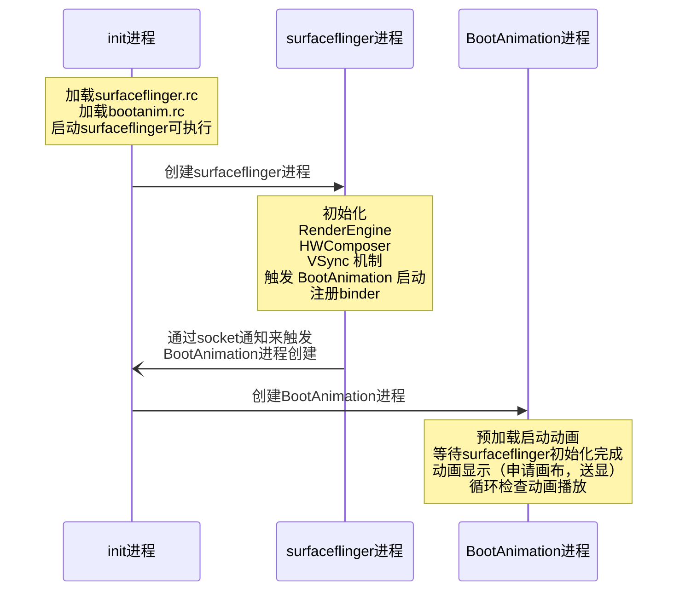
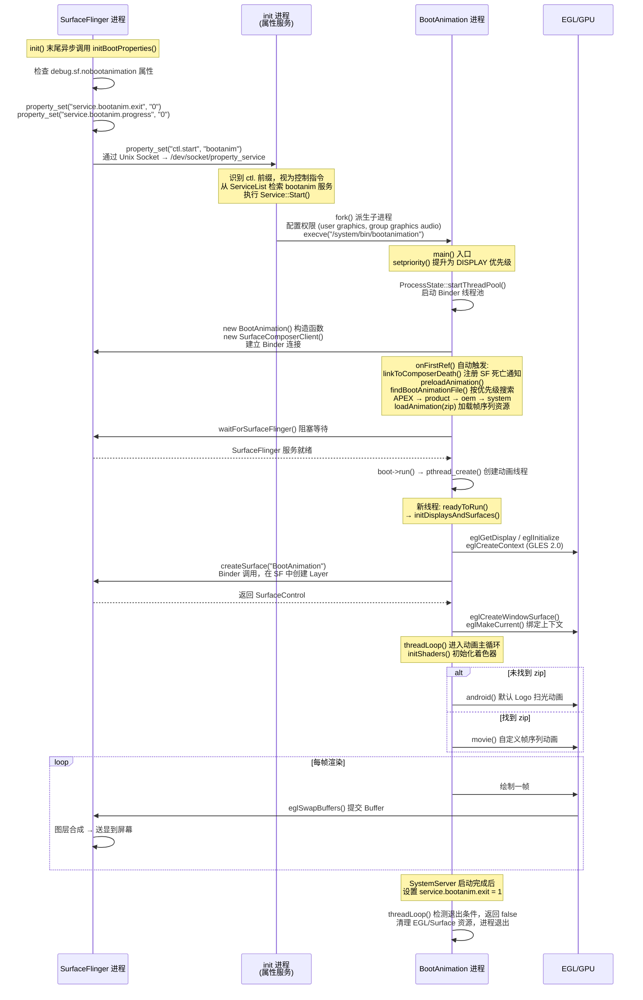

# Android 开机动画显示流程（一）

首先定义开机流程是什么？我们按下开机键到桌面显示



## Loader阶段

### 硬件加电与 ROM 复位

**硬件加电**：用户按下电源键，电源管理芯片（PMIC）供电稳定后，向 CPU 发送复位信号。

**PC 寄存器复位**：CPU 内部的程序计数器（Program Counter, PC）强制复位归零，并指向芯片设计时预设的固定物理地址（通常指向芯片内部的 Boot ROM / ROM 空间）。

**固件执行**：CPU 从该固定物理地址读取并执行 Boot ROM 中的片上固件程序，完成最基础的硬件初始化（如 SoC SRAM 初始化、基本时钟配置）。

### BootLoader 引导程序阶段

**加载引导程序**：Boot ROM 代码将存放于闪存（Flash/NAND/NVMe）中的 BootLoader（如 U-Boot）加载到 RAM（内存）中开始执行。

**初始化与系统校验**： BootLoader 负责初始化复杂的硬件设备（如 DRAM 内存控制器、存储介质、网卡等），并进行系统安全验证（校验内核镜像的数字签名与完整性）。

**内核装载与跳转**： BootLoader 将操作系统内核镜像及设备树（DTB）加载至内存指定位置。完成装载后，BootLoader 执行关键控制权转移指令：`jump_to_kernel()`，移 CPU 执行权给内核入口

## 内核阶段

### 内核早期汇编环境准备

CPU 接收到控制权后进入内核空间，首先由早期汇编代码（如 `arch/.../boot/compressed/head.S`）建立 C 语言运行环境：

1. **设置 CPU 运行模式**：将 CPU 切换至高特权级的运行模式（例如 ARM 架构下的 SVC 模式或 EL1 模式）。
2. **开启 MMU 与地址映射**：构建基础页表（Page Table）并使能**内存管理单元（MMU）**，实现从物理地址（Physical Address）到虚拟地址（Virtual Address）的映射转换。
3. **建立 C 语言栈指针**：设置 C 语言运行时必需的**堆栈指针（Stack Pointer, SP）**，并清理 `.bss` 段。
4. **跳转至 C 语言通用入口**：汇编环境准备就绪后，执行跳转指令：b start_kernel 或使用 bl start_kernel 正式进入内核 C 语言通用初始化的起点 `start_kernel()`（位于源码 `init/main.c`）。

###  0 号进程诞生 (`start_kernel`)

进入 `start_kernel()` 后，内核依次初始化内存管理（Buddy System、Slab）、中断向量表、进程调度器（Scheduler）、时钟与外设驱动等核心子系统。

> **核心概念解析：进程的本质**
>
> 进程是操作系统为了管理资源和执行上下文而**抽象出来的逻辑概念**。其本质是内核维护的一组数据结构（在 Linux 中即 `struct task_struct`），包含了进程状态信息、页表指针、凭据以及上下文上下文环境。

在该阶段收尾时，操作系统建立了整个系统中**第一个存在的进程结构**：

- **0 号进程 (`swapper` / `idle` 进程)**： 它是唯一一个没有通过 `fork()` 或 `kernel_clone()` 诞生的进程，由内核代码静态构建或手动指定。`swapper` 进程运行于内核态，当系统中没有其他就绪进程时，CPU 将切换至 `swapper` 执行空闲等待。

### 内核线程孵化

内核在完成自身最后配置后，利用 `swapper` 进程作为根节点衍生出整个操作系统的进程体系：


**衍生内核线程总管 `kthreadd`（PID = 2）**：

`swapper` 在初始化收尾阶段孵化出 `kthreadd` 进程。`kthreadd` 作为后续所有**内核后台线程**（如内存回收 `kswapd`、块设备写入、驱动异步任务处理等）的父进程，负责内核态任务的管理与创建。

**生成用户空间首个进程 `init`（PID = 1）**：

内核挂载根文件系统（RootFS），并在根文件系统中寻找并执行用户空间的可执行文件（Android 中的 `/system/bin/init`）。伴随 `init` 进程的加载，系统正式从**内核态（Kernel Space）跨入用户态（User Space）**。随后，`init` 进程作为所有用户态进程的鼻祖，开始加载系统服务、图形界面及用户应用。

### init进程

- **解析配置文件**：`init` 进程启动后，会挂载诸如 `/sys`、`/dev` 等文件系统，并解析配置文件（如 `init.rc` 脚本以及各个硬件相关的 `rc` 文件）。
- **孵化守护进程**：`init` 会启动系统中不可或缺的基础守护进程（如 `ueventd` 处理热插拔、`logd` 收集系统日志等）。
- **孕育 Zygote**：`init` 进程最终会通过解析脚本，启动 Android 世界中最核心的次级进程——**Zygote（孵化器）进程**。

#### init.cpp 源码解析

在 Android 启动初期，`init` 进程会通过 `LoadBootScripts` 函数搜寻并解析各个分区（System、Vendor、Product 等）下的 `.rc` 配置文件。通过这些文件，`init` 得以明确接下来需要启动哪些系统服务、挂载哪些文件系统以及配置哪些权限。

**源码路径**：[system/core/init/init.cpp](https://cs.android.com/android/platform/superproject/+/refs/heads/android-17.0.0_r1:system/core/init/init.cpp;l=1?q=init.cpp&sq=&ss=android%2Fplatform%2Fsuperproject)

```c++

/**
 * @brief 加载并解析系统所有的 Boot 启动脚本（.rc 文件）
 * 
 * @param action_manager 引用传入的 Action 管理器，用于存储解析出的触发现场与命令（on <trigger> ...）
 * @param service_list   引用传入的服务列表，用于存储解析出的服务元数据（service <name> <path> ...）
 */
static void LoadBootScripts(ActionManager& action_manager, ServiceList& service_list) {
    // 创建一个解析器（Parser），绑定了对应的 action 管理器和 service 列表
    Parser parser = CreateParser(action_manager, service_list);

    // 检查是否有通过系统属性 ro.boot.init_rc 指定的特殊启动脚本
    std::string bootscript = GetProperty("ro.boot.init_rc", "");
    if (bootscript.empty()) {
        // 1. 加载主配置文件 init.rc 以及 /system/etc/init 目录下的配置
        parser.ParseConfig("/system/etc/init/hw/init.rc");
        if (!parser.ParseConfig("/system/etc/init")) {
            // 如果解析失败或需要延迟导入，则记录到 late_import_paths 中后续处理
            late_import_paths.emplace_back("/system/etc/init");
        }
        
        // 2. 依次加载其他扩展分区的 init 配置目录
        parser.ParseConfig("/system_ext/etc/init");
        if (!parser.ParseConfig("/vendor/etc/init")) {
            late_import_paths.emplace_back("/vendor/etc/init");
        }
        if (!parser.ParseConfig("/odm/etc/init")) {
            late_import_paths.emplace_back("/odm/etc/init");
        }
        if (!parser.ParseConfig("/product/etc/init")) {
            late_import_paths.emplace_back("/product/etc/init");
        }
    } else {
        // 如果指定了自定义的 bootscript，则直接解析该脚本
        parser.ParseConfig(bootscript);
    }
}
```

#### init.rc 源码解析

[.rc语法介绍参考博客](https://mazhidong.github.io/post/aosp/2019-01-18_android%E7%B3%BB%E7%BB%9Finit.rc%E5%85%A8%E8%A7%A3%E6%9E%90/)

- **源码中的路径**：[system/core/rootdir/init.rc](https://cs.android.com/android/platform/superproject/+/refs/heads/android-17.0.0_r1:system/core/rootdir/init.rc;l=206?q=init.rc&ss=android%2Fplatform%2Fsuperproject)
- **运行时的绝对路径**：`/system/etc/init/hw/init.rc`（即手机烧录镜像后，`init` 进程实际去读取的路径）

**编译规则说明：**在 `system/core/rootdir/` 下的 `Android.bp` 中，通常会包含如下的编译配置：

```json
prebuilt_etc {
    name: "init.rc",
    src: "init.rc",          // 指定源文件为当前目录下的 init.rc
    sub_dir: "init/hw",      // 指定安装到目标系统的子目录（即 etc/init/hw/）
    ...
}
```

> **含义**：该指令会将源码目录下的 `init.rc` 编译并复制到目标设备系统的 `etc/init/hw/` 目录下。

## surfaceflinger进程

[frameworks/native/services/surfaceflinger/surfaceflinger.rc](https://cs.android.com/android/platform/superproject/+/refs/heads/android-17.0.0_r1:frameworks/native/services/surfaceflinger/surfaceflinger.rc)

[frameworks/native/services/surfaceflinger/Android.bp](https://cs.android.com/android/platform/superproject/+/refs/heads/android-17.0.0_r1:frameworks/native/services/surfaceflinger/Android.bp)

首先需要确定的是开机动画是通过bootanimation进程使用surfaceflinger进程去送显的。surfaceflinger进程是在init.rc中启动的

```cmake
// frameworks/native/services/surfaceflinger/Android.bp
filegroup {
    name: "surfaceflinger_binary_sources",
    srcs: [
        ":libsurfaceflinger_sources",
        "main_surfaceflinger.cpp",
    ],
}

cc_binary {
    name: "surfaceflinger",
    defaults: [
        "libsurfaceflinger_binary",
    ],
    init_rc: ["surfaceflinger.rc"],
    srcs: [
        ":surfaceflinger_binary_sources",
        // Note: SurfaceFlingerFactory is not in the filegroup so that it can be easily replaced.
        // SurfaceFlingerFactory 没有放进这个 filegroup，这样它就可以很容易地被替换，
        // 如果放到filegroup 那么所有地方引用 surfaceflinger_binary_sources 都会包含它，替换比较麻烦。
        // 白话意思就是SurfaceFlingerFactory.cpp 是一个独立的可替换模块，厂商可自由更换（这里先不管是干什么的）
        "SurfaceFlingerFactory.cpp",
    ],
    shared_libs: [
        "libSurfaceFlingerProp",
    ],

    logtags: ["surfaceflinger.logtags"],
}
// frameworks/native/services/surfaceflinger/surfaceflinger.rc
service surfaceflinger /system/bin/surfaceflinger
    class core animation
    user system
    group graphics drmrpc readproc
    capabilities SYS_NICE
    onrestart restart --only-if-running zygote
    task_profiles HighPerformance
    
// frameworks/base/cmds/bootanimation/bootanim.rc
service bootanim /system/bin/bootanimation
    class core animation
    user graphics
    group graphics audio
    disabled          # 关键：标记为 disabled，不会自动启动
    oneshot           # 只运行一次，退出后不重启
    ioprio rt 0
    task_profiles MaxPerformance
```

**模块定义 (Module Specification)**

在 Android Soong 构建系统中，`cc_binary` 属于原生编译模块类型，用于定义并构建一个 C/C++ 原生可执行程序（Native Executable）。在该模块配置中：

- **动态库链接 (`shared_libs`)**：指定程序在构建阶段需要链接、并在运行时依赖的 C/C++ 动态共享库（`.so`）。
- **Init 脚本安装 (`init_rc`)**：配置该可执行程序对应的系统初始化脚本（`.rc` 文件），构建系统会将其打包并安装至系统镜像的指定位置。

**服务启动与加载流程 (Service Initialization Flow)**

1. **解析引导脚本**：系统启动过程中，内核挂载根文件系统并启动 `init` 进程。`init` 进程调用 `LoadBootScripts()` 函数，扫描并解析系统中安装的所有 `.rc` 引导脚本（包含由该 `cc_binary` 模块安装的配置文件）。
2. **孵化服务进程**：`init` 进程根据 `.rc` 脚本中声明的服务名称、执行路径、运行权限及触发条件（Trigger），以子进程形式孵化（fork）并启动该服务。

> **关键点**：`disabled` 表示该服务不会随 `class_start core` 自动启动，需要被显式触发。

**程序执行入口 (Program Entry Point)**

- **入口文件**：`main_surfaceflinger.cpp`
- **主函数**：`int main()`

当 `init` 进程启动该服务时，控制权将直接交付给 `main_surfaceflinger.cpp` 中的 `main()` 函数。该函数作为服务的核心入口，负责完成 IPC 线程池配置、进程调度策略提升、系统服务注册以及主事件循环的启动。

### `main()` 函数

[frameworks/native/services/surfaceflinger/main_surfaceflinger.cpp](https://cs.android.com/android/platform/superproject/+/refs/heads/android-17.0.0_r1:frameworks/native/services/surfaceflinger/main_surfaceflinger.cpp)

[frameworks/native/services/surfaceflinger/SurfaceFlingerDefaultFactory.cpp](https://cs.android.com/android/platform/superproject/+/refs/heads/android-17.0.0_r1:frameworks/native/services/surfaceflinger/SurfaceFlingerDefaultFactory.cpp)

[frameworks/native/services/surfaceflinger/SurfaceFlinger.cpp](https://cs.android.com/android/platform/superproject/+/refs/heads/android-17.0.0_r1:frameworks/native/services/surfaceflinger/SurfaceFlinger.cpp)

```c++
// frameworks/native/services/surfaceflinger/main_surfaceflinger.cpp 部分代码
int main() {
    // 启动图形内存分配服务 (Gralloc HAL)
    startGraphicsAllocatorService();
    
    // 限制进程内的 Binder 最大线程数为 4
    // Android 的 Binder 默认最大线程数通常是 16 个。
    // 对于独立的 SurfaceFlinger 进程，频繁创建 16 个线程会消耗相当可观的栈内存,还有各种锁竞争。
    ProcessState::self()->setThreadPoolMaxThreadCount(4);
	// 启动 Binder 线程池
    sp<ProcessState> ps(ProcessState::self());
    ps->startThreadPool();                                      

    // 实例化 SurfaceFlinger 并设置 Binder 节点的最小调度策略下限
    // 并交给sp管理（这里代表强引用智能指针）
    sp<SurfaceFlinger> flinger = surfaceflinger::createSurfaceFlinger();

    // 初始化 RenderEngine、HWComposer、VSync 机制
    flinger->init();                                             

    sp<IServiceManager> sm(defaultServiceManager());
    sm->addService(String16(SurfaceFlinger::getServiceName()), flinger, ...); // 注册旧版 Binder 服务
    sm->addService(String16("SurfaceFlingerAIDL"), composerAIDL, ...);        // 注册新版 AIDL 服务

	// 阻塞主线程，等待 VSync 信号驱动图层合成
    flinger->run();                                              
}
```

### 触发 BootAnimation 启动

SurfaceFlinger 在 `init()` 方法的末尾，通过异步线程调用 `initBootProperties()`：

```c++
// frameworks/native/services/surfaceflinger/SurfaceFlinger.cpp

void SurfaceFlinger::init() FTL_FAKE_GUARD(kMainThreadContext){
	// Avoid blocking the main thread on `init` to set properties.
    mInitBootPropsFuture.callOnce([this] {
        return std::async(std::launch::async, &SurfaceFlinger::initBootProperties, this);
    });
}

// During boot, offload `initBootProperties` to another thread. `property_set` depends on
// `property_service`, which may be delayed by slow operations like `mount_all --late` in
// the `init` process. See b/34499826 and b/63844978.
// 在开机过程中，将 initBootProperties 卸载（移交）至另一个线程执行。property_set 依赖于 property_service，
// 而后者可能会因为 init 进程中执行诸如 mount_all --late 等耗时较长的操作而被延迟。
// 详见 Bug 单 b/34499826 和 b/63844978。
void SurfaceFlinger::initBootProperties() {
    property_set("service.sf.present_timestamp", mHasReliablePresentFences ? "1" : "0");

    if (base::GetBoolProperty("debug.sf.boot_animation"s, true) &&
        (base::GetIntProperty("debug.sf.nobootanimation"s, 0) == 0)) {
        // Reset and (if needed) start BootAnimation.
        property_set("service.bootanim.exit", "0");
        property_set("service.bootanim.progress", "0");
        property_set("ctl.start", "bootanim"); // ← 关键：触发 init 启动 bootanim 服务
    }
}
```



## Android 系统属性

[system/core/libcutils/properties.cpp](https://cs.android.com/android/platform/superproject/+/refs/heads/android-17.0.0_r1:system/core/libcutils/properties.cpp;l=1?q=system%2Fcore%2Flibcutils%2Fproperties.cpp&sq=&ss=android%2Fplatform%2Fsuperproject)

[bionic/libc/system_properties/system_properties.cpp](https://cs.android.com/android/platform/superproject/+/refs/heads/android-17.0.0_r1:bionic/libc/system_properties/system_properties.cpp;l=1?q=system_properties.cpp&ss=android%2Fplatform%2Fsuperproject)

### 上层接口

```cpp
// C 层 (libcutils)
int property_set(const char* key, const char* value);
int property_get(const char* key, char* value, const char* default_value);

// C++ 层 (libbase)
int GetIntProperty(const std::string& key, int default_value);
bool GetBoolProperty(const std::string& key, bool default_value);
std::string GetProperty(const std::string& key, const std::string& default_value);

// Java 层
SystemProperties.set("key", "value");
SystemProperties.get("key", "default_value");
SystemProperties.getInt("key", default_value);
SystemProperties.getBoolean("key", default_value);
```

### 底层实现

```cpp
// system/core/libcutils/properties.cpp
int property_set(const char* key, const char* value) {
    return __system_property_set(key, value);
}

int property_get(const char* key, char* value, const char* default_value) {
    int len = __system_property_get(key, value);
    if (len < 1 && default_value) {
        snprintf(value, PROPERTY_VALUE_MAX, "%s", default_value);
        return strlen(value);
    }
    return len;
}

// bionic/libc/system_properties/system_properties.cpp
int __system_property_set(const char* key, const char* value) {
    // 1. 连接 /dev/socket/property_service（Unix Domain Socket）
    // 2. 将 key + value 打包为 PROP_MSG_SETPROP2 协议消息
    // 3. 通过 socket 发送给 init 进程
    // 4. 阻塞等待 init 返回结果码
}

int __system_property_get(const char* key, char* value) {
    // 直接 mmap 映射 /dev/__properties__/ 共享内存
    // 不需要 socket 通信，不需要 init 参与
}
```

### 写入 vs 读取

| 操作     | 底层实现                  | 通信方式           | 是否需要 init                                       |
| -------- | ------------------------- | ------------------ | --------------------------------------------------- |
| **写入** | `__system_property_set()` | Unix Socket → init | ✅ 必须经过 init（权限校验 + 触发 property trigger） |
| **读取** | `__system_property_get()` | 直接访问共享内存   | ❌ 零开销，所有进程可读                              |

### 共享内存存储区

```
/dev/__properties__/                    ← 共享内存根目录（所有进程 mmap 映射）
├── property_info                       ← 属性 SELinux 上下文映射表
├── u:object_r:system_prop:s0           ← system_prop 类型属性
├── u:object_r:default_prop:s0          ← default_prop 类型属性
├── u:object_r:bootanim_prop:s0         ← bootanim 相关属性
└── ...（按 SELinux 类型分文件存储）

/data/property/
└── persistent_properties               ← persist.* 属性持久化存储
```

每个属性在共享内存中的结构：

```cpp
struct prop_info {
    char name[PROP_NAME_MAX];     // 32 bytes
    char value[PROP_VALUE_MAX];   // 92 bytes
    uint32_t serial;              // 变更序列号（用于 __system_property_wait 通知）
};
```

### init 属性服务处理流程

`property_set()` 是对 bionic libc 中 `__system_property_set()` 的薄封装。该函数的底层实现位于`bionic/system_properties.cpp`，其核心行为是：

1. **连接 Unix Domain Socket**：客户端（SurfaceFlinger 进程）通过 `AF_UNIX` socket 连接到 init 进程创建的属性服务 socket（路径为 `/dev/socket/property_service`）
2. **发送协议消息**：将属性名和属性值按照 `PROP_MSG_SETPROP2` 协议格式打包，通过 socket 发送给 init 进程
3. **等待响应**：阻塞等待 init 处理完毕并返回结果码

> **补充说明**：`__system_property_set()` 的完整实现位于 `bionic/libc/system_properties/system_properties.cpp`，该文件属于 bionic libc，不在 AOSP 的 `system/core` 中。如果你需要追踪 socket 通信的协议细节，需要查看 bionic 的源码。

当 key 以 `ctl.` 开头时，init **不会把值存入属性区**，而是把它当作一条指令：

| 写入的 key    | value  | init 执行的动作 |
| :------------ | :----- | :-------------- |
| `ctl.start`   | 服务名 | 启动该服务      |
| `ctl.stop`    | 服务名 | 停止该服务      |
| `ctl.restart` | 服务名 | 重启该服务      |

## bootanimation进程

当 `init` 进程执行 `LoadBootScripts()` 解析 `bootanim.rc` 时，会将 `service bootanim` 节点解析为一个 `Service` 内存结构体并存入 `ServiceList`。由于配置中声明了 **`disabled`**，因此当 `init` 执行 `class_start core` 或 `class_start animation` 时，不会自动拉起该服务。

```
service bootanim /system/bin/bootanimation
    class core animation
    user graphics
    group graphics audio
    
    oneshot
    ioprio rt 0
    task_profiles MaxPerformance
```

SurfaceFlinger进程 通过属性服务向 `init` 进程发送系统控制指令：`SystemProperties.set("ctl.start", "bootanim")`）。

`init` 进程的事件循环监听到 `ctl.start = bootanim` 属性变化后，从 `ServiceList` 中检索出 `bootanim` 服务对象，执行 `Service::Start()`：

- 调用 `fork()` 派生出子进程。
- 在子进程中配置权限（根据 `.rc` 中的 `user graphics`、`group graphics audio` 和 `task_profiles` 进行降权与 CGroup 调度绑定）。
- 调用 `execve("/system/bin/bootanimation", ...)` 替换进程映像。

**代码入口执行**： 替换成功后，子进程进入 `/system/bin/bootanimation` 可执行文件的入口点——即 `bootanimation_main.cpp` 的 `main()` 函数，随后创建 Binder 客户端连接 SurfaceFlinger 并开始渲染动画。

### `main()`函数

[frameworks/base/cmds/bootanimation/bootanimation_main.cpp](https://cs.android.com/android/platform/superproject/+/refs/heads/android-17.0.0_r1:frameworks/base/cmds/bootanimation/bootanimation_main.cpp;l=1?q=frameworks%2Fbase%2Fcmds%2Fbootanimation%2Fbootanimation_main.cpp&sq=&ss=android%2Fplatform%2Fsuperproject)

```c++
int main()
{
    // 提升进程优先级为 DISPLAY 级别（最高实时优先级之一）
    setpriority(PRIO_PROCESS, 0, ANDROID_PRIORITY_DISPLAY);

    // 检查是否禁用了开机动画（通过 ro.bootanim.disable 等属性判断）
    bool noBootAnimation = bootAnimationDisabled();
    ALOGI_IF(noBootAnimation, "boot animation disabled");

    if (!noBootAnimation) {
        // 初始化 Binder 进程环境
        sp<ProcessState> proc(ProcessState::self());
        ProcessState::self()->startThreadPool();

        // 创建 BootAnimation 对象（可能耗时 ~200ms 加载 zip）
        // 音频播放回调
        sp<BootAnimation> boot = new BootAnimation(audioplay::createAnimationCallbacks());

        // 阻塞等待 SurfaceFlinger 服务就绪
        waitForSurfaceFlinger();

        // 启动动画线程
        boot->run("BootAnimation", PRIORITY_DISPLAY);

        ALOGV("Boot animation set up. Joining pool.");

        // 主线程加入 Binder 线程池（阻塞，直到进程退出）
        IPCThreadState::self()->joinThreadPool();
    }
    return 0;
}
```

### 构造与预加载

#### 构造函数

```c++
BootAnimation::BootAnimation(sp<Callbacks> callbacks)
        : Thread(false), mLooper(new Looper(false)), mClockEnabled(true),
          mTimeIsAccurate(false), mTimeFormat12Hour(false),
          mTimeCheckThread(nullptr), mCallbacks(callbacks) {
    ATRACE_CALL();

    // 创建与 SurfaceFlinger 的 Binder 连接会话
    mSession = sp<SurfaceComposerClient>::make();

    // 判断是开机动画还是关机动画
    std::string powerCtl = android::base::GetProperty("sys.powerctl", "");
    if (powerCtl.empty()) {
        mShuttingDown = false;   // 开机动画
    } else {
        mShuttingDown = true;    // 关机动画
    }
}
```

> `BootAnimation` 继承自 `Thread`（`utils/Thread.h`），是一个引用计数对象。当 `sp<BootAnimation>` 首次持有时，会自动调用 `onFirstRef()`。

####  预加载动画资源

```c++
void BootAnimation::onFirstRef() {
    ATRACE_CALL();

    // 注册 SurfaceFlinger 死亡通知
    status_t err = mSession->linkToComposerDeath(this);
    SLOGE_IF(err, "linkToComposerDeath failed (%s)", strerror(-err));

    if (err == NO_ERROR) {
        // 在 waitForSurfaceFlinger() 之前就预加载动画资源
        // 这样可以与 SF 启动并行，节省约 200ms
        ALOGD("%sAnimationPreloadTiming start time: %" PRId64 "ms",
                mShuttingDown ? "Shutdown" : "Boot", elapsedRealtime());
        preloadAnimation();
        ALOGD("%sAnimationPreloadTiming stop time: %" PRId64 "ms",
                mShuttingDown ? "Shutdown" : "Boot", elapsedRealtime());
    }
}
bool BootAnimation::preloadAnimation() {
    ATRACE_CALL();
    findBootAnimationFile();          // 查找动画文件
    if (!mZipFileName.empty()) {
        mAnimation = loadAnimation(mZipFileName);   // 加载 zip 包
        return (mAnimation != nullptr);
    }
    return false;
}

static const char OEM_BOOTANIMATION_FILE[] = "/oem/media/bootanimation.zip";
static const char PRODUCT_BOOTANIMATION_DIR[] = "/product/media/";
static const char PRODUCT_BOOTANIMATION_DARK_FILE[] = "bootanimation-dark.zip";
static const char PRODUCT_BOOTANIMATION_FILE[] = "bootanimation.zip";
static const char SYSTEM_BOOTANIMATION_FILE[] = "/system/media/bootanimation.zip";  // 系统默认
static const char APEX_BOOTANIMATION_FILE[] = "/apex/com.android.bootanimation/etc/bootanimation.zip";
static const char OEM_SHUTDOWNANIMATION_FILE[] = "/oem/media/shutdownanimation.zip";
static const char PRODUCT_SHUTDOWNANIMATION_FILE[] = "/product/media/shutdownanimation.zip";
static const char SYSTEM_SHUTDOWNANIMATION_FILE[] = "/system/media/shutdownanimation.zip"
void BootAnimation::findBootAnimationFile() {
    ATRACE_CALL();
    // 读取系统属性 ro.boot.theme，如果值为 1 则播放暗色主题的开机动画，否则播放默认（亮色）动画。
    const bool playDarkAnim = android::base::GetIntProperty("ro.boot.theme", 0) == 1;
    
    // 产品定制开机动画
    const std::string productBootanimationFile = PRODUCT_BOOTANIMATION_DIR +
        android::base::GetProperty("ro.product.bootanim.file", playDarkAnim ?
        PRODUCT_BOOTANIMATION_DARK_FILE : PRODUCT_BOOTANIMATION_FILE);
    
    // 定义了三个动画文件列表，每个列表都是 优先级从高到低 排列的。后面的代码会遍历列表，找到第一个存在的文件就用它
    static const std::vector<std::string> bootFiles = {
        APEX_BOOTANIMATION_FILE, productBootanimationFile,
        OEM_BOOTANIMATION_FILE, SYSTEM_BOOTANIMATION_FILE
    };
    static const std::vector<std::string> shutdownFiles = {
        PRODUCT_SHUTDOWNANIMATION_FILE, OEM_SHUTDOWNANIMATION_FILE, SYSTEM_SHUTDOWNANIMATION_FILE, ""
    };
    static const std::vector<std::string> userspaceRebootFiles = {
        PRODUCT_USERSPACE_REBOOT_ANIMATION_FILE, OEM_USERSPACE_REBOOT_ANIMATION_FILE,
        SYSTEM_USERSPACE_REBOOT_ANIMATION_FILE,
    };
    
	// 根据场景选择搜索列表
    if (android::base::GetBoolProperty("sys.init.userspace_reboot.in_progress", false)) {
        findBootAnimationFileInternal(userspaceRebootFiles);
    } else if (mShuttingDown) {
        findBootAnimationFileInternal(shutdownFiles);
    } else {
        findBootAnimationFileInternal(bootFiles);// ← 开机走这里
    }
}
bool BootAnimation::findBootAnimationFileInternal(const std::vector<std::string> &files) {
    ATRACE_CALL();
    for (const std::string& f : files) {
        if (access(f.c_str(), R_OK) == 0) {
            mZipFileName = f.c_str();
            return true;
        }
    }
    return false;
}
```

> **搜索策略**：依次检查每个路径的 `access(f, R_OK)` 是否可读，找到第一个即停止，将路径存入 `mZipFileName`。如果所有路径都不存在，`mZipFileName` 保持为空。

### 启动动画线程

[system/core/libutils/Threads.cpp](https://cs.android.com/android/platform/superproject/+/refs/heads/android-17.0.0_r1:system/core/libutils/Threads.cpp;l=716)

`boot->run("BootAnimation", PRIORITY_DISPLAY)` 调用的是 `Thread::run()`，它会：

1. 创建一个新的 pthread 线程
2. 在新线程中先调用 `readyToRun()`（一次性初始化）
3. 然后循环调用 `threadLoop()`（直到返回 false 或调用 requestExit()，但是这里的循环似乎没什么作用，因为内部一直在循环）

```
main()                                    ← bootanimation_main.cpp
  └── boot->run("BootAnimation", ...)    ← 创建线程
        └── pthread_create(_threadLoop)   ← threads.cpp
              └── _threadLoop()           ← threads.cpp（新线程中）
                    ├── readyToRun()      ← BootAnimation.cpp（初始化 GL）
                    └── threadLoop()      ← BootAnimation.cpp（加载+播放动画）
                          └── playAnimation()  ← 渲染每一帧

```

#### 初始化显示和 Surface

```cpp

status_t BootAnimation::readyToRun() {
    ATRACE_CALL();
    mAssets.addDefaultAssets();
    return initDisplaysAndSurfaces();   // ← 核心初始化
}
```

#### 创建图形环境

```cpp
status_t BootAnimation::initDisplaysAndSurfaces() {
    // 获取物理显示器 ID 列表
    std::vector<PhysicalDisplayId> displayIds = SurfaceComposerClient::getPhysicalDisplayIds();

    // 如果未启用多屏，只使用第一个显示器
    if (!com::android::graphics::bootanimation::flags::multidisplay()) {
        displayIds.erase(displayIds.begin() + 1, displayIds.end());
    }

    // 获取每个显示器的 display token
    for (const auto id : displayIds) {
        const auto token = SurfaceComposerClient::getPhysicalDisplayToken(id);
        mDisplays.push_back({.displayToken = token});
    }

    // 初始化 EGL 环境（GPU绘制）
    mEgl = eglGetDisplay(EGL_DEFAULT_DISPLAY);
    eglInitialize(mEgl, nullptr, nullptr);
    EGLConfig config = getEglConfig(mEgl);       // RGB888, 无深度缓冲
    EGLint contextAttributes[] = {EGL_CONTEXT_CLIENT_VERSION, 2, EGL_NONE};
    mEglContext = eglCreateContext(mEgl, config, nullptr, contextAttributes);  // GLES 2.0

    // 为每个显示器创建 Surface
    for (auto& display : mDisplays) {
        // 获取显示器分辨率
        DisplayMode displayMode;
        SurfaceComposerClient::getActiveDisplayMode(display.displayToken, &displayMode);
        ui::Size resolution = displayMode.resolution;
        resolution = limitSurfaceSize(resolution.width, resolution.height);

        // 创建surfacecontrol,在对应的surfaceflinger创建layer
        display.surfaceControl = session()->createSurface(
            String8("BootAnimation"), resolution.width, resolution.height,
            PIXEL_FORMAT_RGB_565, ISurfaceComposerClient::eOpaque);

        // 将 Surface 关联到显示器的 LayerStack
        configureDisplayAndLayerStack(display, ui::LayerStack::fromValue(displayIdx));

        // 创建surface画布对应surfaceflinger的bufferqueue
        display.surface = display.surfaceControl->getSurface();
        display.eglSurface = eglCreateWindowSurface(mEgl, config, display.surface.get(), nullptr);

        // 设置为当前 EGL 上下文
        eglMakeCurrent(mEgl, display.eglSurface, display.eglSurface, mEglContext);
    }

    // 注册显示器热插拔事件接收器
    mDisplayEventReceiver = std::make_unique<DisplayEventReceiver>();
    mLooper->addFd(mDisplayEventReceiver->getFd(), 0, Looper::EVENT_INPUT,
                   new DisplayEventCallback(this), nullptr);

    return NO_ERROR;
}
```

#### 动画主循环入口

```cpp
bool BootAnimation::threadLoop() {
    ATRACE_CALL();
    bool result;
    initShaders();   // 初始化 OpenGL ES 着色器

    // 根据是否找到 bootanimation.zip 决定播放模式
    if (mZipFileName.empty()) {
        // ****没有找到 zip → 使用默认 Android Logo 动画
        ALOGD("No animation file");
        result = android(mDisplays.front());
    } else {
        // ****找到了 zip → 播放自定义动画
        result = movie();
    }

    // 动画结束，清理资源
    mCallbacks->shutdown();
    eglMakeCurrent(mEgl, EGL_NO_SURFACE, EGL_NO_SURFACE, EGL_NO_CONTEXT);
    eglDestroyContext(mEgl, mEglContext);
    for (auto& display : mDisplays) {
        eglDestroySurface(mEgl, display.eglSurface);
        display.surface.clear();
        display.surfaceControl.clear();
    }
    eglTerminate(mEgl);
    eglReleaseThread();
    IPCThreadState::self()->stopProcess();
    return result;
}
```

**两种播放模式**：

| 条件                | 模式       | 方法        | 说明                                                      |
| ------------------- | ---------- | ----------- | --------------------------------------------------------- |
| `mZipFileName` 为空 | 默认动画   | `android()` | 使用内置的 android-logo-mask.png + android-logo-shine.png |
| `mZipFileName` 非空 | 自定义动画 | `movie()`   | 加载 bootanimation.zip 播放帧序列                         |

##### **默认 Android Logo 动画**

```cpp
bool BootAnimation::android(const Display& display) {
    // 加载两张内置纹理
    initTexture(&mAndroid[0], mAssets, "images/android-logo-mask.png");   // Android Logo 遮罩
    initTexture(&mAndroid[1], mAssets, "images/android-logo-shine.png");  // 光泽扫过效果

    // 清屏为黑色
    glClearColor(0, 0, 0, 1);
    glClear(GL_COLOR_BUFFER_BIT);
    eglSwapBuffers(mEgl, display.eglSurface);//绘制一帧

    // 动画开始时间
    const nsecs_t startTime = systemTime();
    // 动画循环
    do {
        processDisplayEvents();   // 处理显示器热插拔，这里可能屏幕会发生改变

        // 计算 Logo 居中位置
        const GLint xc = (display.width  - mAndroid[0].w) / 2;
        const GLint yc = (display.height - mAndroid[0].h) / 2;

        // 计算光泽扫过偏移量（基于时间）
        nsecs_t now = systemTime();
        double time = now - startTime;// 当前事件
        //每帧移动4个像素，移动移动了多少圈,比如2.5
        float t = 4.0f * float(time / us2ns(16667)) / mAndroid[1].w;
        // j计算距离起点的位置，0.5* logo宽度
        GLint offset = (1 - (t - floorf(t))) * mAndroid[1].w;
        GLint x = xc - offset;

        glClear(GL_COLOR_BUFFER_BIT);

        // 先画光泽层（shine texture），两份拼接实现无缝滚动
        glDisable(GL_BLEND);
        glBindTexture(GL_TEXTURE_2D, mAndroid[1].name);
        drawTexturedQuad(x,                 yc, mAndroid[1].w, mAndroid[1].h, display);
        drawTexturedQuad(x + mAndroid[1].w, yc, mAndroid[1].w, mAndroid[1].h, display);

        // 再画 Logo 遮罩层（mask texture），通过 alpha 混合裁剪出 Logo 形状
        glEnable(GL_BLEND);
        glBindTexture(GL_TEXTURE_2D, mAndroid[0].name);
        drawTexturedQuad(xc, yc, mAndroid[0].w, mAndroid[0].h, display);

        eglSwapBuffers(mEgl, display.eglSurface);

        // 帧率控制：~12fps（83ms/帧），节省 CPU，减慢绘制速度正常一帧是16.66ms
        const nsecs_t sleepTime = 83333 - ns2us(systemTime() - now);
        if (sleepTime > 0) usleep(sleepTime);

        checkExit();   // 检查 service.bootanim.exit 属性
    } while (!exitPending());

    return false;
}
```

##### **自定义动画 — movie()**

```cpp
// frameworks/base/cmds/bootanimation/BootAnimation.h
struct Animation : public RefBase {
    float fps;
    int width;
    int height;
    std::string fileName;
    std::vector<Part> parts;    
};

struct Part {
    std::string path;           // 帧图片所在目录，如 "part0"
    int count;                  // 播放次数，0 = 无限循环
    int pause;                  // 播完后暂停的帧数
    std::vector<Frame> frames;  // 这一段的每一帧
    // ...
};


// BootAnimation.cpp
bool BootAnimation::movie() {
    
    if (mAnimation == nullptr) {
        mAnimation = loadAnimation(mZipFileName); //解析zip加载动画
    }

    if (mAnimation == nullptr)
        return false;

    // mCallbacks->init() may get called recursively,
    // this loop is needed to get the same results
    // 加载子动画的音频资源
    for (const Animation::Part& part : mAnimation->parts) {
        if (part.animation != nullptr) {
            mCallbacks->init(part.animation->parts);
        }
    }
    // 动画音频
    mCallbacks->init(mAnimation->parts);
    
    // ....
    // ***开始播放动画 ← 核心调用
    playAnimation(*mAnimation);
    
    // ....
    releaseAnimation(mAnimation);
    mAnimation = nullptr;

    return false;
}
bool BootAnimation::playAnimation(const Animation& animation) {
    
    // part个数
    const size_t numParts = animation.parts.size();
    
    for (size_t partIdx = 0; partIdx < numParts; partIdx++) {
        const Animation::Part& part(animation.parts[partIdx]);
        const size_t numFramesInPart = part.frames.size();
        glBindTexture(GL_TEXTURE_2D, 0);

        // 如果 Part 是嵌套的子动画包，递归播放
        if (part.animation != nullptr) {
            playAnimation(*part.animation);
            if (exitPending()) break;
            continue;
        }

        // ═══════ 中层循环：重复播放当前 Part ═══════
        // part.count 控制重复次数，0 表示无限循环（直到退出信号）
        for (int frameIdx = 0;
             !part.count || frameIdx < part.count || fadedFramesCount > 0;
             frameIdx++) {

            // 检查是否应该停止（收到退出信号 + 淡出完成）
            if (shouldStopPlayingPart(part, fadedFramesCount, lastDisplayedProgress)) break;

            // 通知音频回调当前播放的 Part
            mCallbacks->playPart(partIdx, part, frameIdx);

            // 设置背景色
            glClearColor(part.backgroundColor[0], part.backgroundColor[1],
                         part.backgroundColor[2], 1.0f);
          // ═══════ 内层循环：遍历 Part 中的每一帧 ═══════
            for (size_t frameIdxInPart = 0; frameIdxInPart < numFramesInPart; frameIdxInPart++) {
                if (shouldStopPlayingPart(part, fadedFramesCount, lastDisplayedProgress)) break;

                processDisplayEvents();

                const Animation::Frame& frame(part.frames[frameIdxInPart]);
                nsecs_t lastFrame = systemTime();

                // 加载帧纹理到 GPU
                if (frameIdx > 0) {
                    glBindTexture(GL_TEXTURE_2D, frame.tid);   // 已加载过，直接绑定
                } else {
                    if (part.count != 1) {
                        glGenTextures(1, &frame.tid);
                        glBindTexture(GL_TEXTURE_2D, frame.tid);
                    }
                    int w, h;
                    initTexture(frame.map, &w, &h, false);   // 首次加载
                }

                // 计算淡出因子（退出时的渐隐效果）
                float fade = 0;
                if (exitPending() && part.hasFadingPhase()) {
                    fade = static_cast<float>(++fadedFramesCount) / part.framesToFadeCount;
                }

                // ──── 对每个物理显示器渲染 ────
                for (const auto& display : mDisplays) {
                    eglMakeCurrent(mEgl, display.eglSurface, display.eglSurface, mEglContext);

                    // 计算动画在屏幕上的居中位置（考虑分辨率缩放）
                    const double ratioW = (double)display.width / display.initWidth;
                    const double ratioH = (double)display.height / display.initHeight;
                    const int animationX = (display.width - animation.width * ratioW) / 2;
                    const int animationY = (display.height - animation.height * ratioH) / 2;

                    glClear(GL_COLOR_BUFFER_BIT);

                    // 使用 GLES 着色器绘制帧纹理
                    glUseProgram(mImageShader);
                    glUniform1i(mImageTextureLocation, 0);
                    glUniform1f(mImageFadeLocation, fade);
                    glEnable(GL_BLEND);
                    drawTexturedQuad(xc, frameDrawY, trimWidth, trimHeight, display);
                    glDisable(GL_BLEND);

                    // 如果配置了时钟，绘制时钟文字
                    if (mClockEnabled && mTimeIsAccurate && validClock(part)) {
                        drawClock(animation.clockFont, part.clockPosX, part.clockPosY, display);
                    }

                    // 如果是最后一个 Part 且启用了进度条，绘制进度
                    if (displayProgress) {
                        drawProgress(lastDisplayedProgress, animation.progressFont,
                                     posX, posY, display);
                    }

                    // 提交帧到buffer
                    eglSwapBuffers(mEgl, display.eglSurface);
                }

                // 帧率控制：精确等待到下一帧时间点
                nsecs_t now = systemTime();
               	// 当前帧时间和上一帧时间的间隔
                nsecs_t delay = frameDuration - (now - lastFrame);
                if (delay > 0) {
                    struct timespec spec;
                    spec.tv_sec  = (now + delay) / 1000000000;
                    spec.tv_nsec = (now + delay) % 1000000000;
                    clock_nanosleep(CLOCK_MONOTONIC, TIMER_ABSTIME, &spec, nullptr);
                }

                checkExit();   // 检查 service.bootanim.exit 属性
            }
        }
      // Part 之间的暂停
        // desc.txt 中每段可以设置暂停帧数，播完一段后等一下再播下一段。
        int pauseDuration = part.pause * ns2us(frameDuration);
        while(pauseDuration > 0 && !exitPending()){
            if (pauseDuration > MAX_CHECK_EXIT_INTERVAL_US) {
                usleep(MAX_CHECK_EXIT_INTERVAL_US);
                pauseDuration -= MAX_CHECK_EXIT_INTERVAL_US;
            } else {
                usleep(pauseDuration);
                break;
            }
            checkExit();
         }
        // ...
        // 这段代码在 playAnimation() 的最内层循环末尾
        // 处理的是：系统启动完成了，但当前段是无限循环（count=0），怎么退出
        if (exitPending()                    // 条件1：系统已启动完成，bootanim 该退出了
            && !part.count                   // 条件2：当前段 count=0，即无限循环播放
            && mCurrentInset >= mTargetInset // 条件3：inset 动画过渡已完成（没有正在进行的缩放/位移）
            && !part.hasFadingPhase()) {     // 条件4：当前段没有配置淡出效果
                                             // 四个条件全满足 = "死循环段，又没法自然结束"
            // ── 有进度条的情况 ──
            if (lastDisplayedProgress != 0   // 正在显示进度条（不是 0 说明开启过进度显示）
                && lastDisplayedProgress != 100) {  // 但还没跑到 100%
                android::base::SetProperty(PROGRESS_PROP_NAME, "100");  // 强制把进度属性设为 100
                continue;  // ★ 不退出！继续播放当前段
                           // 下一轮循环时 progress=100，就不会进这个 if，走到下面的 break
                           // 目的：让进度条视觉上先跑满，再退出，避免进度条卡在比如 87% 就突然切画面
            }
            // ── 没有进度条，或进度条已经 100% ──
            break;  // ★ 跳出无限循环，进入下一个 part 或结束动画
                    // 注释也写了：exit the infinite non-fading part
                    //            when it has been played at least once
        }

    }
    // ......
    return true;
}
```

### 退出机制 — checkExit()

```cpp
void BootAnimation::checkExit() {
    char value[PROPERTY_VALUE_MAX];
    // 第一步：读属性值 "service.bootanim.exit"，读不到就默认 "0"
    property_get(EXIT_PROP_NAME, value, "0");
    // 第二步：转成整数
    int exitnow = atoi(value);
    // 第三步：非零就退出
    if (exitnow) {
        //requestExit() 不会立刻杀死线程，只是把 mExitPending 设为 true。
        // 当前帧画完后，_threadLoop 的循环检查到这个标志，就不再调用下一帧的 threadLoop()，线程自然结束。
        requestExit();
    }
}
// system/core/libutils/Threads.cpp
void Thread::requestExit()
{
    Mutex::Autolock _l(mLock);
    mExitPending = true; // 这里如果设置为true，那么exitPending返回为true，那么我们的动画播放循环也就会结束了
}

bool Thread::exitPending() const
{
    Mutex::Autolock _l(mLock);
    return mExitPending;
}
```

> **退出触发方**：`service.bootanim.exit` 由 **SurfaceFlinger** 的 `bootFinished()` 方法设置为 `"1"`。而 `bootFinished()` 是由 **WindowManagerService** 在系统启动完成后通过 Binder 调用的。Launcher 绘制首帧后触发完成信号高数WMS，WMS通知bootanim 退出

### bootanimation.zip 的结构

```
bootanimation.zip
├── desc.txt              ← 描述文件：宽度 高度 fps + Part 定义
│   示例：
│   1080 1920 30          ← 宽 高 帧率
│   p 1 0 part0           ← p: 播放模式, count=1, pause=0, 目录=part0
│   p 0 0 part1           ← count=0 表示无限循环直到退出
│
├── part0/                ← Part 0 的帧序列
│   ├── 0000.png
│   ├── 0001.png
│   └── ...
│
└── part1/                ← Part 1 的帧序列
    ├── 0000.png
    ├── 0001.png
    └── ...
```

**desc.txt 中的 Part 控制参数**：

| 字段      | 含义                                                  |
| --------- | ----------------------------------------------------- |
| `p` / `c` | `p` = 播放完后继续下一个 Part；`c` = 播放完后重新开始 |
| `count`   | 重复次数，0 = 无限循环                                |
| `pause`   | Part 结束后的暂停帧数                                 |
| 目录名    | 帧图片所在的子目录                                    |