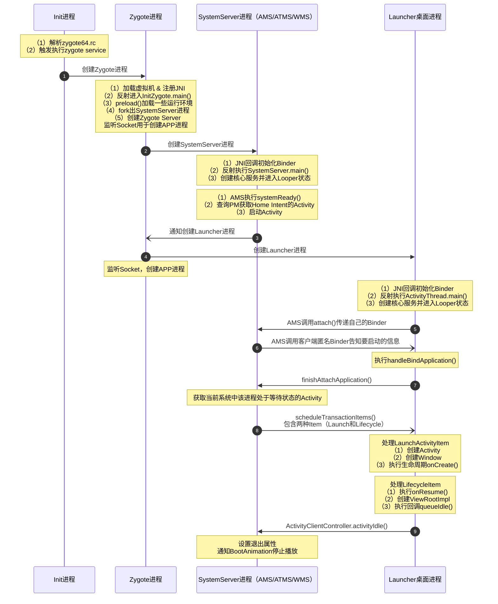

# Android 开机动画显示流程（二）

我们从Android 开机动画显示流程一种了解到了开机动画的显示，那么开机动画什么时候结束呢？我们要从桌面显示的流程来展开



## init进程解析脚本

源码：[system/core/rootdir/init.rc](https://cs.android.com/android/platform/superproject/+/android-latest-release:system/core/rootdir/init.rc;l=206?q=init.rc&ss=android%2Fplatform%2Fsuperproject)

在 `init.rc` 中，通常会通过 `import` 导入平台相关的配置文件（例如：`import /system/etc/init/hw/init.${ro.zygote}.rc`）。以 64 位启动为例，我们追踪到 `system/core/rootdir/init.zygote64.rc`。

当 `init` 进程执行 `LoadBootScripts()` 解析 `init.zygote64.rc` 时，会将 `service zygote64` 节点解析为一个 `Service` 内存结构体并存入 `ServiceList`。由于配置中声明了 **`class main`**，因此当 `init` 执行 `class_start main` ，自动拉起该服务。

> 💡 **参考资料**：有关 `.rc` 脚本的详细编写规范，可参考官方文档 [Android Init README](https://android.googlesource.com/platform/system/core/+/oreo-release/init/README.md)。


以下是 `init.zygote64.rc` 中内容：


`service`是 rc脚本文件里面的一个关键字。用于定义一个由 `init` 进程启动的程序（通常运行于独立的子进程中）。在启动服务前，`init` 会校验对应的可执行文件是否存在。

**基本语法格式**：

```
service <name> <pathname> [ <argument> ]*
    <option>
    <option>
    ...
```

- **`<name>`**：服务名称。
- **`<pathname>`**：当前服务对应的可执行文件路径。
- **`[ <argument> ]`**：可选参数。
- **`<option>`**：服务的配置选项（如权限、进程组、重启策略等）。

## Zygote 进程启动

- **什么是 Zygote**：Zygote 意为“受精卵”，它是 Android 所有 Java 进程的共同祖先。
- **核心作用**：
  - **预加载资源**：Zygote 在启动时会预加载 Android 系统的核心类（Core Classes）、系统资源文件以及 **ART（Android Runtime）虚拟机**。
  - **进程孵化机制**：当用户点击桌面图标启动一个新 App 时，系统并不会从零开始完整创建一个进程，而是让 **Zygote 进程通过 `fork()` 机制快速复制出一个子进程**。这种机制极大地减少了应用启动的时间和内存开销。

### 1. Zygote进程怎么启动的呢？

在前文的init.zygote64.rc 源码中，我们看到了 `/system/bin/app_process64` 这个可执行文件。它本质上是 Android Native 层的一个关键程序，也是所有 Android 应用进程和 Zygote 进程的起点。

- **类比理解**：`app_process` 在 Android 系统中的角色，就相当于传统 Java SDK 里的 `java` 命令。它是一个用 C++ 编写的可执行程序，核心职责是**拉起 ART 虚拟机、注册 JNI 方法、寻找并调用 Java 入口。从而开启整个 Android 的 Java 运行环境**。
- **进程树根节点**：无论是 Android 的核心孵化进程 **Zygote**、通过 Zygote 孵化的普通 App，还是通过命令行直接启动的 Java 工具（如 `am`, `pm`），最终都是通过执行这个程序进入 Java 世界的。

**源码路径**：

[frameworks/base/cmds/app_process/app_main.cpp](https://cs.android.com/android/platform/superproject/+/android-latest-release:frameworks/base/cmds/app_process/app_main.cpp)

[frameworks/base/core/jni/AndroidRuntime.cpp](https://cs.android.com/android/platform/superproject/+/android-latest-release:frameworks/base/core/jni/AndroidRuntime.cpp;l=1227?q=AndroidRuntime.cpp&ss=android%2Fplatform%2Fsuperproject)

当执行 `app_process64` 可执行程序时，它会根据传入的参数来判断当前模式，并为进程设置对应的名称（Nice Name）：

```c++
// Zygote 模式：如果检测到 --zygote 参数，自动设置进程名为 "zygote64"（64位）
if (strcmp(arg, "--zygote") == 0) {
    niceName = ZYGOTE_NICE_NAME;  // "zygote64"
}
// 手动指定：如果通过 --nice-name=xxx 指定了进程名
else if (strncmp(arg, "--nice-name=", 12) == 0) {
    niceName = (arg + 12);
}

// 最终通过 setArgv0 将进程名写入系统底层
runtime.setArgv0(niceName.c_str(), true /* setProcName */);
```

程序在处理完参数后，会调用 `runtime.start()` 正式拉起 ART 虚拟机，并根据不同模式引导进入对应的 Java 入口。

```
app_main.cpp
  │
  ├── #include <android_runtime/AndroidRuntime.h>  (第23行)
  │
  ├── class AppRuntime : public AndroidRuntime      (第34行，继承)
  │     ├── 重写: onVmCreated, onStarted, onZygoteInit, onExit
  │     └── 未重写: start() ← 继承自父类
  │
  └── main() 函数
        ├── AppRuntime runtime(...)                  (第185行，实例化)
        └── runtime.start("ZygoteInit", args, ...)   (第336行)
              ↓ 实际调用
            AndroidRuntime::start()  ← 定义在 AndroidRuntime.cpp
              ↓ start() 内部会回调
            runtime.onVmCreated()    ← 多态，调用 AppRuntime::onVmCreated()
            runtime.onStarted()      ← 多态，调用 AppRuntime::onStarted()

```

```c++
/*
 * ============================================================
 * 启动虚拟机，进入 Java 世界核心逻辑
 * ============================================================
 *
 * runtime.start() 内部主要执行以下三步：
 *   1. startVm()  → 调用 JNI_CreateJavaVM() 创建 ART 虚拟机实例
 *   2. startReg() → 注册 Android 核心 JNI 原生方法
 *   3. 通过 JNI 调用指定 Java 入口类的 main() 方法，正式切换到 Java 层
 *
 * 启动分支的三种情况：
 *   - Zygote 模式 → 启动 ZygoteInit（孵化所有后续的系统服务和 App Java 进程）
 *   - 普通模式    → 启动 RuntimeInit（执行指定的独立 Java 工具类）
 *   - 都没有      → 参数错误，报错退出
 */
if (zygote) {
    // Zygote 模式：引导进入 ZygoteInit
    runtime.start("com.android.internal.os.ZygoteInit", args, zygote);
} else if (!className.empty()) {
    // 普通 Java 程序模式：引导进入 RuntimeInit
    runtime.start("com.android.internal.os.RuntimeInit", args, zygote);
} else {
    // 异常处理：既不是 zygote 也未指定类名，打印错误并强制崩溃退出
    fprintf(stderr, "Error: no class name or --zygote supplied.\n");
    app_usage();
    LOG_ALWAYS_FATAL("app_process: no class name or --zygote supplied.");
}
```

关键代码在 [frameworks/base/core/jni/AndroidRuntime.cpp](https://cs.android.com/android/platform/superproject/+/android-latest-release:frameworks/base/core/jni/AndroidRuntime.cpp;l=1?q=AndroidRuntime.cpp) 中大致如下：

```c++
void AndroidRuntime::start(const char* className, const Vector<String8>& options, bool zygote)
{
    // ... 创建 VM、注册 JNI ...

    // 1. 查找 Java 类
    jclass startClass = env->FindClass(slashedClassName);

    // 2. 查找 main 方法签名：public static void main(String[] args)
    jmethodID startMeth = env->GetStaticMethodID(startClass, "main",
                                                  "([Ljava/lang/String;)V");

    // 3. 调用 main 方法
    env->CallStaticVoidMethod(startClass, startMeth, strArray);
}

```

### 2. Zygote源码分析

[frameworks/base/core/java/com/android/internal/os/ZygoteInit.java](https://cs.android.com/android/platform/superproject/+/android-latest-release:frameworks/base/core/java/com/android/internal/os/ZygoteInit.java;l=91?q=ZygoteInit&sq=&ss=android%2Fplatform%2Fsuperproject)

[frameworks/base/core/java/com/android/internal/os/Zygote.java](https://cs.android.com/android/platform/superproject/+/android-latest-release:frameworks/base/core/java/com/android/internal/os/Zygote.java;l=60?q=Zygote&sq=&ss=android%2Fplatform%2Fsuperproject)


整体启动流程，包含了主要的3个阶段

```
app_process main()                    ← C++ 入口
  → runtime.start("ZygoteInit")      ← 启动 JVM，调用 Java 层
    → ZygoteInit.main()              ← Java 层入口
       ├── preload()                  ← 预加载
       ├── new ZygoteServer()         ← 创建zygote服务端server（封装了socket通信）
       ├── forkSystemServer()         ← ② fork SystemServer
       └── zygoteServer.runSelectLoop()  ← ③ 服务端循环等待
```

#### 2.1 preload() 

资源预加载：在 fork 之前把常用资源加载到内存，子进程通过 COW（Copy-on-Write）共享，节省内存、加速启动。这也是为什么我们自己开发app的时候使用Activtiy，Service这些类不需要额外的引入，就是这个阶段吧这些依赖读到内存中了

```java
// ZygoteInit.java 第128行
static void preload(TimingsTraceLog bootTimingsTraceLog) {
    beginPreload();                          // 通知 VM 开始预加载
    preloadClasses();                        // 从 /system/etc/preloaded-classes 加载数千个类
    cacheNonBootClasspathClassLoaders();     // 缓存非 bootclasspath 的共享库 ClassLoader
    Resources.preloadResources();            // 预加载系统资源
    nativePreloadAppProcessHALs();           // 预加载 App 进程 HAL
    maybePreloadGraphicsDriver();            // 预加载 OpenGL/Vulkan 图形驱动
    preloadSharedLibraries();                // 加载 libandroid.so、libjnigraphics.so
    preloadTextResources();                  // 初始化断字器、字体缓存
    preloadCompatConfig();                   // 预加载兼容性配置
    WebViewFactory.prepareWebViewInZygote(); // WebView 预初始化
    endPreload();                            // 通知 VM 预加载结束
    warmUpJcaProviders();                    // 预热安全提供者
}
```

**`preloadClasses()` 的安全细节**（第291行）：加载类时临时降权，防止类的静态初始化块执行恶意操作：

```java
// 第306-321行：临时从 root 降到 unprivileged UID
final int reuid = Os.getuid();
final int regid = Os.getgid();
if (reuid == ROOT_UID && regid == ROOT_GID) {
    Os.setregid(ROOT_GID, UNPRIVILEGED_GID);  // 降到 9999
    Os.setreuid(ROOT_UID, UNPRIVILEGED_UID);
}

// 第331行：逐行读取并加载类
while ((line = br.readLine()) != null) {
    Class.forName(line, true, null);  // 强制初始化
    count++;
}

// 第395-402行：加载完成后恢复 root
if (droppedPriviliges) {
    Os.setreuid(ROOT_UID, ROOT_UID);
    Os.setregid(ROOT_GID, ROOT_GID);
}
```

**为什么 preload 阶段禁止创建线程？**

```java
// ZygoteInit.java 第829行
ZygoteHooks.startZygoteNoThreadCreation();  // 禁止创建线程
// ... preload() ...
// ... forkSystemServer() ...
ZygoteHooks.stopZygoteNoThreadCreation();   // 第907行，fork 后恢复
```

因为 Linux `fork()` 只复制调用线程，其他线程在子进程中直接消失。如果 ART 的 GC/JIT 线程在 fork 时正持有锁，子进程就会死锁。

#### 2.2 forkSystemServer()

```java
// ZygoteInit.java 第699行
private static Runnable forkSystemServer(String abiList, String socketName,
        ZygoteServer zygoteServer) {
    // 1. 设置 capabilities（系统级权限）
    long capabilities =
            (1L << OsConstants.CAP_KILL) |
            (1L << OsConstants.CAP_NET_ADMIN) |
            (1L << OsConstants.CAP_SYS_NICE) |
            (1L << OsConstants.CAP_SYS_PTRACE) |
            // ... 共十余项权限

    // 2. 硬编码 SystemServer 启动参数
    String[] args = {
            "--setuid=1000",           // system 用户
            "--setgid=1000",
            "--setgroups=1001,1002,...",
            "--capabilities=" + capabilities + "," + capabilities,
            "--nice-name=system_server",
            "--runtime-args",
            "com.android.server.SystemServer",
    };

    // 3. 执行 fork
    // 由于fork是系统调用这里是调用了native方法
    pid = Zygote.forkSystemServer(
            parsedArgs.mUid, parsedArgs.mGid,
            parsedArgs.mGids, parsedArgs.mRuntimeFlags,
            null,
            parsedArgs.mPermittedCapabilities,
            parsedArgs.mEffectiveCapabilities);

    // 4. 子进程处理,Zygote进程不会执行这个
    if (pid == 0) {
        zygoteServer.closeServerSocket();   // 子进程关闭 socket
        return handleSystemServerProcess(parsedArgs);
    }
    return null;  // 父进程返回 null
}
```

当一个进程调用 `fork()` 创建子进程后，操作系统会复制父进程的几乎所有状态（包括内存空间、寄存器、打开的文件描述符等）。

关键点在于它们的执行起点和后续走向：

- **执行起点：** 子进程并不是从 `main` 函数重新开始执行的，而是从**调用 `fork()` 函数的那一行代码的下一行开始执行**。因为子进程拷贝了父进程当时的运行上下文（PC 指针），所以它“继承”了父进程执行到哪里的记忆。
- **如何区分它们：** 虽然代码起点一样，但 `fork()` 的返回值在父子进程中是不同的：
  - 在**父进程**中，`fork()` 返回子进程的 PID（一个大于 0 的整数）。
  - 在**子进程**中，`fork()` 返回 `0`。
  - 如果创建失败，则返回 `-1`。

因此，在实际编程中，我们几乎总是通过 `if-else` 条件判断这个返回值，来让父进程和子进程走入不同的代码分支（做不同的事情）。

**子进程初始化**（`handleSystemServerProcess`，第492行）：

```java
private static Runnable handleSystemServerProcess(ZygoteArguments parsedArgs) {
    Os.umask(S_IRWXG | S_IRWXO);  // 文件权限设为 owner-only

    ClassLoader cl = getOrCreateSystemServerClassLoader();
    Thread.currentThread().setContextClassLoader(cl);

    // 进入 zygoteInit → 最终调用 SystemServer.main()
    return ZygoteInit.zygoteInit(parsedArgs.mTargetSdkVersion,
            parsedArgs.mDisabledCompatChanges,
            parsedArgs.mEnabledCompatChanges,
            parsedArgs.mRemainingArgs, cl);
}

// ZygoteInit.java 第983行
public static Runnable zygoteInit(...) {
    RuntimeInit.commonInit();
    ZygoteInit.nativeZygoteInit();   // ← 关键：初始化 Binder
    return RuntimeInit.applicationInit(...);
}
```

#### 2.3 ZygoteServer 

```java
// ZygoteInit.java 第909行
zygoteServer = new ZygoteServer(isPrimaryZygote);  // 创建 socket 服务端

// 第926行：进入 select 循环，持续等待 AMS 的 fork 请求
caller = zygoteServer.runSelectLoop(abiList);
```

`ZygoteServer` 内部通过 **UNIX domain socket**（非 Binder）监听 AMS 的请求。当 AMS 需要启动新 App 时，通过 socket 发送参数，Zygote fork 出子进程。

**这里为什么Zygote不用binder通信呢？反而用socket？**

### 3. 补充知识

从 `app_main.cpp` 发现 Binder 初始化。观察 `AppRuntime` 类（继承自 `AndroidRuntime`），Binder 的初始化发生在两个回调中：

```cpp
// Zygote 路径 (app_main.cpp 第92行)
virtual void onZygoteInit() {
    sp<ProcessState> proc = ProcessState::self();
    proc->startThreadPool();
}

// App 路径 (app_main.cpp 第79行)
virtual void onStarted() {
    sp<ProcessState> proc = ProcessState::self();
    proc->startThreadPool();
}
```

这两个回调通过 JNI 从 Java 层触发（`AndroidRuntime.cpp`）：

```cpp
// Zygote 路径：Java 层调用 nativeZygoteInit() 时触发
static void com_android_internal_os_ZygoteInit_nativeZygoteInit(JNIEnv* env, jobject clazz) {
    gCurRuntime->onZygoteInit();   // → AppRuntime::onZygoteInit()
}

// App 路径：Java 层调用 nativeFinishInit() 时触发
static void com_android_internal_os_RuntimeInit_nativeFinishInit(JNIEnv* env, jobject clazz) {
    gCurRuntime->onStarted();      // → AppRuntime::onStarted()
}
```

两条路径做的事情完全一样：**`ProcessState::self()` + `startThreadPool()`**。

源码：[system/libhwbinder/ProcessState.cpp](https://cs.android.com/android/platform/superproject/+/android-latest-release:system/libhwbinder/ProcessState.cpp?q=Processstate.cpp&ss=android%2Fplatform%2Fsuperproject)

#### 3.1 初始化 Binder 环境

`ProcessState::self()` — 初始化 Binder 运行时环境单例获取

```cpp
// ProcessState.cpp 第71行
sp<ProcessState> ProcessState::self() {
    return init(DEFAULT_BINDER_VM_SIZE, false);
}

// 第84行
sp<ProcessState> ProcessState::init(size_t mmapSize, bool requireMmapSize) {
    static sp<ProcessState> gProcess;
    static std::once_flag gProcessOnce;

    std::call_once(gProcessOnce, [&](){
        gProcess = new ProcessState(mmapSize);  // ← 全局唯一实例
    });
    return gProcess;
}
```

通过 `std::call_once` 保证每个进程只创建一个 `ProcessState` 实例。

```cpp
// ProcessState.cpp 第407行
ProcessState::ProcessState(size_t mmapSize)
    : mDriverFD(open_driver())     // ← ① 打开驱动
    , mVMStart(MAP_FAILED)
    , mMaxThreads(DEFAULT_MAX_BINDER_THREADS)
    , mThreadPoolStarted(false)
    , mMmapSize(mmapSize)
{
    if (mDriverFD >= 0) {
        // ← ② mmap 映射接收缓冲区
        mVMStart = mmap(nullptr, mMmapSize, PROT_READ,
                        MAP_PRIVATE | MAP_NORESERVE, mDriverFD, 0);
    }
}
```

`open_driver()`：打开设备节点

```cpp
// ProcessState.cpp 第375行
static int open_driver() {
    int fd = open("/dev/binder", O_RDWR | O_CLOEXEC);  // ← 打开驱动
    if (fd >= 0) {
        // 校验驱动版本
        int vers = 0;
        ioctl(fd, BINDER_VERSION, &vers);

        // 通过 ioctl(BINDER_SET_MAX_THREADS) 传给内核，
        // 含义是binder 驱动可以额外发起 15 次 BR_SPAWN_LOOPER 来让用户空间创建新线程。
        size_t maxThreads = DEFAULT_MAX_BINDER_THREADS;  
        ioctl(fd, BINDER_SET_MAX_THREADS, &maxThreads);
    }
    return fd;
}
```

缓冲区大小和默认最大binder线程梳理

```cpp
// ProcessState.cpp 第44行
#define DEFAULT_BINDER_VM_SIZE ((1 * 1024 * 1024) - sysconf(_SC_PAGE_SIZE) * 2)
#define DEFAULT_MAX_BINDER_THREADS 15
```

默认约 **1MB - 8KB**（1MB 减去两个页大小）。

#### 3.2 启动 Binder 线程池

`startThreadPool()` — 启动 Binder 线程池

```cpp
// ProcessState.cpp 第107行
void ProcessState::startThreadPool() {
    AutoMutex _l(mLock);
    if (!mThreadPoolStarted) {
        mThreadPoolStarted = true;
        if (mSpawnThreadOnStart) {
            spawnPooledThread(true);   // ← 创建第一个 Binder 线程，这里没有循环因此只有一个
        }
    }
}
```

`startThreadPool()` 主动创建了 **1 个**用户空间线程，不是binder驱动通知的，因此一共最多有15+1个binder线程。

`spawnPooledThread()`：创建线程

```cpp
// ProcessState.cpp 第307行
void ProcessState::spawnPooledThread(bool isMain) {
    if (mThreadPoolStarted) {
        String8 name = makeBinderThreadName();
        sp<Thread> t = new PoolThread(isMain); // ← 只 new 了一个线程对象
        t->run(name.c_str());          // ← 启动线程
    }
}
```

`PoolThread`：线程执行逻辑

```cpp
// ProcessState.cpp 第53行
class PoolThread : public Thread {
    virtual bool threadLoop() {
        IPCThreadState::self()->joinThreadPool(mIsMain);  // ← 进入阻塞循环
        return false;
    }
};
```

线程启动后立即进入 `joinThreadPool()`，通过 `ioctl(BINDER_WRITE_READ)` 阻塞等待驱动分发事务。

#### 3.3 当前状态总结

`onZygoteInit()` / `onStarted()` 执行完毕后：

```
✅ 已具备：
  - 进程与 Binder 驱动的连接已建立（/dev/binder 已打开）
  - 内核接收缓冲区已映射（mmap）
  - 至少 1 个 Binder 线程在阻塞等待事务

❌ 尚未具备：
  - 没有任何 BBinder 子类实例（没有具体的服务端对象）
  - 没有注册到 ServiceManager（其他进程无法发现和调用）
```

真正的 Binder 对象创建发生在后续阶段：

- SystemServer 进程中，各系统服务（如 ActivityManagerService）通过 ServiceManager.addService() 注册时，才会创建 BBinder 实体
- App 进程中，通过 ServiceManager.getService() 获取服务代理时，才会创建 BpBinder 代理对象

## SystemServer 进程启动

[frameworks/base/services/java/com/android/server/SystemServer.java](https://cs.android.com/android/platform/superproject/+/android-latest-release:frameworks/base/services/java/com/android/server/SystemServer.java;l=350?q=SystemServer%20&sq=&ss=android%2Fplatform%2Fsuperproject)

- **SystemServer 的诞生**：Zygote 孵化出的第一个核心 Java 进程就是 **SystemServer**。
- **承载系统核心服务**：SystemServer 负责运行 Android 运行时的所有核心系统服务，常见服务包括：
  - **ActivityManagerService (AMS)**：负责管理四大组件（Activity、Service、BroadcastReceiver、ContentProvider）的生命周期及任务栈。
  - **PackageManagerService (PMS)**：负责解析安装包（APK）、管理权限和应用列表。
  - **WindowManagerService (WMS)**：负责管理窗口的创建、显示、隐藏及焦点分配。
  - **PowerManagerService**、**NotificationManagerService** 等。
- 这里服务其实本质上就是一个binder的对象，我们通过servicemanager就可以获取这些服务器端binder的代理对象然后就可以调用呢这些服务相当于通信

### 1. 入口

```java
// SystemServer.java:726-728
public static void main(String[] args) {
    new SystemServer().run();
}
```

`run()` 方法是 SystemServer 的核心，分为三个阶段：**初始化 → 启动服务 → 进入主循环**。

### 2. 初始化阶段

在进入服务启动之前，SystemServer 需要完成一系列关键的基础设施搭建：

```java
// SystemServer.java:948
// 将 binder 线程池上限从默认的 15 提升到 31
BinderInternal.setMaxThreads(sMaxBinderThreads);  // sMaxBinderThreads = 31

// SystemServer.java:954
// 准备主线程的消息循环
Looper.prepareMainLooper();
```

**为什么要提升到 31 个 binder 线程？** 因为 SystemServer 承载了 100+ 系统服务，并发请求量远超普通 App。源码注释也明确说明了这一点：

```java
// SystemServer.java:508-510
// maximum number of binder threads used for system_server
// will be higher than the system default
private static final int sMaxBinderThreads = 31;
```

这个设置最终通过 `ioctl` 系统调用修改内核 binder 驱动中的 `max_threads` 值：

```cpp
// ProcessState.cpp:451-462
status_t ProcessState::setThreadPoolMaxThreadCount(size_t maxThreads) {
    LOG_ALWAYS_FATAL_IF(mThreadPoolStarted && maxThreads < mMaxThreads,
           "Binder threadpool cannot be shrunk after starting");
    if (ioctl(mDriverFD, BINDER_SET_MAX_THREADS, &maxThreads) != -1) {
        mMaxThreads = maxThreads;  // 更新为 31
    }
    return result;
}
```

注意这里有一个硬约束：**线程池启动后只能增大，不能缩小**，否则直接 FATAL。

### 3. 服务启动阶段

初始化完成后，SystemServer 按优先级分四批启动服务：

```java
// SystemServer.java:1047-1050
startBootstrapServices(t);   // 第一批：引导服务（最核心）
startCoreServices(t);        // 第二批：核心服务
startOtherServices(t);       // 第三批：其他服务
startApexServices(t);        // 第四批：APEX 模块服务
```

#### 3.1 引导服务

这是最关键的一批，包含了系统运行的基础设施服务：

```java
// SystemServer.java:1192-1462
private void startBootstrapServices(@NonNull TimingsTraceAndSlog t) {
    // 启动 Watchdog，监控死锁
    final Watchdog watchdog = Watchdog.getInstance();
    watchdog.start();

    // 启动 ActivityManagerService —— 四大组件的管理者
    ActivityTaskManagerService atm = mSystemServiceManager.startService(
            ActivityTaskManagerService.Lifecycle.class).getService();
    mActivityManagerService = ActivityManagerService.Lifecycle.startService(
            mSystemServiceManager, atm);

    // 启动 PowerManagerService —— 电源管理
    mPowerManagerService = mSystemServiceManager.startService(PowerManagerService.class);

    // 启动 PackageManagerService —— 包管理
    mPackageManagerService = PackageManagerService.main(
            mSystemContext, installer, domainVerificationService,
            mFactoryTestMode != FactoryTest.FACTORY_TEST_OFF);

    // 启动 DisplayManagerService —— 显示管理
    mDisplayManagerService = mSystemServiceManager.startService(DisplayManagerService.class);

    // 启动 UserManagerService —— 用户管理
    mUserManagerService = mSystemServiceManager
            .startService(UserManagerService.LifeCycle.class).getService();
}
```

#### 3.2 核心服务

```java
// SystemServer.java:1467-1545
private void startCoreServices(@NonNull TimingsTraceAndSlog t) {
    mSystemServiceManager.startService(BatteryService.class);      // 电池服务
    mSystemServiceManager.startService(UsageStatsService.class);   // 使用统计
    mSystemServiceManager.startService(WebViewUpdateService.class);// WebView 更新
    mSystemServiceManager.startService(GpuService.class);          // GPU 服务
}
```

#### 3.3 其他服务

这一批包含了大量用户可感知的服务：

```java
// SystemServer.java:1550-3665
private void startOtherServices(@NonNull TimingsTraceAndSlog t) {
    // WindowManagerService —— 窗口管理
    wm = WindowManagerService.main(context, inputManager, !mFirstBoot,
            new PhoneWindowManager(), mActivityManagerService.mActivityTaskManager);
    ServiceManager.addService(Context.WINDOW_SERVICE, wm, ...);

    // InputManagerService —— 输入管理
    inputManager = mSystemServiceManager.startService(
            InputManagerService.Lifecycle.class).getService();

    // StatusBarManagerService —— 状态栏
    // NotificationManagerService —— 通知管理
    // LocationManagerService —— 定位服务
    // ... 还有数十个服务
}
```

### 4. 进入主循环

所有服务启动完成后，主线程进入消息循环：

```java
// SystemServer.java:1096-1098
// Loop forever.
Looper.loop();
throw new RuntimeException("Main thread loop unexpectedly exited");
```

此时 SystemServer 的线程模型如下：

```
SystemServer 进程
    │
    ├─► 主线程（1 个）
    │       Looper.loop() 处理 Handler 消息
    │
    ├─► Binder 线程池（最多 32 个）
    │       ├─ 主 binder 线程（1 个）：joinThreadPool(true)，永不退出
    │       └─ 工作 binder 线程（最多 31 个）：joinThreadPool(false)，按需创建/退出
    │
    └─► 其他线程（大量）
            ├─ Watchdog 线程：监控死锁
            ├─ UiThread：系统 UI 相关的 Handler 线程
            ├─ SystemServerInitThreadPool：并行初始化线程池
            ├─ 各 Service 自建的线程：
            │       ├─ DisplayManagerService 的线程
            │       ├─ InputManagerService 的线程
            │       ├─ WindowManagerService 的动画线程
            │       ├─ PowerManagerService 的线程
            │       ├─ AlarmManagerService 的线程
            │       └─ ... 每个服务可能创建自己的 HandlerThread 或工作线程
            └─ GC 线程、JIT 编译线程等 ART 内部线程
```

## Launcher 启动与进入桌面

- **启动桌面程序**：当 SystemServer 把所有的系统核心服务初始化并注册到 ServiceManager 后，AMS 会通知启动系统的桌面程序——**Launcher**（即手机的主屏幕、桌面 App）。
- **进入桌面**：Launcher 作为普通的应用进程被 Zygote 孵化出来，并向 AMS 注册。随后，桌面图标被成功渲染并在屏幕上显示。
- **完成启动**：至此，整个 Android 系统的启动流程顺利结束，设备正式进入日常交互状态。

### 1.  触发时机

当 SystemServer 完成所有服务启动后，AMS 会执行 `systemReady()` 回调，这是系统就绪的标志。在这个回调中，AMS 会启动 Launcher。

核心逻辑在 `ActivityManagerService` 中（AOSP 源码）：

```java
// ActivityManagerService.java (AOSP)
public void systemReady(Runnable goingCallback, TimingsTraceAndSlog t) {
    // ... 各种初始化 ...
	mBooting = true;
    // 启动 Launcher
    mAtmInternal.startHomeOnAllDisplays(currentUserId, "systemReady");
}
```

### 2. 启动流程

```
AMS.systemReady()
    │
    ▼
startHomeOnAllDisplays()
    │
    ▼
RootWindowContainer.startHomeOnDisplay()
    │
    ├─► 查询 PackageManager 获取 Home Intent 匹配的 Activity
    │       Intent: ACTION=MAIN, CATEGORY=HOME
    │
    ├─► AMS.startActivity()
    │       │
    │       ▼
    │   检查目标进程是否已存在
    │       │
    │       ├─ 不存在 → 请求 Zygote fork 新进程
    │       │
    │       └─ 已存在 → 直接在已有进程中启动 Activity
    │
    ▼
Zygote fork 出 Launcher 进程
    │
    ▼
Launcher 进程初始化
    ├─► ProcessState::self()     ──► 初始化 binder
    ├─► startThreadPool()        ──► 启动 binder 线程池
    ├─► ActivityThread.main()    ──► 进入 Activity 生命周期
    └─► onCreate() → onResume()  ──► 渲染桌面
```

### 3. Launcher

Launcher 本质上是一个普通的 Android 应用，它的启动流程和其他 App 完全一致：

1. **Zygote fork**：AMS 通过 Socket 通知 Zygote fork 出新进程
2. **Binder 初始化**：新进程执行 `onZygoteInit()`，初始化 binder 线程池（默认 15 个额外线程，共 16 个）
3. **ActivityThread.main()**：进入 Java 层，准备 Looper
4. **Activity 生命周期**：`onCreate()` → `onStart()` → `onResume()`
5. **渲染桌面**：加载应用图标、壁纸、Widget，显示在屏幕上

Launcher 与普通 App 的区别在于它的 Intent Filter：

```xml
<!-- Launcher 的 AndroidManifest.xml -->
<activity android:name=".Launcher">
    <intent-filter>
        <action android:name="android.intent.action.MAIN" />
        <category android:name="android.intent.category.HOME" />
        <category android:name="android.intent.category.DEFAULT" />
    </intent-filter>
</activity>
```

AMS 通过发送 `ACTION_MAIN + CATEGORY_HOME` 的 Intent 来找到并启动 Launcher。

### 4. 关闭开机动画

Launcher 启动后，系统需要关闭开机动画，将屏幕交给 Launcher。这个过程由 **WMS（WindowManagerService）** 驱动：

#### 4.1 触发idle回调

Launcher 启动完成后，通过一条完整的跨进程调用链通知 WMS 准备启用屏幕。下面逐步追踪这条链路。

##### **第一步：注册idle回调**

`handleResumeActivity()` 末尾会将新启动的 Activity 加入 `mNewActivities` 队列，并注册 `Idler`：

```java
// ActivityThread.java — handleResumeActivity() 末尾，每次handleResumeActivty就会添加
mNewActivities.add(r);
Looper.myQueue().addIdleHandler(new Idler());
```

##### **第二步：Launcher 进程的主线程消息队列变空**

当 Launcher 的 `onCreate()` → `onResume()` 执行完毕后，ActivityThread 主线程的消息队列处理完所有启动相关消息（`BIND_APPLICATION`、`EXECUTE_TRANSACTION` 等），队列变空。此时 `Looper` 发现没有待处理消息，会调用注册的 `IdleHandler.queueIdle()` 回调。

> `Idler` 是 app 进程通过 Binder 向 AMS 发出的一个"就绪信号"。它在 `handleResumeActivity` 中注册到主线程 MessageQueue，当 `EXECUTE_TRANSACTION` 消息执行完毕、主线程第一次空闲时触发，告诉 AMS “这个 Activity 的生命周期回调都跑完了”。AMS 收到后会开机时关闭 bootanimation、stop 上一个 Activity（避免黑屏）、启动排队中的下一个 Activity。本质上它是跨进程调度的握手点，确保窗口切换的时序安全。

##### **第三步：Idler 报告 Activity 已 idle**

当主线程消息队列变空时，`Idler.queueIdle()` 被触发：

```java
// ActivityThread.java
private class Idler implements MessageQueue.IdleHandler {
    @Override
    public final boolean queueIdle() {
        boolean stopProfiling = false;
        if (mBoundApplication != null && mProfiler.profileFd != null
                && mProfiler.autoStopProfiler) {
            stopProfiling = true;
        }

        final ActivityClient ac = ActivityClient.getInstance();
        // 遍历所有新启动的 Activity，报告它们已进入 idle 状态
        while (mNewActivities.size() > 0) {
            final ActivityClientRecord a = mNewActivities.remove(0);
            if (a.activity != null && !a.activity.mFinished) {
                // 通过 Binder 调用，通知系统服务该 Activity 已 idle
                ac.activityIdle(a.token, a.createdConfig, stopProfiling);
                a.createdConfig = null;
            }
        }
        if (stopProfiling) {
            mProfiler.stopProfiling();
        }
        return false;  // 只执行一次
    }
}
```

> **什么是"主线程处理完所有消息"？** Android 主线程通过 `Looper` 不断从 `MessageQueue` 中取消息处理。当 `MessageQueue.next()` 发现队列空了，就会先执行所有注册的 `IdleHandler.queueIdle()`，然后再阻塞等待新消息。所以"处理完所有消息"指的是启动相关的 Handler 消息（BIND_APPLICATION、EXECUTE_TRANSACTION 等）全部执行完毕，队列中没有更多待处理消息。

##### **第四步：ActivityClient 通过 Binder 跨进程调用系统服务**

```java
// ActivityClient.java
public void activityIdle(IBinder token, Configuration config, boolean stopProfiling) {
    try {
        // 跨进程调用到 ActivityClientController（system_server 进程）
        getActivityClientController().activityIdle(token, config, stopProfiling);
    } catch (RemoteException e) {
        e.rethrowFromSystemServer();
    }
}
```

##### **第五步：system_server 接收调用，交给 TaskSupervisor 处理**

```java
// ActivityClientController.java
public void activityIdle(IBinder token, Configuration config, boolean stopProfiling) {
    final long origId = Binder.clearCallingIdentity();
    try {
        synchronized (mGlobalLock) {
            final ActivityRecord r = ActivityRecord.forTokenLocked(token);
            if (r == null) return;
            // 交给 TaskSupervisor 处理 Activity idle
            mTaskSupervisor.activityIdleInternal(r, false /* fromTimeout */,
                    false /* processPausingActivities */, config);
        }
    } finally {
        Binder.restoreCallingIdentity(origId);
    }
}
```

##### **第六步：TaskSupervisor 检查所有 Activity 是否都 idle**

```java
// ActivityTaskSupervisor.java
void activityIdleInternal(ActivityRecord r, boolean fromTimeout,
        boolean processPausingActivities, Configuration config) {
    // ...
    r.idle = true;  // 标记该 Activity 为 idle

    // 关键判断：两个条件必须同时满足
    // mBooting 默认false，systemReady中设置为true
    if ((mService.isBooting() && mRootWindowContainer.allResumedActivitiesIdle())
            || fromTimeout) {
        checkFinishBootingLocked();  // 触发启动完成流程
    }
    // ...
}
```

> **不是随便一个 Activity idle 就会触发。** 必须满足：
>
> 1. `mService.isBooting()` — 系统正处于启动阶段（`mBooting == true`）
> 2. `allResumedActivitiesIdle()` — **所有**处于 resumed 状态的 Activity 都已经 idle
>
> 开机完成后 `mBooting` 被设为 `false`，后续任何 Activity 进入 idle 都不会再触发。

##### **第七步：postFinishBooting 触发 enableScreenAfterBoot**

```java
// ActivityTaskSupervisor.java
private void checkFinishBootingLocked() {
    final boolean booting = mService.isBooting();
    boolean enableScreen = false;
    mService.setBooting(false);
    if (!mService.isBooted()) {
        mService.setBooted(true);
        enableScreen = true;
    }
    if (booting || enableScreen) {
        // 通知 ATMS 完成启动并启用屏幕
        mService.postFinishBooting(booting, enableScreen);                                                                                                               
    }
}
```

```java
// ActivityTaskManagerService.java
void postFinishBooting(boolean finishBooting, boolean enableScreen) {
    mH.post(() -> {
        if (finishBooting) {
            mAmInternal.finishBooting();
        }
        if (enableScreen) {
            // 调用 enableScreenAfterBoot
            mInternal.enableScreenAfterBoot(isBooted());
        }
    });
}
```

##### **第八步：enableScreenAfterBoot 通知 WMS**

```java
// ActivityTaskManagerService.java 内部类
public void enableScreenAfterBoot(boolean booted) {
    writeBootProgressEnableScreen(SystemClock.uptimeMillis());
    mWindowManager.enableScreenAfterBoot();  // 调用 WMS
    synchronized (mGlobalLock) {
        updateEventDispatchingLocked(booted);
    }
}
```

#### 4.2 WMS 等待窗口就绪

WMS 收到通知后，`enableScreenAfterBoot（）` 里调用 `performEnableScreen()`，但不会立即关闭开机动画，而是**等待所有系统窗口（包括 Launcher）绘制完成**：

```java
// WindowManagerService.java
private void performEnableScreen() {
    synchronized (mGlobalLock) {
        if (mDisplayEnabled) {
            return;  // 已经启用过
        }

        // 关键检查：等待所有系统装饰窗口绘制完成
        if (!mForceDisplayEnabled) {
            for (int i = mRoot.getChildCount() - 1; i >= 0; i--) {
                if (mRoot.getChildAt(i).shouldWaitForSystemDecorWindowsOnBoot()) {
                    return;   // ← 还有窗口没画完，等一下再调用
                }
            }
            // 所有窗口都画完了
        }

        // 设置退出属性，通知 bootanim 停止播放
        if (!mBootAnimationStopped) {
            SystemProperties.set("service.bootanim.exit", "1");  // ← 关键！
            mBootAnimationStopped = true;
        }

        // 轮询等待 bootanim 进程真正退出（每 50ms 检查一次）
        if (!checkBootAnimationCompleteLocked()) {
            return;
        }

        // 通知 SurfaceFlinger 启动完成
        SurfaceControl.bootFinished();
        mDisplayEnabled = true;
    }

    // 通知 AMS 动画已完成
    mActivityManager.bootAnimationComplete();
}
```

**核心逻辑**：

1. `shouldWaitForSystemDecorWindowsOnBoot()` 检查所有窗口是否绘制完成
2. 如果有窗口还没画完 → `return`，等窗口状态变化后 WMS 会重新触发
3. 所有窗口就绪 → 设置 `service.bootanim.exit = "1"`
4. 轮询等待 bootanim 进程退出
5. 通知 SurfaceFlinger，启用显示

#### 4.3 bootanim 检测退出信号

bootanim 进程在每一帧渲染后都会检查 `service.bootanim.exit` 属性：

```cpp
// BootAnimation.cpp
void BootAnimation::checkExit() {
    // 读取共享内存中的属性值（无 IPC，直接读内存）
    char value[PROPERTY_VALUE_MAX];
    property_get("service.bootanim.exit", value, "0");
    int exitnow = atoi(value);

    if (exitnow) {
        requestExit();  // ← 设置 Thread 的退出标志
    }
}
```

**property_get 的本质**：不是 IPC 调用，而是直接读取共享内存 `/dev/__properties__` 中的值，纳秒级完成。

#### 4.4 bootanim 线程退出

`requestExit()` 设置退出标志后，当前帧画完后线程自然退出：

```cpp
// system/core/libutils/Threads.cpp
void Thread::requestExit()
{
    Mutex::Autolock _l(mLock);
    mExitPending = true; // 这里如果设置为true，那么exitPending返回为true，那么我们的动画播放循环也就会结束了
}

bool Thread::exitPending() const
{
    Mutex::Autolock _l(mLock);
    return mExitPending;
}
```

### 5. 启动完成

当 Launcher 的 `onResume()` 执行完毕，桌面图标渲染到屏幕上，开机动画退出，整个 Android 启动流程正式结束：

```
init 进程
    │
    ▼
Zygote 进程
    │
    ├─► fork → SystemServer
    │           ├─► AMS / PMS / WMS / ...
    │           ├─► systemReady()
    │           ├─► startHomeOnAllDisplays()
    │           └─► enableScreenAfterBoot()
    │
    └─► fork → Launcher 进程
                ├─► ActivityThread.main()
                ├─► Launcher.onCreate() → onResume()
                └─► 回调WMS

WMS.performEnableScreen()
    │
    ├─► 等待所有窗口绘制完成
    ├─► set("service.bootanim.exit", "1")
    ├─► bootanim 检测退出 → 释放 Surface → 进程退出
    ├─► SurfaceFlinger 移除 bootanim Layer
    └─► 桌面显示 ✓
```